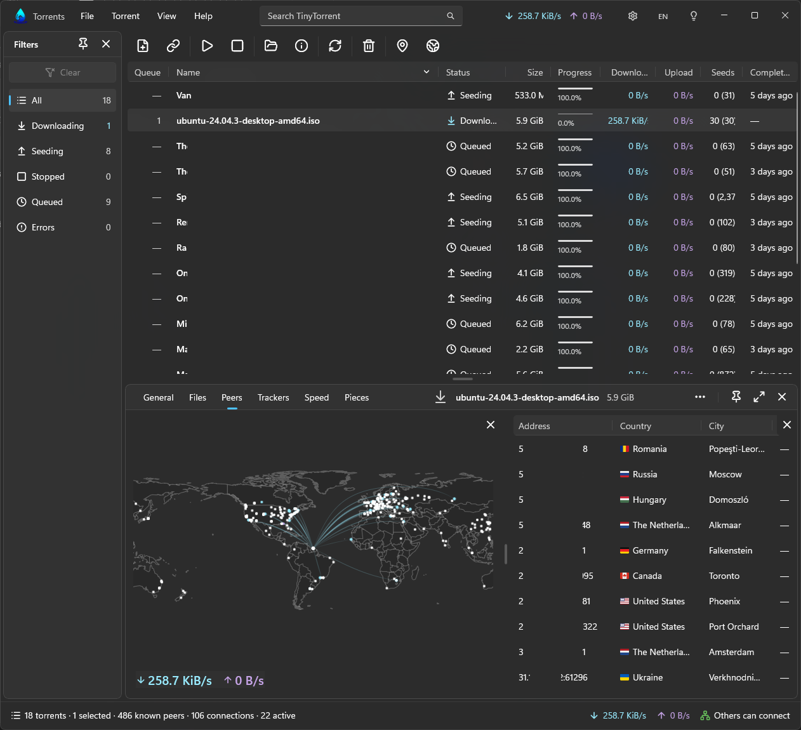
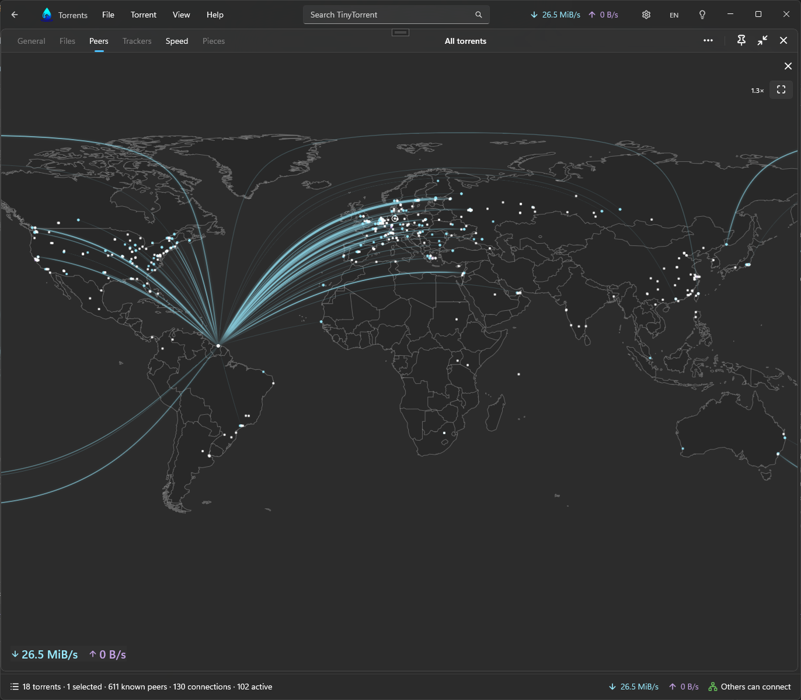
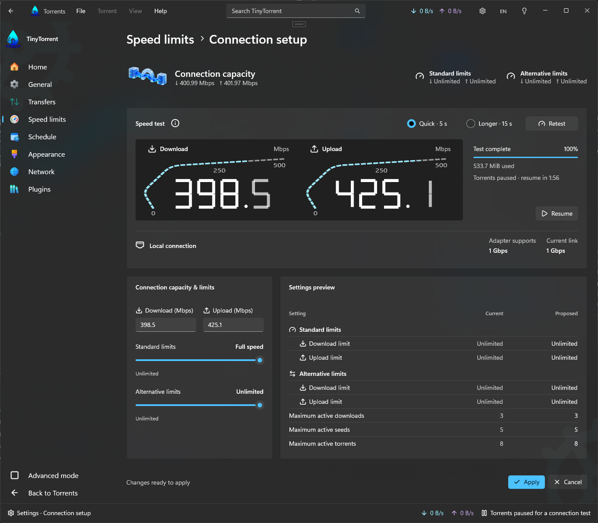
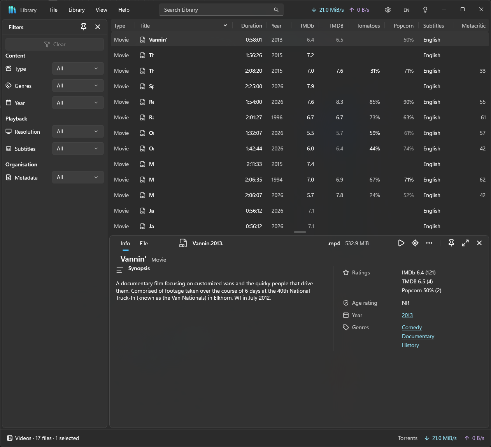

#  TinyTorrent

**Torrent client. Video library. Subtitle finder.**

No ads. No spyware. No telemetry.[^telemetry]\
Light on memory. Free. Open source.

**[Download for Windows](https://github.com/SynoSoftware/TinyTorrent2/releases/latest)**
· Windows 10 (version 1809) or later, 64-bit

[^telemetry]: TinyTorrent adds no analytics and turns off Windows crash
    reporting for itself. Microsoft's Windows App SDK may still collect usage
    diagnostics, depending on your Windows privacy settings.

Built for Windows from the ground up. No web page in a window, no JavaScript
underneath.

Keep it simple, or open every panel and watch your transfers like mission
control. When a movie finishes, it's waiting in your Library with its ratings,
cast, and subtitles.

## Native and light by design

Many desktop apps are websites in a window. Each one brings its own web
browser, and your memory pays for it. TinyTorrent doesn't.

- **Native from end to end.** Built with WinUI 3, Windows' own interface
  technology, on the proven libtorrent engine. No browser inside.
- **Close the window, keep downloading.** Close the window to free the memory
  it used. Downloads and seeding continue from the notification area.
- **Exit means exit.** Choose **Exit** in the tray menu to stop all transfers.
  TinyTorrent is an app you can see, not a Windows service running in the
  background.
- **Looks and feels like Windows.** Fluent 2 design, Acrylic surfaces, light
  and dark themes, keyboard shortcuts, and six languages that you can switch
  without a restart.

## Torrents: simple at a glance, mission control when you want it

Your torrent list shows what's happening at a glance. Want more? Open the
inspector to see every file, peer, tracker, and piece, with the speed history.
Put every peer on a world map. Close the panels when you're done.

<table>
  <tr>
    <td width="50%">
      
       Every peer of every torrent on a world map
    </td>
    <td width="50%">
      
       Test your connection in seconds
    </td>
  </tr>
</table>

- **Add and organise.** Torrent files and magnet links, drag-and-drop, batch
  additions, metadata previews, file selection, priorities, and download queues.
- **Control transfers.** Pause, resume, force start, normal and alternative speed
  limits, scheduled limits and pauses, and seeding limits.
- **Find what needs attention.** Search, filter by status and errors, and edit
  trackers.
- **Get the right speed limits.** A speed test measures your connection and
  proposes matching limits.
- **Manage your files.** Open folders, verify downloads, move files, and choose
  between removing a torrent and deleting its downloaded files.

## Library: every movie you've downloaded, ready to watch

- **Search as you type.** Find a movie by title, genre, year, or actor. You
  don't need to remember which torrent it came from.
- **Every rating in one row.** IMDb, TMDB, Rotten Tomatoes, Popcornmeter, and
  Metacritic side by side, with the synopsis and cast.
- **Filter by what matters tonight.** Genre, year, series and season,
  resolution, and whether subtitles are there.
- **Your choice of movie data.** Use an online service, or download the IMDb
  data once and search it offline.
- **Music too.** Browse your downloaded music by artist, album, and track.
- **Open and watch.** Each file opens in your default player.

## Subtitles: already there when you press play

- **Set it once.** Choose OpenSubtitles, SubDL, or SubSource. No account
  needed.
- **Ready early.** Subtitles appear beside your movies, even before the
  download finishes.
- **Works with any player.** Each subtitle is saved next to its movie with a
  matching name, so your player finds it on its own.
- **Your pick when you want it.** Browse every subtitle offered for a movie
  and choose the one you prefer.

## Why I built it

I grew up with torrent clients of about 160 KB that were small, fast, and did
what I needed. Today even simple tray apps can use a lot of memory. I wanted a
full-featured client that feels at home on Windows, is careful with resources,
and closes when I tell it to.

## Download

Get the latest installer from
[GitHub Releases](https://github.com/SynoSoftware/TinyTorrent2/releases).

## How we build software

TinyTorrent is a working example of how we build software at
[Synapse](https://synapse.sr). We make custom software for businesses, and
every project follows the same [rules](AGENTS.md#code-style) as this one. The
full code and those rules are here for you to read.

Our goal is software that stays easy and affordable to change for years.
That's why:

- **Easy for your people.** We start from the job your staff need to do, and
  the screens work the way they expect.
- **Simple code.** If a simple solution works, we use it. Simple code has
  fewer bugs and is faster to change.
- **No copies.** Each rule in the program is written once. When we fix it, we
  fix it in one place.
- **Nothing "for later".** We build what you need now, not what you might
  need one day.
- **Decisions written down.** Each important decision is recorded with its
  reason. If you change developers, the new team can see why things are the
  way they are.
- **Tested where it matters.** We check each change against what could go
  wrong for your users.

Don't take our word for it. Ask a developer you trust to read the code. And if
you're comparing software companies, ask each of them to show you the same.

### Need software built like this?

[Tell us what you need](https://synapse.sr).

## Build it yourself

You don't need to build TinyTorrent to use it. If you want to:

1. Install Visual Studio and the .NET SDK.
2. In PowerShell, run `engine\src\Dependencies.ps1` once. It downloads and
   builds libtorrent and the libraries it needs. This takes more than an hour.
3. Open [TinyTorrent.slnx](TinyTorrent.slnx), choose **Debug x64**, and build.

To make an installer, double-click [Release.cmd](Release.cmd). The
[release instructions](installer/README.md) list the tools it needs.

Before you contribute, read the [documentation guide](docs/README.md) and the
[contribution instructions](AGENTS.md).

## Licence

The project code is licensed under the [Mozilla Public License 2.0](LICENSE).
Logos, artwork, and other branding assets are covered by a separate
[proprietary and trademark notice](resources/LICENSE).
