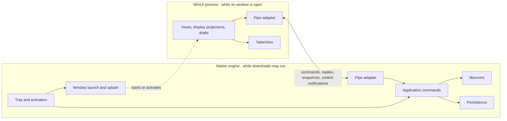

# Architecture

TinyTorrent is a Windows desktop torrent client with one native libtorrent
engine, an on-demand WinUI 3 window, one local pipe between them, and the shared
TableView control library. This document owns product scope, process
responsibilities, source layout, dependencies and installation.
[Decisions still open](#decisions-still-open) lists the remaining choices, and
the [documentation guide](../README.md) identifies each contract's authority.

## Usability comes first

Common sense, ease of use, and intuitive behavior take precedence over other
design choices in these plans. The contracts and implementation exist to
serve the person's task. Prefer familiar actions, sensible defaults, and
automatic handling of routine work; change a mechanism that adds avoidable steps
or exposes internal bookkeeping. Ask the user to decide only when their intent
is ambiguous or proceeding would risk their files or discard unfinished work.

Follow Microsoft's Fluent 2 principles through native Windows and WinUI patterns.
When inherited visual rules conflict with clarity, accessibility, or familiar
platform behavior, resolve the conflict at the rule's owner. The
[UI contract](ui.md#native-controls-and-visual-authority) owns the
concrete presentation guidance.

## Saved-value recovery

**Owner ruling:** loading repairs a damaged saved value when the rest of its
store remains readable, because the person should not have to repair files to
keep the product working. Preserve healthy values and records. Use that value's
default or nearest accepted value, whichever best preserves the person's choice;
write the repair through the existing store. An unreadable protected secret
becomes no saved secret and requires credentials again where the supplier needs
them. Keep unknown identities and unavailable network routes fail-closed rather
than substituting another identity or route. Refuse a store whose unreadable
format or records cannot be repaired without dropping the person's data.
Commands still reject invalid input at its editor; recovery applies only to loading.

## Product and scope

TinyTorrent is a small, fast client that does the everyday torrent tasks well
and nothing more. A feature earns its place by an everyday need; one that adds
weight for a few users stays out. No other client's feature list is a reason to
add a feature.

The product manages local downloads and seeds. It supports magnet and torrent-file
addition, including several sources at once and drag-and-drop, metadata preview,
destination and file choices, paused addition, duplicate detection with tracker
merging, pause/resume, force start, queue order, global and alternative speed
limits, scheduled pauses and speed limits, peer limits, seeding policies,
verification, moving files, a `.!tt` suffix on unfinished files so a file with
its real name is always finished, and distinct
remove versus delete-data actions. It opens downloaded files and folders, copies
magnet links and info hashes, and finds torrents by text or isolates errors. It exposes
useful errors and on-demand files, peers, trackers, pieces, and speed
information, including tracker editing and reannounce. Keyboard use,
accessibility, shell activation, and recovery after restart are part of the product.

The [Library master plan](library.md) adds local search of finished files with
movie, TV and music information. Data sources own file membership, beginning
with managed torrents. Library, TMDB enrichment and subtitle downloading run
entirely in C# while the product window is open. They share one C# SQLite owner
for saved facts, decisions and the last accepted file lists. The complete engine
summary reconciles membership before cached rows are published; background reads
confirm or replace those lists before file work trusts them. The resident engine keeps no
Library projection or provider work. C# creates, populates
and queries the database and owns subtitle-file handling. These features use
existing torrent facts and commands without adding native feature code or APIs.
The plan owns the feature's detailed behavior and future data-source seam.
The [database contract](database.md) owns shared persistence, initialization,
versioning and connection lifetime.

The optional [torrent catalogue](indexing.md) is separate from Library. The
engine owns its SQLite archive and search projection, shared-session DHT
collection and best-effort availability observations. Search is a third
workspace and stays usable with collection off. Its downloads use existing Add.

### Third-party provider access

**Owner ruling: build free application keys into the release for TMDB, OMDb,
MDBList, OpenSubtitles, SubDL and SubSource.** This avoids customer key setup.
Every provider that takes an API key also accepts the person's own key, which
replaces the built-in one, because every installation shares the built-in
key's allowance. TinyTorrent funds no paid package and never upgrades access automatically;
provider limits delay optional work instead. Applicable free terms must cover
the integration; a working key alone does not establish that. SubDL's terms
forbid a shared free key that powers a commercial service, so its built-in key
holds only while TinyTorrent is not one ([SubDL access](subtitles/suppliers.md#subdl)).
Local features remain usable without provider access.

A Library provider or subtitle supplier declares only what it asks the person
for: nothing, an API key, or a user name and password. The app's one account
dialog asks for it and the plugin's owner saves the result, because a dialog per
plugin would repeat the same fields, checks and wording. The person can enter
their own key even when the release has no built-in key for that provider.

**Owner ruling: automatic provider work is limited per movie.**
Every torrent takes the same import path: its files are read and listed. When
movie information download is on, every video without a match is identified,
from saved information first and from the provider only when needed, because
a file nobody identified cannot be used in Library. A video without a match is
tried once in each session. Automatic work and Fetch new respect remembered
empty results, unusable resources and the search limit across sessions, because
a second copy of a movie sends the same question to the provider. Movie lookups
and subtitle searches share that limit, one setting on the Plugins page.
Force fetch and the batch scopes Fetch missing and Fetch all authorize a fresh
request for the selected data, including locally blocked data. Provider waits
and pacing still apply. Reset in Settings clears local protection without
starting work; [search protection](search-protection.md) owns the precise
counting, retry and reset rules.
Automatic subtitle searches run only for new torrents, because a subtitle
search spends the supplier's allowance. A torrent is new when the database's list of known
torrents does not contain it: it was added in this session or while the window
was closed. A torrent becomes known once the window has seen it finished, so a
download that finishes after a restart still gets its subtitles. A database with no history takes the torrents it first sees as
known, so their subtitles wait for Find. Removing a torrent while the window is
open forgets it, so adding it again makes it new. Automatic work starts 30
seconds after the window first connects to the engine, so it does not compete
with startup. Only an explicit fresh request overrides local protection.

### Product boundaries

**Owner ruling: do not bundle or launch an embedded browser engine.** Native
controls and HTTP requests serve the product without its memory cost.
Explicit website links open in the person's default browser.

Design the interface around these tasks and libtorrent's capabilities. Remote
servers, browser access, interchangeable engines, other platforms and torrent
creation are outside scope. Optional public-DHT collection is scoped by the
[catalogue contract](indexing.md). Blocklists and running a
program when a download finishes need an identified user requirement before
they become implementation work. The approved Settings scope includes one
watched torrent folder, configurable speed-history intervals, addition and
seeding defaults, and protocol and storage choices.
These serve the workflows in [Settings](ui/settings.md); they do not
authorize a general automation system or arbitrary engine tuning.
The product includes automatic port mapping (UPnP/NAT-PMP), an
editable listen port, binding torrent traffic to one network adapter such as a
VPN, notifications, preventing idle sleep while downloading on mains power, and
an update check. Port mapping, notifications about problems, idle-sleep
prevention while downloading, and the update check start enabled and can be
turned off; notifications about finished and added downloads start disabled.
A connection encryption setting, Preferred by default, shows that TinyTorrent
encrypts, and an optional SOCKS5, SOCKS4 or HTTP proxy carries outgoing
connections.

A setting exists only where people need different behavior. When one answer
is right for nearly everyone, it is fixed behavior; when no one has shown a
problem, there is neither. Beyond the approved Settings scope, engine tuning,
diagnostics, cosmetic choices, and protocol internals stay fixed until a
demonstrated workflow needs otherwise, because every setting is read by everyone
and its saved key is permanent.

Several torrents can use the same files, so the same content can be seeded from
several trackers, as established clients allow. The
[shared-files policy](engine/files.md#shared-files) keeps file deletion and moves
from reaching another torrent's files. Automatic replacement of an existing
torrent is outside the initial scope.

### Network route

**Owner ruling: every outbound connection TinyTorrent makes or starts follows
the confirmed proxy and network adapter.** This protects the person's selected
route across torrent traffic, update checks, providers and browser operations.
A request that cannot use that route is not sent; disclosure never authorizes
a bypass. An unknown or unavailable route has no direct fallback.

Apply the adapter to the proxy connection too, and resolve destination names
through the proxy where its protocol supports it. With neither proxy nor adapter
selected, use the normal system route. A route change cancels obsolete requests;
later work uses the newly confirmed route. Credentials stay scoped to their
intended endpoint across redirects.

The product window configures its shared HTTP owner from one confirmed settings
snapshot before starting requests, independently of Library storage readiness.

C# HTTP uses SOCKS4a for a SOCKS4 proxy: plain SOCKS4 carries an IPv4 address,
whereas SOCKS4a carries the destination name without a direct DNS lookup. A proxy
that refuses that form leaves the request unavailable. TLS stays inside the
proxy tunnel for every supported proxy type.

## Privacy

TinyTorrent must not add usage analytics, diagnostic uploads, crash uploads or
installation identifiers sent to any third party, including Microsoft, because
download activity and application use are private. Apply supported app-level
controls to prevent dependency reporting. Diagnostics remain in
[local logs](engine/lifetime.md#diagnostics).

**Owner ruling: retain the shared Microsoft runtimes and make the best effort
available through supported app-level controls.** Shared-runtime deployment and
servicing stay with Microsoft; do not build or distribute private runtimes or
change system-wide Windows diagnostics settings. The remaining Microsoft
runtime limitation is accepted and stays disclosed in the About telemetry
tooltip, so the qualified claim does not promise control over Windows.

Torrent protocol traffic, enabled metadata and subtitle requests, update checks
and a connection test the person starts serve product features rather than
analytics. They still disclose the request and network address to their
destination and follow the [network route](#network-route). Do not attach
unrelated usage data or identifiers to those requests.

The current stock Windows App SDK dependency prevents an absolute no-telemetry
guarantee. Its [data collection notice](https://github.com/microsoft/WindowsAppSDK#data-collection)
states that it collects usage data. Microsoft
[explains](https://github.com/microsoft/WindowsAppSDK/discussions/1941)
that runtime telemetry follows Windows diagnostics settings and that its release
pipeline injects telemetry support absent from private source builds. Suppressing
Windows Error Reporting does not suppress that instrumentation. The shared
runtime therefore prevents an absolute guarantee of no Microsoft telemetry;
the owner ruling above accepts this limit without changing deployment.

## Two processes, one download authority

The native engine remains running while downloads may run. It contains libtorrent,
persistence, the tray, the splash window, and the local pipe endpoint. Opening the
interface starts or activates a separate WinUI process; closing its window lets
that process exit while transfers continue.



Two processes allow the WinUI runtime to disappear and a window crash to leave transfers
running. A measurement on 2026-10-04 sized the first reason: a minimal
unpackaged WinUI window (Windows App SDK 2.4, .NET 10, Release, a 200-row list)
whose process stays alive after the window closes keeps about 32 MB private
working set, the figure Task Manager shows, and about 97 MB private commit.
Hiding the window frees almost nothing. Trimming the working set drops it to
2 MB, but it grew back to 5 MB within 30 idle seconds, and the commit stays. Two
processes keep that cost out of start at sign-in and out of the closed-window
state this product measures first. The second reason is real too: WinUI ends
its process on an unhandled exception, and in one process that would stop
every download. The price is a cold WinUI start on every Open, which the splash
covers, and the pipe with its reconnect path. The
[resource check](../agents/testing.md#resource-checks) measures the time from Open to a
usable window; a slow open is a reason to revisit this split. A single process
would keep the measured WinUI cost resident, and shared memory would add
synchronisation and lifetime costs.

A separate tray process would add another resident executable and
supervision path without earning its cost. The engine loads neither .NET nor
WinUI. It builds as one executable; focused native checks can link the same
implementation units. Its startup, commands, and shutdown also work without tray
windows or WinUI files, so headless checks use the production implementation.

**Owner ruling: the engine is `TinyTorrent.exe` and the WinUI window is
`TinyTorrentUI.exe`.** The engine is the program people start: shortcuts, file
and link handlers and start at sign-in launch it, and the firewall asks about
it, so it carries the product name. A generic name such as `Engine.exe` looks
like malware in Task Manager and in the firewall prompt. Both files carry the
full product name, not an abbreviation such as `tt-`, because a person who
sees an abbreviation cannot tell which product it belongs to. Both report
"TinyTorrent" as their file description, so Windows shows the product name
where it would otherwise show the file name.
[Directory.Build.props](../../Directory.Build.props) is the only place that
defines the two names; projects, code and scripts read them from there, because
each process starts the other by name and two copies of a name drift apart.

| Responsibility | Sole owner |
| --- | --- |
| Swarm and transfer execution, torrent metadata | libtorrent inside the engine |
| Application commands, torrent membership, queue and transfer policy | Engine |
| Durable torrent identities, engine settings, resume checkpoints | Engine persistence |
| Torrent payload operations and their recovery | Engine |
| Tray, splash, activation routing, window launch, application lifetime | Engine |
| File/link handler and start-at-sign-in registration | Engine registration owner |
| Installation files, prerequisites, shortcuts, and uninstall entry | Installer |
| Background settings and selected application language | Engine |
| Framing, decoding, request correlation, connection failures | Pipe adapter at each endpoint |
| Display copies, filters, drafts, dialogs, window placement, window-only settings | WinUI |
| Library search, TMDB, subtitle acquisition/file handling and their settings/facts | C# product-window lifetime; one SQLite owner |
| Discovered torrent catalogue, DHT collection and local catalogue queries | Engine lifetime; a separate native SQLite owner using the existing session |
| Table geometry, sorting, selection, and gestures | TableView |
| Resource lookup and live text refresh | One localisation component per process, following the [localisation contract](localisation.md#ownership-and-live-behavior) |

Keep work together when it changes together. Use a small interface that hides
a real decision; remove forwarding layers that add no policy or useful isolation. Add an
abstraction when a concrete caller needs it, not to permit hypothetical engines,
platforms, or test substitutes.

Immutable snapshots, saved checkpoints, and display projections serve different
lifetimes under the same state authority. Two language codecs implement the same
protocol.

## Command and presentation flow

Tray actions and pipe requests call the same engine operations. Transport checks
belong to the adapter; torrent-state validation and download policy belong to the
engine. The tray does not call its own process through IPC.

WinUI uses MVVM. View models use `INotifyPropertyChanged` and `ICommand`
directly, without a new framework, service interface, or second torrent
database. This keeps gestures on one command path and stops control lifetime
from owning edits.

- `MainViewModel` owns the window's presentation state, membership, accepted
  selection, command availability and connection facts, through one concrete
  pipe client. It publishes a completed visible list only when membership or
  order changes; routine snapshots refresh window state, and connection and
  language transitions reach the affected child owners. It owns the model
  steps of close, Exit and reset in their order, and whether the close exits
  or reopens. One private `Reply` sends every engine reply of the close, Exit
  and activation handshakes: it reports a failure and never throws, and only
  a failed close reply keeps the window open.
- `Settings.Editor` owns the collection of settings, applies confirmed
  snapshots to them, and owns adapter choices and the operations that cross
  settings: leaving Settings, search and reset. Each `Setting` owns its field
  lifecycle: its draft, conversion and its message, submission, and the replies
  to its saves. A `SettingsRow` given a setting shows its label and error,
  enables its control, and saves a switch, a selection or a unit; the page
  keeps the keys and focus of text fields. Editor's `Schedule` owns period
  editing and whole-list saves. The lookup limit uses the same field lifecycle
  and saves through the Library request policy rather than the engine. Editor
  also owns plugin coverage and database summary reads and their retained
  results, so those operations do not depend on a page's controls. Views
  request loading when the relevant content becomes visible and bind to the
  results.
- `AddDraft`, `Inspector` and `FileDraft` own their unfinished operations.
  `AddDraft` holds addition choices and preview state. It also receives
  dropped, pasted, picked and activated sources: it takes them in arrival
  order, adds several together without a dialog, and tells `MainViewModel`
  whether the Add dialog or the merge question opens. `MainWindow` tells it
  when its dialog opens and closes. `Inspector` keeps peer and tracker row
  identity within the current session and target.
- Views bind to those owners. `MainWindow` keeps native pickers, dialogs,
  window chrome, control-specific focus and scrolling, and TableView gestures.
  Around the model's close steps it hides and shows the window, suspends the
  open dialog and resolves drafts by their close policy, saves or forgets the
  placement once the close has succeeded, and restores focus when it fails.
  The model accepts or refuses a selection before the window reflects it.
  Connection conditions and command failures have separate app-level messages;
  field and editor failures stay at their owners. `MainViewModel` owns the
  message bar; `Notifications` owns the toast stack, how long each toast
  stays, what closing it means, the command error and the screen-reader
  announcements. `MainWindow` tells it when time on screen passes and when
  the stack shows. The code that sends an engine command says whether the
  person requested it or the window did, for a read or on its own, and only
  an accepted command the person requested clears the command error.

In the engine, one private `CommitEdit` derives, persists and applies tracker
and priority changes for explicit edits and merges; each entry point keeps its
own legality checks. `SpeedHistory` owns its buffers and aggregation, while the
engine owns sampling cadence and the session envelope.

The peer map follows the same ownership inside `Torrents`. `Inspector` owns
scope, geolocation and the chosen place, and retains its plain `MapModel`.
That model aggregates observations and distributes estimated destinations.
`PeerMap` owns native input, focus and inspection; `MapViewport` owns the shared
projection and navigation calculations. `MapRenderer` owns geometry, animation
and native resource caches, released when the control unloads. Shell composition
stays in `Shell/InspectorPane`. Supporting records live with their creator;
these owners introduce no role folders or additional projects.

WinUI presents confirmed state and pending work. File pickers, clipboard actions,
and opening Explorer use Windows directly; changes to engine-owned files go
through the engine.

The product host maps a completed engine snapshot into display rows keyed by
durable torrent identity, then supplies its filtered projection to TableView.
Keep row instances stable and apply live property updates on the UI dispatcher,
following the [TableView update contract](../../lib/TableView/docs/tableview-contract.md#53-source-identity-and-update-contract).
Replacing the source on every transfer tick would cancel queue dragging;
ordinary telemetry updates the row values. Table sorting changes presentation
order; a queue reorder event becomes a
request to the engine's command owner. Selection and drafts remain presentation
state, reconciled against confirmed membership.

The close/reopen path makes the intended lifetime visible:

```mermaid
sequenceDiagram
    actor User
    participant Engine as Native engine
    participant UI as WinUI process
    User->>Engine: Open application
    Engine->>UI: Start or activate window
    UI->>Engine: Connect and request snapshot
    Engine-->>UI: Confirmed state and session identity
    UI->>Engine: Torrent command
    Engine-->>UI: Acceptance or rejection
    UI->>Engine: Request outcome / refreshed state
    Engine-->>UI: Pending, completed, or failed
    User->>UI: Close window
    Note over UI: Close normally; protect unfinished input if present
    Note over Engine: Transfers and persistence continue
    User->>Engine: Open again
    Engine->>UI: Start window
    UI->>Engine: Reconnect and reconcile snapshot
```

Application Exit follows the coordinated [shutdown](engine/lifetime.md#closing-and-shutdown)
path.

## Ownership decisions

These settle ownership questions that the code alone does not answer. GitHub
issues own actionable work and its status.

- [PipeClient.Files](../../app/src/Shared/Engine/PipeClient/Files.cs) holds Inspector
  arbitration through the matching fresh push, including after a cached-ready
  reply. Background file reads settle there; Inspector alone decides whether
  its current presentation accepts a result. The
  [pipe API contract](pipe-api.md#snapshots-and-detail) owns that lifetime.
- `Settings.Editor` holds the engine setting fields and the Plugins search
  limit as `Setting`s; `Library.Browser` owns the provider and automatic
  download choices. `Subtitles.Settings` presents the subtitle choices, and
  `Subtitles.Acquisition` saves every one through a single queue that the UI
  thread appends to, so saves apply in click order and closing waits for them
  instead of for a Settings view. In a
  `Setting`, Escape discards unsubmitted intent while accepted work settles;
  later deliberate input stays distinct from cancellation, including input
  equal to the former confirmed value.
- [Supplier](../../app/src/Subtitles/Supplier.cs) hosts each
  [ISupplier](../../app/src/Subtitles/ISupplier.cs). It owns validity before
  every send and allowance reservation, the key on each request, the sign-in
  request's accounting, redirects, subtitle decoding and which subtitles fit
  a file. Its operation carries account, HTTP access and the acquisition
  validity callback through sign-in, retries and redirects. A supplier builds
  its requests, reads the answers into facts and declares its sign-in style
  and quota facts; it reaches the network only through the host's send
  delegate. Account Check has no movie membership requirement. Acquisition
  keeps file-work and publication checks; ProviderHttp stays the
  network-route owner.
- Table resolves saved visibility and sort before publishing the layout, and
  accepts held rows and release intentions only after comparison succeeds.
  A changed saved sort uses the same full-source presentation as explicit Sort;
  initial capture evaluates only the final pending sort. Host callbacks
  unrelated to that comparison have no general rollback; notification handlers
  run after mechanics.
- [Engine settings](../../engine/src/Engine/Settings.cpp) protect a changed proxy
  password before committing it. Confirmed ciphertext is reused by unrelated
  document saves, so encryption failure refuses the credential change without
  blocking those saves or losing the previous credentials.
  [Acquisition.Load](../../app/src/Subtitles/Acquisition/Storage.cs) publishes settings
  and supplier allowance only after its SQLite transaction commits.
- `MainWindow` orders close, Exit and reset, because hiding, dialog suspension,
  draft prompts, placement and focus interleave with the model steps;
  `MainViewModel` supplies those steps and the engine's close replies. A
  separate departure owner would call back into the window for most steps, so
  its interface would be as wide as the sequence.
- Child owners such as `AddDraft`, `Inspector` and `Editor` take their
  `MainViewModel`, because each uses a different set of its members. A shared
  object of window-access facts would sit beside that reference in every child
  except `SpeedLimit`.
- `Inspector` keeps the wanted-file draft beside its tracker draft, because both
  share its pending edit, failure and departure. `FileSelection` shows the
  choices and is told whether to keep them across a snapshot.
- `Week` keeps its pointer and keyboard gestures, and `PeriodSpan` owns
  snapping and clamping. A pixel-free gesture model would have no caller
  besides `Week`.
- `PipeClient` creates its own named pipe. Connecting needs the pipe handle
  itself, for the server process, the engine path in the version message and a
  Debug build's stop of another engine, and no second production transport
  exists. A stream or connect-function seam would serve only tests.
- Each feature owner keeps its cancellation source, accepts a stop and reports
  Cancelling or Finishing under its own publication gate, as
  [Cancellation has one path](background-work.md#cancellation-has-one-path)
  requires. `BackgroundWork` cannot tell a stop that loses to publication, so
  moving the source or the late-report filter into its handle would be the
  shared cancellation machinery that
  [search protection](search-protection.md#ownership-and-interface) rejects.

Each `Setting` saves through a `SettingStore`. A store says whether its value
can be edited and saved, saves it, and says whether a failed save proves the
value is unsaved; the field lifecycle stays in `Setting`. The default store sends
the value to the engine. Only an engine refusal proves the value is unsaved,
because any other failure can lose the reply to an applied save, so the setting
waits for a snapshot to confirm the value. The lookup limit's store saves one
SQLite value, so each failure is final.

## Projects and source layout

[TinyTorrent.slnx](../../TinyTorrent.slnx) holds these projects and selects x64.
Broader platform lists in individual C# projects do not add release targets.

| Project | Role | Project dependency |
| --- | --- | --- |
| [Engine](../../engine/src/Engine.vcxproj) | Native transfer state, persistence, pipe, tray, splash and lifetime. | libtorrent and native dependencies from `3rdParty/`; no WinUI or .NET. |
| [TinyTorrent](../../app/src/TinyTorrent.csproj) | On-demand product window, display and draft state, Library and subtitles. | TableView, WinUI and .NET; one pipe to Engine. |
| [TableView](../../lib/TableView/src/TableView.csproj) | Reusable `Table` control, templates, and English text. | WinUI and Lucide; no torrent application dependency. |
| [Lucide](../../lib/Lucide/src/Lucide.csproj) | Lucide icon font and glyph names. | WinUI. |
| [TableViewSample](../../lib/TableView/sample/TableViewSample.csproj) | Desktop demonstrations and diagnostic probes. | TableView. |
| [TableViewTests](../../lib/TableView/tests/TableViewTests.csproj) | Desktop MSTest host for control behavior. | TableView. |

| Location | Purpose |
| --- | --- |
| `engine/src/` | The native engine project. |
| `engine/inc/` | The native project's headers. Includes name a header from this root, such as `Engine/State.h`. |
| `app/` | The WinUI product host and its instructions. Prototype documents live in `app/prototypes/`. |
| `lib/TableView/` | The only TableView: the library in `src/`, focused verification in `tests/`, and a demonstration host in `sample/`. [TableView.slnx](../../lib/TableView/TableView.slnx) holds only these, with Lucide. |
| `lib/Lucide/` | The Lucide icon font and its glyph names, for any WinUI project. |
| `resources/` | Product branding: the application icon and logo. |
| `artifacts/` | Generated output, kept outside source inputs to prevent recursive copies. |
| `3rdParty/` | The engine's dependencies, compiled once; not in git. See [third-party dependencies](#third-party-dependencies). |

The app is one WinUI project. `Shell/` holds the window, the main view model and
InspectorPane composition. `Search/`, `Torrents/`, `Settings/`, `Library/` and
`Subtitles/` keep their related state, operations and presentation together.
`Shared/` holds common facilities, with engine communication, storage, network,
desktop and diagnostics in their own folders; `Controls/` holds reusable UI.
`App` and `Enums.cs` stay in the project root. Partial-type folders keep their
owner's namespace. [Naming and structure](../agents/naming.md#app-folders) owns the
placement rules.

TableView owns its templates and English text and has no engine dependency.
Hosts supply rows, columns, templates, identity and handlers through its public
API; the [TableView contract](../../lib/TableView/docs/tableview-contract.md) owns
that API and the [implementation map](../../lib/TableView/docs/tableview-implementation.md)
owns its internals.

### Build integration

[Compilation](../agents/compilation.md) owns when and how to build.
[Directory.Build.props](../../Directory.Build.props) owns the `artifacts/` root and
the managed output layout. It excludes generated folders from source inputs, so
repeated XAML builds cannot consume their own output. The
[native project](../../engine/src/Engine.vcxproj) uses the same root for its output
and intermediates.

The app build copies the engine beside the window through
[CopyEngine.ps1](../../app/CopyEngine.ps1). An identical binary stays untouched, so
UI-only rebuilds leave transfers running. When the binary changed, the script
force-stops the engine running from that destination in the current Windows
session, bypassing Exit confirmation and the final checkpoint, then replaces it.
It resolves junctions before comparing paths, because the process can report the
physical output path rather than the repository's `artifacts/` path.

Every TinyTorrent in a logon session shares one window lock and one engine pipe,
so a launch hands off to whichever window and engine already run, from any
folder. A Debug window stops a window started from another path and takes the
lock; on its first connection it stops the engine that owns the pipe unless that
engine runs from beside it, then starts its own. Path identifies the build,
because the build stops a running engine before replacing it. Release windows
never stop anything.

## Dependencies and cost

Runtime memory while downloading or seeding with WinUI closed is the primary
resource measure. Correctness, durable downloads, required features, and useful
throughput remain constraints. Package size is secondary. Closing WinUI releases
its process and engine work retained solely for that window.

Retain libtorrent and the networking/crypto dependencies needed for torrent
interoperability. Removing application HTTP/RPC does not remove HTTPS trackers,
web seeds, incoming peer connections, TCP/uTP, or useful discovery.

The [native project](../../engine/src/Engine.vcxproj) defines the toolchain, x64
target and static linking, and [Dependencies.ps1](../../engine/src/Dependencies.ps1)
pins the dependency versions and feature selection, as
[third-party dependencies](#third-party-dependencies) describes. Extend that build
for engine implementation. When updating dependencies, check the latest stable
[upstream release](https://github.com/arvidn/libtorrent/releases/latest)
independently of `../TinyTorrent`, pin the selected version and feature set,
and recheck version-sensitive engine assumptions. Pinning keeps builds reproducible.
The automatic disk policy is recorded in [engine settings](engine/settings.md#disk-write-caching).
Runtime packages need a concrete job; test frameworks and build tools stay out
of the shipped dependency graph.

The app build fetches DB-IP's free country data once a month into
`artifacts/data/` and copies it beside the app, so every build resolves peer
flags from data at most a month old without a copy in git. The fetch is the
one network step an ordinary build takes; without network it uses the newest
cached month, and fails only when no copy exists
([peer location](peer-location.md)).

Remove unnecessary retained work and duplicate data before constraining useful
transfer buffers or peer activity. Bound queues and retained data at their existing
owners. Each worker has identifiable blocking work and an idle wait. DLLs, shared
runtime installations, and single-file bundles do not by themselves prove lower
running memory.

### Third-party dependencies

vcpkg is no longer acceptable, by the owner's ruling. Visual Studio's vcpkg
integration runs `vcpkg install` on every build. When any input to its package
fingerprint changes, such as the compiler, CMake, PowerShell or a port script, it
deletes every installed library and compiles Boost, OpenSSL and libtorrent again
in the middle of an ordinary build. This happened and destroyed the installed
libraries.

The engine's dependencies are therefore git checkouts at pinned revisions. They are
compiled once and are never downloaded or compiled again until someone changes a
pin. [Dependencies.ps1](../../engine/src/Dependencies.ps1) owns the pins and creates
`3rdParty/` at the repository root:

- the checkouts of libtorrent, OpenSSL, Boost (headers only) and nlohmann/json;
- `tools/`: Strawberry Perl and NASM, which OpenSSL's build needs and Visual Studio
  does not include, downloaded from their official sources and checked against a
  pinned SHA-256;
- `Release/` and `Debug/`: the static libraries and headers the engine links, and
  libtorrent's exported compile definitions.

Git ignores `3rdParty/`. It is outside `artifacts/`, so cleaning build output never
forces the dependencies to be compiled again. Only the repository owner runs the
script; a build never starts it. When `3rdParty/` holds no complete installation,
the engine build fails and names the script, so a build after `3rdParty/` was moved
or removed cannot download and compile everything again. Run on a complete
installation without `-Update`, the script does nothing. An ordinary build never
downloads or compiles a dependency, even after a compiler, CMake or Visual Studio
update. The libraries are compiled without `/GL`, because a library compiled with
`/GL` refuses to link after a compiler update and a library compiled without it
links with every later compiler.

libtorrent uses the [SynoSoftware fork](https://github.com/SynoSoftware/libtorrent),
pinned to an exact commit in `Dependencies.ps1`. The fork owns the pause tick-list
correction and the optional full IP peer snapshot on `post_peer_info`;
`3rdParty/libtorrent` is its local Git checkout and stays ignored by
TinyTorrent. Commit source changes in the fork, merge upstream updates there,
verify the resulting revision, then update TinyTorrent's pin. This preserves the
correction through updates without copied source or a separately applied patch.
Return to upstream when a verified upstream revision includes the correction.

The engine takes libtorrent's compile definitions from the libtorrent build in
`3rdParty/` instead of keeping its own list. A definition that differs from the
library's changes libtorrent's types under the engine and corrupts memory at
runtime with no build error.

To change a pinned version:

1. Change the source revision, the build options, or a tool's URL and SHA-256 in
   `Dependencies.ps1`.
2. Run `powershell -ExecutionPolicy Bypass -File engine\src\Dependencies.ps1 -Update`.
   It fetches the new version and rebuilds that library and every library built
   against it. The other dependencies stay as they are.
3. Build the engine and recheck version-sensitive engine assumptions.

To rebuild everything deliberately, delete `3rdParty/` and run the script.

## Installation and updates

Ship an unpackaged application with a small per-user Inno Setup installer from
the project's release page. The Microsoft Store is not required. Use
[non-administrative install mode](https://jrsoftware.org/ishelp/topic_setup_privilegesrequired.htm)
for the application under `%LOCALAPPDATA%\Programs\TinyTorrent`; engine data
lives separately under `%LOCALAPPDATA%\TinyTorrent`. Resolve these locations
through Windows known folders. [Release.cmd](../../Release.cmd) runs the
[release command](../../installer/README.md), which generates the installer.

Publish WinUI as framework-dependent. Ship the engine, product host, TableView,
resources, and required application dependencies, without app-local copies of
the shared WinUI or .NET runtimes. Before launch, the installer checks for
exactly the runtimes the release needs, following the
[unpackaged deployment guide](https://learn.microsoft.com/en-us/windows/apps/windows-app-sdk/deploy-unpackaged-apps),
reuses compatible installed ones, and fetches missing ones from Microsoft's
official distribution. Prerequisite installation can need elevation or be blocked by machine policy;
report that outcome instead of promising every machine a no-admin installation.
Cancelling a prerequisite must leave a retryable installation, not launch a
broken window. Setup verifies the installed runtime after its installer finishes
and offers a required restart before replacing application files, so a vendor
exit code alone does not decide whether the application can run.
Updating TinyTorrent does not redownload an already compatible runtime.

First installation offers opening torrents with TinyTorrent, selected by
default, and starting at sign-in, not selected by default, because people do not
expect a torrent client to start and upload at sign-in unless they asked for it.
Setup performs the registration and, when
Windows requires the person's default-app choice, takes them to that choice.
Declining it leaves the application installed and usable. The installer calls
the engine's [registration actions](engine/lifetime.md#windows-registration);
Settings calls the same owner. Upgrades preserve disabled registrations and
existing default-app choices without repeating setup prompts. The installer owns
the engine-targeting shortcut and Installed apps entry, not a second handler writer.
Optional registration failures do not turn a usable installation into a failed
one; Settings can retry those choices through the same engine owner.
Uninstall requests coordinated Exit, attempts both registration cleanups, and
removes its program files. Missing program files and failed optional cleanup do
not trap the user in an installation they cannot remove. It leaves downloads,
saved engine data, and shared runtimes intact.

The installer does not silently add firewall rules or change network profiles.
[Windows Firewall](https://learn.microsoft.com/en-us/windows/security/operating-system-security/network-security/windows-firewall/rules)
may prompt for inbound access; a prompt or approval is not guaranteed by policy
or account permissions. Continue using available outgoing connections when
inbound access is blocked. Port mapping does not bypass the host firewall.

Updates use the same release installer, after the coordinated
[Exit](engine/lifetime.md#closing-and-shutdown). When TinyTorrent was running before the
update, the installer starts it again, so downloads do not stay stopped until
the person remembers to open it. It starts in the tray, or with its window when
Help > Update passed `/OPEN=1`, because that person was using the window. If the installed executable cannot start,
Setup uses the bundled engine to request Exit; a running application's refused
Exit still stops replacement to protect unfinished input. Windows Restart Manager
handles remaining file locks. Stage and validate a complete release
before replacing it; never launch an engine/window pair from different releases.
Keep an interrupted update recoverable without modifying downloads.

Without an update check, most installations keep an old libtorrent and its known
network-facing defects. When the window opens, WinUI asks the project's release
page for the latest version, at most once a day, unless the Check for updates
setting is off. A newer release shows Update available in the window.
Installing it is the person's action: Help > Update downloads the release's
installer through the saved proxy and network adapter, checks it, and runs it
without questions, as the update above describes. The check depends on the
running program. A TinyTorrent whose signature Windows trusts runs only an
installer with a trusted signature from the same publisher, so an unsigned
installer never replaces a signed installation. Any other TinyTorrent requires
the SHA-256 that the release publishes beside the installer. Signature checks fetch no revocation
or certificate data, because Windows would send those requests outside the
saved route. A failed download, check or setup leaves the current version
running and says why. There is no silent update, resident updater, or check
while the window is closed.

WinUI stores the last attempt and known release version in `updates.json`
beside its window layout. The check uses the project's public latest-release
API, without credentials, with an eight-second limit. Cache the attempt before
requesting, including an unsuccessful attempt, so reopening an offline window
does not repeat the request within 24 hours. Unavailable releases and network
failures do not interrupt torrent work. Turning the setting off or closing
WinUI cancels a pending request. The update command opens only the project's
release page, never a download URL supplied in a reply.

Sign public release artifacts; validate installation, upgrade, and uninstall
with the chosen prerequisites before publication. A future winget listing can
reference this same installer without becoming a Store dependency.

## Decisions still open

Resolve each decision before its dependent work, then record the choice at its
owner and update this live list. Continue independent implementation work while
unrelated questions remain open.

| Decision | When it matters | Owner |
| --- | --- | --- |
| Table row appearance | At the next hands-on Fluent review of the product tables. Review row hover, selection accent, corner shape, and focus treatment. Retain the existing appearance until that review; invisible keyboard location remains an accessibility gap. | [TableView visual contract](../../lib/TableView/docs/tableview-contract.md#8-rendering-layout-and-visual-language) |
