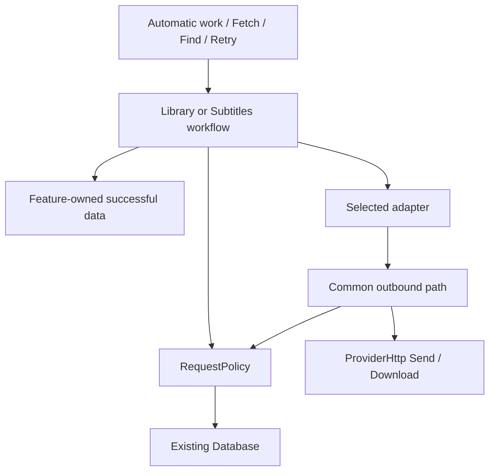

# Search protection

This contract covers remote calls from TMDB, Wikidata, OMDb, MDBList,
OpenSubtitles, SubDL, SubSource, IMDb dataset downloads and DB-IP city data
downloads. IMDb movie searches read local data under the rules below.

## Decision and scope

One concrete, window-lifetime `Shared.Network.RequestPolicy` owns durable
request suppression, access waits, pacing and their reset semantics. Library
owns identification and metadata reuse. Subtitles owns matching, acquisition
and file publication. Adapters own endpoint parameters and response decoding.

A valid missing answer is remembered by the question asked, across files and
restarts. Temporary failures have shared backoff; they are never missing-data
answers. **Force fetch** requests a fresh answer despite local suppression.
**Reset search protection** clears the selected history without deleting useful
data or user decisions. Reset and requesting data are separate actions; reset
does not enqueue a search. Remote quotas remain separate.

Success has four observable conditions:

- Equivalent files reuse an answer, including an empty one, without another
  remote request.
- An outage causes one recovery attempt per applicable backoff, not one per
  movie. Unaffected access paths remain usable.
- Every local hold has a visible retry/reset path, and every timed wait can end.
- Reset cannot lose unrelated accepted work, erase successful data, or let an
  old completion restore cleared protection.

Known misses do not poll. The app's automatic-work eligibility, startup delay,
subtitle completion stages, network route and file-publication rules apply
unchanged. The five-search cap for remote searches and its shared setting stay.
Reaching the cap creates a local block; the Force/Missing/All actions provide
explicit recovery.

## Ownership and interface

| Responsibility | Owner | Reason |
| --- | --- | --- |
| Metadata workflow, matching and successful caches | Library | Remote facts still need identification and user-decision rules. |
| Subtitle workflow, matching, successful candidates and files | Subtitles | Candidates still need language, release and destination rules. |
| Suppression, access recovery, pacing and reset semantics | RequestPolicy | Every adapter needs the same protection decisions. |
| Request parameters, parsing and provider-specific quota facts | Adapter | Remote contracts differ; common policy does not. |
| HTTP connections, confirmed route, transport cancellation and reply classification | ProviderHttp, including its streaming Download path | Protection must not create a second transport or route authority, and the same reply must give the same failure and hold in every feature. |
| IMDb download/import and replaceable data | Imdb.Dataset; Library coordinates lookup drain | A dataset update must preserve the installed file until a complete replacement is ready. |
| Schema initialization and transaction execution | Database | Feature data and protection need one commit authority. |
| Construction, lifetime and cross-feature reset coordination | [Features](../../app/src/Shell/Features.cs), a host that is neither feature | Neither feature owns the other's lifetime. |

The policy reads eligibility, records classified outcomes, reserves outbound
allowance and resets local history. Requests, intents and outcomes have names;
an empty list or a combination of `force`, `limited` and `answered` flags never
communicates refusal.

Protection integrates at the common Library lookup/resource-read path and the
common subtitle search/download path. Endpoint adapters report facts and cannot
invent their own admission checks, retry delays or resets. The outbound path
applies the policy before every call, including calls inside one adapter
operation. `Supplier.Operation` carries the account and validity check through
`Supplier.Send`; the allowance checks belong to the policy, and the validity
check runs before each send, including redirects and login. Authentication
controls which credentials are sent, not whether pacing applies to an
unauthenticated download. Library's `SaveSearch` and `SaveResponse` commit
related data together and finish after caller cancellation; protection extends
those paths and adds no parallel operation or persistence layer.

`ProviderHttp` classifies every reply on the common outbound path once, as
[answers, holds and recovery](#answers-holds-and-recovery) lists. Anything but
a success records its hold through RequestPolicy and throws a
`ReplyException`, which names its `ReplyFailure` and that hold. Library,
Subtitles and the data downloads each turn it into their own failure in one
switch, and the failure's retry time is the hold's. An adapter states its
provider's facts on the `ProviderCall`: whether a 3xx is a redirect it
follows, whether a refused session is one it renews, whether a 404 names the
requested resource, and a quota that its reply reports in its own way.

Library serializes execution through `VideoLookup._access`; Subtitles uses
`Acquisition._operation`, including account checks. Each workflow keeps its
serialization because it also protects decisions and publication. IMDb reads
use Library's execution owner too, but no network policy. A shared executor,
second scheduler, generic cache callbacks, shared-task cancellation machinery,
a new project, an interface per class, a generic repository or an event bus
would duplicate that responsibility and are unnecessary.

Feature stores record reusable answers and request outcomes in one
`Database.Run` transaction. RequestPolicy owns its SQL; its internal recording
operation participates through the current connection. There is no nested
`Database.Run`, network I/O in a transaction, or database access in adapters.
The policy provides eligibility and due times; feature workers own queue order
and wakeups. Presentation reads the same policy as execution.

The shared [AccountDialog](../../app/src/Shared/AccountDialog.cs), plugin access
declarations and `Shared.Credentials` stay the owners of credentials. The dialog
edits; Library or Subtitles saves/checks; RequestPolicy owns protection. There
are no provider-specific editors and no second credential store. Library has no
account-check operation.

## Request identity and access scope

Request identity answers: **have we obtained this answer for this evidence?**
It contains the catalogue/supplier, operation, effective parameters, relevant
language and any established subtitle evidence stage that permits another try.
It is one bounded, canonical representation built from the same prepared input
as the outbound request, never parsed or normalized independently in two places.

- Library search includes effective query and language for localized providers.
  Description identity names the movie, series or individual episode resource.
- Subtitle hash search includes hash, size and language. Filename/title search
  includes the parameters that supplier actually receives, retaining release
  distinctions it uses.
- For suppliers without hashes, early and completed subtitle evidence have
  distinct suppression identities: the completion rule permits one later title
  search even with unchanged remote parameters. Equivalent copies share the
  completed-evidence answer. Earlier successful candidates remain reusable where
  they satisfy the matching rules.
- Catalogue identity distinguishes providers. OMDb and MDBList do not share
  answers merely because they describe the same IMDb movie; local IMDb data
  cannot satisfy a remote provider's missing search or resource.
- Local paths and torrent identities do not distinguish otherwise equivalent
  questions. An adapter that sends a filename includes that effective filename,
  not its directory. Account-dependent content includes its account scope.

Access scope answers: **which calls does this failure or allowance affect?**
Adapters identify the applicable service, key, account or endpoint scope and
request/download allowance. Every relevant hold applies. IMDb dataset downloads
have their own access scope, independent of local movie reads. A wait scoped to
downloads, such as OpenSubtitles' body deadlines, holds downloads only. A
search-format failure cannot be cleared by successful login.

Key-scoped allowances use the effective built-in or personal key; account-scoped
allowances use a stable remote account identity where available. Changing a
password must not silently refill a known account quota. Credential changes
invalidate authentication failure for the replaced credentials, not an unrelated
quota. Only opaque credential identities are persisted, never secrets in history
or logs. Switching back to a previously used identity restores its unexpired
holds. Other installations' consumption of a shared key is unknowable locally;
remote replies remain authoritative.

Saved-account and draft-account Check use the same admission and accounting as
other calls, with the captured effective credentials. Check is an explicit access
recheck, not a movie search: it neither consumes the per-movie cap nor creates
content-negative history, even when a supplier verifies access with a fixed title.
Its usage and remote holds persist independently of saving the draft. Cancelling
the editor discards credentials and presentation results, not observed remote
limits. A successful check clears only the access failure it actually disproves.

A displayed item maps to its current structured request identities at the feature
owner. Scoped retry uses those identities; Settings reset uses their catalogue or
supplier. History is never selected by substring matching opaque keys. Library's
provider chooser stays: each actionable provider choice uses its own protection
state, never another provider's block or an aggregate force state on the parent.

## Answers, holds and recovery

These are different facts, not one catch-all status enum. A feature may have
good saved information while a fresh request is waiting or has failed.

| Fact | Ordinary behavior | What ends it |
| --- | --- | --- |
| Valid answer | Reuse feature-owned data, including absent optional fields. | Explicit refresh or the adapter's applicable freshness rule. |
| Valid empty answer / missing resource | Remember the exact request in RequestPolicy; no polling. | A fresh user request, reset or newly eligible evidence. |
| No acceptable match | Keep candidates and the feature's matching decision; do not label the remote data absent. | Changed evidence/options or user selection/fresh search. |
| Temporary transport/server failure | Shared access backoff; pending work waits. | A relevant due attempt succeeds, or the user requests an early local probe. |
| Remote quota/rate wait | Hold only the affected calls until their deadline. | Deadline and subsequent remote response. Local reset cannot replenish it. |
| Access needs attention | Stop the affected path without polling. | Correct setup, supported verification, or an explicit recheck. |
| Unusable individual record | Hold that request, preserving good data. | Retry/reset or a targeted correction when its adapter is fixed. |
| Malformed protocol/page format | Back off the affected operation, preventing every movie from failing separately. | A relevant successful retry or adapter correction. |
| Cancellation/local ineligibility | No missing answer. | Later work becomes eligible. |

Only a validated remote response establishes missing data. HTTP 200 is
insufficient; errors and challenges inside its body are classified, and an
error inside a successful HTTP response holds the provider instead of creating a
failed record for every movie. A 404/410 is a missing item only when the adapter
knows it identifies the requested resource rather than a broken endpoint.
Unsupported input and local filtering never create a remote miss.

`ProviderHttp` reads every reply to Library, Subtitles and the IMDb and city
data downloads with the same rules:

| Reply | Failure | Hold |
| --- | --- | --- |
| 2xx, or 3xx when the call follows redirects itself | None | None, unless it also reports a used-up allowance |
| 429, `X-RateLimit-Remaining: 0` or a quota the adapter reads, such as a subtitle supplier's 402 | Wait | Remote wait on the allowance scope, or on every operation of the access; an adapter's quota names its own scope |
| 401 or 403 to a request with an authentication scope, which every Library request and supplier API request has | Refused, or Expired for a session the caller renews | Access needs attention on the authentication scope; Expired holds nothing |
| 404 or 410 when the call names one resource | Missing | None |
| Any other status, a transport failure or a timeout | Unavailable | Backoff on the operation |
| A reply over its size limit, or JSON that Library cannot parse | Invalid | Backoff on the operation |
| A proxy or adapter that cannot carry the request | Route | None |

A wait that the status or headers report is recorded even when the body cannot
be read. Retry-After, or else `X-RateLimit-Reset` in Unix seconds or as
a date, gives the wait or backoff its requested time.

The last valid answer is stored separately from later failed attempts. A timeout
during Force fetch must neither replace good metadata nor erase a remembered miss
and reopen automatic searching. An explicit refresh reports its failure even
when older information is displayed. A cache hit cannot clear an access failure,
and success on one operation cannot clear an unrelated hold.

Only RequestPolicy owns remote-negative history. Feature caches keep no second
independent missing flag. Matching decisions and local file failures remain
feature facts. A missing subtitle download reference affects that reference, not
the movie's entire subtitle search.

## Execution and request pacing

Within its serialized workflow, the feature:

1. Revalidates current membership/settings, then rereads cache and protection.
2. Reuses an answer or reports the hold. Fresh intent applies to the requested
   search/resource; unchanged successful dependencies remain reusable.
3. Invokes the adapter. Before every outbound call, the common send path checks
   operation validity and atomically reserves applicable pacing allowance.
4. Records any remote wait/failure before another call can start, including the
   next page. Known remote holds are retained for the captured access identity
   even if the requesting file/context has since been cancelled.
5. Commits reusable data and its classified request outcome. It applies a match
   or publishes a file only after the existing current-target check.
6. Releases execution so later duplicates read the committed answer or hold.

No second request runs concurrently through the same feature owner. Repeated
submissions of an already-pending user command are not queued. A cancelled
operation releases execution; a later caller can retry if no answer was
received. There is no shared result task whose cancellation another caller owns.

A long wait returns a reason and due time to the worker; it does not retain an
execution gate while idle. Queues skip held work when another eligible access
path can run. Explicit work gets priority between operations through feature
scheduling. On wake, the policy is rechecked: a remembered due time is not
permission.

Every outbound call is paced: search pages, detail reads, login, allowed
redirects, download-link requests and file downloads. Quota charges apply only to
endpoints covered by that supplier's allowance; a CDN read is not automatically
another API charge. A reservation is kept once a send may have begun, including
cancellation or timeout. An uncertain allowance-spending operation is not
replayed blindly; it reuses its acquired reference or follows the supplier's
supported recovery.

Pacing uses the serialized execution, adapter-declared rate windows, and a fixed
local minimum of one second between starts per access scope. This is a
conservative policy, not a measured optimum or a supplier rate claim. The
bounded usage that long quota windows need persists, including SubSource's
declared windows. In-session pacing uses monotonic elapsed time; saved deadlines
use UTC.

Temporary failures use a 30-second exponential backoff with small jitter and a
maximum of one hour including jitter. The streak and due time persist at access
scope. The next eligible real request is the probe; there is no extra
health-check call. Its outcome is recorded before another job is admitted.
Pending work recovers automatically; known misses create no timer.

A relevant remote deadline takes precedence over an earlier local retry. Both
Retry-After forms and provider-specific quota facts are parsed, and wait headers
are recorded even when the response body is unreadable. HTTP 429 does not
prescribe the service's quota scope; see [HTTP 429](https://www.rfc-editor.org/rfc/rfc6585.html#section-4)
and [Retry-After](https://www.rfc-editor.org/rfc/rfc9110.html#name-retry-after).
The policy caps a newly received deadline at 24 hours from receipt, so an
excessive remote value cannot prevent requests indefinitely. The cap applies to
newly recorded deadlines; it does not rewrite existing stored holds. Without a
usable deadline, the supplier's documented reset rule applies, or a one-hour
fallback followed by one probe. Missing headers never create permanent waits.
These policy constants are not user settings.

The streaming download path, which the IMDb and city data downloads use, has
the same outbound admission and reply classification, and records status and
wait headers before reading the body or starting the next transfer. A remote
wait refuses the next Download until it ends, and the download's failure names
its time. Remote transfer failures are classified there; local file writes,
import failures and dataset SQLite errors remain Dataset recovery and create no
remote service backoff. The path keeps its idle timeout and streaming writes: it
does not buffer a large dataset or impose the JSON path's whole-request timeout.
A dataset 404 is a download failure, never evidence that a particular movie is
absent.

## IMDb datasets and local answers

The [IMDb datasets plan](imdb-datasets.md#phase-1-the-imdb-provider) owns the
dataset's separate replaceable file, read-only lookup connections, temporary
import, explicit Download/Update/Delete actions and Settings feedback. This
contract protects its remote downloads and does not repeat that design.

**Owner ruling: IMDb offline is managed only in Settings.** It is not an entry
in Library context menus, the individual Fetch/Force fetch provider chooser,
or batch fetch actions. Local movie reads never start a download. Settings
Download/Update requests the complete dataset as one operation; there is no
per-movie IMDb download endpoint. The import format is the IMDb datasets plan's;
it is never split into movie downloads.

RequestPolicy protects remote requests, so it needs no IMDb bypass or special
exemption. **The plugin contract declares whether a provider supports
downloading information for an individual movie: `ProviderOption.IsOnline`,
true for every provider that declares no `Dataset`.** API providers are
online; IMDb offline declares its dataset. Settings still lists both. The
provider chooser, context menus, batch actions and execution admission consume
this same capability; it is never inferred from the provider's name or from
whether its data is installed. Library reads the installed dataset locally under
its ordinary matching owner.

- Reading local movie data is not a protected remote request: it creates no
  remote search count, negative history or access wait. Missing or damaged
  data directs the person to Settings. Reset cannot install or repair it.
- Remote completed-query caching does not absorb local dataset reads. Local
  answers use the installed dataset's freshness: after replacement, neither
  learned candidates nor saved title/year matching shortcuts may settle an
  unresolved movie using stale dataset facts. Accepted identifications and
  useful saved metadata stay. This is local data invalidation at Library's
  existing owner, not permission to bypass any protection or contact IMDb.
- Per-session attempt markers bound an automatic sweep. An empty local answer
  does not cause a busy loop; a later session may read it again. Installing a
  dataset clears only that catalogue's unresolved attempt markers and any
  session query reuse, so eligible unfinished work can see new titles during the
  same session. A failed or cancelled installation leaves the old dataset and its
  eligibility state intact.
- Dataset installation and deletion use Library's pause/drain operation instead
  of ending its batch. Queued entries and explicit decisions stay. Installation
  resumes eligible accepted work; deletion leaves work waiting for available
  data or an explicit Stop, without starting a download. Deletion turns off
  IMDb automatic lookups.
- Download and Update are explicit Settings commands for the entire dataset.
  Each transfer follows the same search protection, pacing and remote waits
  as other outbound calls. Each explicit Download or Update uses the shared
  recheck command: it may try once past an earlier attention or local backoff
  hold. It still respects remote waits, allowance and pacing. Reset uses the
  standard rules; no separate IMDb override exists. A dataset transfer does not
  charge the movie cap, create per-movie misses, redownload a dataset
  automatically, or let a remote download hold stop reads of the installed file.
- Reset for IMDb or all providers first prevents another dataset command from
  starting, then cancels and drains the whole Download/Build/Install command
  and its policy writes **before taking Library's change/execution gates**.
  Otherwise completion can wait for `Reload` while reset waits for completion.
  The existing download owner checks cancellation before installation;
  installed data is preserved and the interruption is reported in its existing
  UI. Reset never restarts the large download. File replacement
  remains serialized with Library reads; no database lock is held while
  draining the transfer or importing the data.

Protection transactions stay in `library.db`, and dataset failures stay out of
that file's incompatible-storage recovery. The cross-provider IMDb rating read
of [phase 2](imdb-datasets.md#phase-2-imdb-ratings-for-every-provider) retains
these protection and file-preservation rules. A changed local rating never
clears an OMDb/TMDB search hold or grants permission to contact those providers.

## Retry and reset

**Owner ruling: an individual item has one Fetch entry, labelled Force fetch
when locally blocked. Reset all belongs only in Settings, never a context menu.**
The label exposes the override before the click; there are not two competing
commands, and a failed Fetch followed by another confirmation is not required.
The command captures the item, provider and query. Changed input uses ordinary
admission, and a newly discovered block is explained rather than silently
overridden.

The subtitle choice dialog labels its retry **Search again**, so the action
describes the person's task. It keeps the same scoped override of local
protection and explains the current block; supplier waits are never overridden.

Search feedback covers that captured query. Selecting a candidate identifies
its detail or subtitle-download resource; a hold on that resource is shown at
the selection action, which offers its own scoped Force fetch. A different
candidate never inherits permission to override the previous candidate's hold.

The existing [feedback placement](ui.md#feedback-placement) owner shows
why an item is blocked. A remembered miss is informational, not an error;
a temporary failure names the cause and retry time. The same short reason is
available with the command through its description and accessibility text.
Force fetch permits one fresh attempt for that item, not a provider-wide reset.
A provider-imposed wait shows its deadline and has no force override; credentials
that need correction offer Settings. Repeated submission is disabled while pending.

A subtitle batch uses a scope selector and one Find button. Library's
batch instead groups videos by the provider's last answer, as described below.
Both reuse the native interaction pattern, not a new generic batch framework.
The three subtitle scopes have nested counts, for example a selection with one
request per item and 10 eligible, 5 locally blocked and 10 already satisfied
items:

| Scope | Example count | Requested work |
| --- | --- | --- |
| New | 10 | Missing work without local suppression; remote waits still apply. |
| Missing data | 15 | New plus locally blocked missing work; explicitly retry the blocked requests once. |
| All selected | 25 | Missing work plus a fresh lookup for already satisfied items. |

New describes missing work without a local block, not newly added torrents.
Missing data explicitly includes blocked items. All selected includes refresh
of successful data. This behavior is explained beside the selector; there is no
reset step or confirmation. Feature owners first classify requests, then count
each selected movie with at least one request in that scope. The counts are
nested, but differences are not always counts of blocked movies: a movie can have
both an eligible language and a blocked language. New executes only eligible
languages; Missing also executes its blocked unresolved languages; All includes
satisfied languages. For EN exact plus ES blocked, Missing counts one movie and
requests only ES. Pending duplicate work is not accepted again.

Remote waits and setup failures do not change those scope memberships; the batch
shows why included work cannot run yet instead of silently dropping it from the
count. Unsupported inputs and explicitly cleared Library entries are excluded
under their existing rules. Counts and execution derive from this one feature
classification, are rechecked at execution, and report changed eligibility or
waits. Equivalent requests are grouped so each is refreshed once per batch.
Saved data stays if refresh fails.

Library also projects resource holds discovered for the current file evidence
in this session. The attempt records the required question and joins its live
RequestPolicy hold, so another successful request releases it immediately.
After reopening, dependencies such as episode resources are discovered again
during resolution; initial counts cannot include an undiscovered dependency,
but persisted protection still refuses its HTTP request at execution.

Library defines missing through its identification/data rules, not whether every
optional field has a value. Subtitles defines the corresponding unresolved work
through its language and match rules. Its **No exact match** includes likely
subtitles already downloaded; missing is not equated with no `.srt` file. The
middle subtitle scope includes new and blocked unresolved searches while keeping
its feature-specific wording. A movie counts once even when several wanted
languages need work. The separate Exact match only / Best match / alternatives
choice stays. All repeats supplier searches; it does not authorize overwriting
subtitle files, re-downloading the same reference or replacing user choices. The
existing publication and ownership rules still decide what can be saved.

For Library All, the already accepted identification is refreshed through its
provider; it is not rematched and an explicit choice is not replaced. A
different match is never applied silently. Library's batch groups videos by the
chosen provider's last answer: Not checked yet uses New's protection, Not found
last time uses Missing's, and Already checked uses All's. For a video another
provider identified, the answer adds to the same IMDb title and never replaces
the identification.

Subtitle batch admission is scope-aware: New respects local protection and the
cap; Missing and All explicitly include and retry locally blocked work. Capped
requests are not excluded from every scope.

Settings > Plugins owns **Reset search protection**. Reset all clears all local
blocks and the associated cap/backoff history across Library and Subtitles; a
provider-specific reset applies the same operation to that provider. Reset starts
no search and deletes no movie information, subtitles or user decisions.

| Action | Changes | Preserves |
| --- | --- | --- |
| Force fetch; blocked work included by Missing or All | One fresh invocation bypasses the relevant local request hold and existing cap; it may make one early probe through a pre-existing local access backoff. The shared hold stays recorded until the probe's result updates it. | Good data, last valid answer if retry fails, unrelated history, remote holds and pacing. |
| Reset search protection (provider/supplier or all, in Settings) | Transactionally clear the scope's local request suppression, transient backoff and retained cap counts; invalidate dependent attempts and completed-search reuse for blocked unresolved requests. Do not enqueue a search or grant fresh intent to later work. | Saved candidates and metadata, user decisions, files, credentials, unrelated history, access-needs-attention state, remote holds and pacing usage. |

Fresh intent belongs to the captured request, never a global or permanent force
mode. It persists with already-durable accepted subtitle jobs, so reopening
before execution does not lose the person's Missing/All request. Library keeps
its session-only batch lifetime. The intent ends when that requested lookup
answers, fails or is stopped; waiting for admission does not spend it. It lives
within existing accepted-work storage, not another queue.

An early probe admits only the authorized logical lookup while the shared
backoff stays recorded, including the pages and authentication calls needed to
complete that lookup. The old hold cannot block its own continuation. At most
one such probe is allowed per access scope for a command, not once per movie.
Later failures/waits apply immediately, including between pages or login and
search, and supersede any older queued override. A stopped or failed fresh
attempt cannot pass its override to ordinary retries. A new Force command
supersedes an older failed access recheck. Actual success or failure updates the
shared hold; force preserves its failure streak so another failure does not
restart at the shortest delay.

Equivalent files share protection, so resetting one request can make others
eligible. Reset does not invoke Fetch/Find or start a new batch. Existing
automatic settings and already accepted jobs keep their normal scheduling, so
accepted work can resume after its local hold is cleared. Reset never enables a
disabled feature, creates subtitle jobs for old torrents or searches every
installed provider. Explicit clears and satisfied jobs remain intact; only
suppressed unfinished work becomes eligible.

The reset hint in Settings reads: “Allow previously skipped searches again.
Keeps movie information and subtitles. Does not add searches. Previously queued
work may resume.” Enabled automatic work still follows its normal scheduling.
Remote waits show their retry time; a force request during one reports that wait
without sending. Setup failures offer settings or a supported recheck. Repeat
reset submission is disabled while pending, failures are reported, and
eligibility refreshes after commit. Text uses the existing English/Spanish
catalogues and keyboard paths; there is no per-file flood of toasts and no new
diagnostics page.

Reset's coordination:

1. Features serializes resets with feature lifetime changes and pauses
   admission at the affected feature owners.
2. Active operations are cancelled and drained, including their outcome/cache
   writes. Execution gates are obtained in fixed order: Library, then Subtitles
   if both apply. Features never acquire each other's gate, and policy recording
   never calls back into them.
3. In one Database transaction, the selected policy facts and dependent feature
   attempts are cleared. Each feature invalidates completed-search reuse for the
   affected blocked unresolved requests, preserving candidate records and
   successful metadata. Otherwise the next Fetch could reuse the same rejected
   candidate set and stop again without asking the provider. Not every successful
   query in the reset scope is invalidated. Library suppression attempts are
   removed. For subtitle jobs, suppression-derived NoMatch/capped-complete state
   is cleared and only work still authorized by existing manual or automatic
   eligibility reopens. Stage evidence, Exact/Likely match facts, output
   references, choices and unrelated jobs stay. A finished historical search is
   not renewed manual authorization.
4. Gates are released, state refreshes and previously accepted work resumes. The
   cleared scope does not become a search queue. If drain or commit fails,
   committed history is retained, work resumes from it and the reset failure is
   reported.

Library distinguishes Stop, which ends its batch, from the temporary pause/drain
that reset and dataset installation use; pause/drain keeps interrupted but
still-valid queued intent. Subtitle reset preserves membership and file
ownership; it only reopens the necessary search stage. No UI or database lock is
held while draining the network. Existing operation timeouts bound the drain.
This avoids both lost work and stale completions without a generation/version
protocol.

## Persistence and failure boundaries

Protection uses the existing Database, schema authority and transaction path,
as the [database contract](database.md) records. `Database/Schema.cs` defines
storage, `Database.Run` executes transactions, and `Database/Files.cs` owns
shared membership reconciliation, cleanup and snapshot invalidation. Protection
keeps only:

- Current request suppression and its checked time; no append-only attempt log.
- Access holds, failure streaks and deadlines with their actual scopes.
- Bounded pacing usage required by declared windows.
- Existing cap counts.
- Completion times on reusable answers, so one accepted refresh is shared by
  equivalent batch items and survives a queued subtitle job reopening.

Current source membership stays temporary engine-derived facts; protection
history never creates membership or accepted work. Protection is independent of
torrent withdrawal, so removing and re-adding a movie does not refill its remote
allowance. Reusable replies are saved after cancellation but apply to files only
through the current-membership/decision check. Reset invalidates affected
presentation snapshots in its commit and keeps the established rollback/reopen
and fail-closed recovery paths. Protection adds no second connection, schema
initializer, in-memory membership catalogue or reset store. IMDb's separately
owned replaceable file is the documented exception, not another owner of
`library.db`.

Successful remote-answer caches stay with their feature. Complete search
identity is recorded alongside candidates: Library's learned choices alone cannot
prove that a specific query was answered. Subtitle caches retain stable
references and matching facts, not expired download URLs or subtitle payloads.
Provider freshness/retention rules apply; history cleanup never silently renews
traffic.

Completed intermediate resource reads are saved, so a missing episode does not
discard an already-read series description. A partially completed search is
never an authoritative empty answer or complete candidate set, and contradictory
later pages cannot replace a complete cached answer. Partial pages are kept only
where the adapter/cache representation supports them; there is no generic
pagination-resume framework.

Actual remote replies can outlive the requesting context: their reusable answer
and access facts persist for the captured identity, but an obsolete file decision
is never applied. Reset drains those writes before its clearing transaction.
Cancellation before a valid answer creates no miss. A crash after a remote reply
but before local commit can cause a repeat; HTTP and SQLite cannot commit
atomically, and uncertain requests never become permanent negative answers.

If protection cannot be read or saved, new remote work pauses and existing
storage recovery applies. The app never silently runs unprotected. Local features
remain usable where their data is readable. A confirmed route change cancels
obsolete traffic and releases local transient backoff, preserving content history
and remote account holds. Shutdown, database recovery and reset use the app's
existing lifetime authority.

## The existing search cap

The [shared search limit](architecture.md#third-party-provider-access) keeps its
default of five and its scope and counting semantics: Library catalogue/text;
subtitle supplier/title/year/season/episodes/language; completed workflows count,
including misses. Reaching the cap marks the request locally blocked, so the
individual command becomes Force fetch. That command and the batch Missing and
All scopes authorize one fresh attempt despite the cap; New and automatic work
respect it. Subtitle counting does not charge each hash/title sub-search.

RequestPolicy owns the cap and features consult it after cache reuse. Charges
are recorded with completed remote lookup outcomes; cache hits, rejected
admission and failed network attempts do not count. The cap supplements request
reuse and access recovery; it is not a second implementation of either, and no
Library-to-Subtitles setting callback exists.

## Review checks

Policy decisions alone cannot prove serialization or publication, so checks
exercise feature execution as well. These failures are the review criteria for
changes to this contract:

- Duplicate files and reopen repeat an empty lookup; changed language/resource
  or completed subtitle evidence is wrongly suppressed.
- Filtered candidates, malformed/partial responses or cancellation become a
  false miss; a failed retry erases good data or the previous valid miss.
- An outage retries once per queued movie; successful login clears an unrelated
  search/download hold; quota switching/reopen or discarding a checked draft
  loses a known deadline or changes the saved account.
- Reset during a delayed reply restores old suppression, drops unrelated queued
  work or publishes to a removed file; resetting history starts a new search.
- Force fetch bypasses a newly reported failure, or internal pagination/login/
  download calls bypass pacing; ordinary Fetch silently overrides a hold or a
  retry applies to a different item/query than its feedback named.
- Batch counts exclude blocked items from Missing/All, count languages as movies,
  or force the same shared request repeatedly; subtitle refresh overwrites a file
  or loses the distinction between a likely and an exact match.
- A queued subtitle refresh loses its authorization on reopen, an early probe
  admits unrelated work, or Library All skips already identified entries.
- Nonempty candidates yield no acceptable match, then reset and ordinary Fetch
  reuse that same completed search instead of sending one fresh query; retained
  candidate facts and subtitle files must survive this reset.
- Local IMDb empty/ambiguous answers or cap history stop a new dataset from
  resolving an unfinished movie; installation loses queued Library work. Local
  reads send HTTP or incur remote-policy charges. Dataset download waits make
  installed-data reads unusable, or reset/cancellation loses the installed file or
  restarts a download.
- IMDb damage reaches Library's incompatible-storage recovery and offers to
  delete user decisions; that failure stays classified at its dataset owner.

The smallest affected WinUI journey is reviewed for reset discovery,
pending/failure feedback, keyboard access and English/Spanish text.
