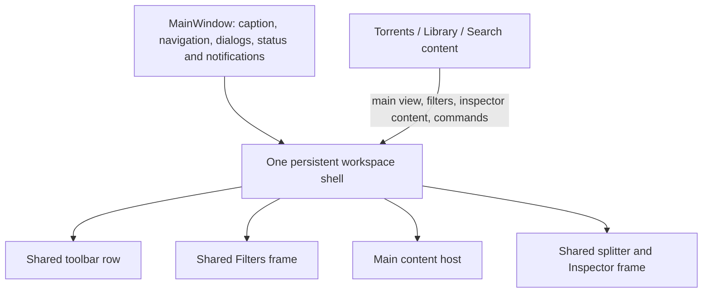

# Shared workspace shell study

Study date: 2026-10-26. Implemented the same day. The decisions below record
what was built and why. The study after them is the original proposal; where
the two differ, the decisions are what the product does. The contracts now
own the behavior: [workspace](../contracts/ui/workspace.md),
[inspector](../contracts/ui/torrents.md#inspector-and-edits) and
[Library menus](../contracts/library/presentation.md#page-and-menus).

## Decisions taken

1. **No new shell type or content interface.** `MainWindow` already had one
   workspace layout: one Filters pane with a content slot per page, one page
   content area with a slot per page, one splitter and one inspector surface.
   Torrents and Library already used it. The differences between pages had two
   causes: the maximized state was stored in the `Pane` control instead of the
   model, and Search had its own private copy of the layout. Fixing those two
   causes gives the same user result with fewer concepts than a new shell.
2. **The model holds three independent inspector facts.**
   `MainViewModel.HasInspector`, `IsInspectorCompact` and the new
   `IsInspectorMaximized` are the user's choices. `UpdateInspectorSize`
   derives what to draw from them. They stay three booleans, not one enum,
   because each must survive the others changing: Close remembers pinned or
   expanded, and Pin remembers maximized for the next expand. Filters already
   keeps its visibility and presentation the same way.
3. **Search uses the shared layout.** Its results view goes into
   `CatalogueContent`. A new `Search.InspectorPane` goes into a
   `CatalogueInspector` slot beside `InspectorContent`, the same way the
   Filters content does. Search's private splitter, height, maximize state and
   arrangement code were deleted, and its Close now uses the guarded
   `HideInspector` path. One renderer fixes the empty Search page hiding the
   inspector and the size and maximize differences.
4. **Each inspector view keeps its own `Pane` frame.** The window sets the
   frame's state from the model and connects its buttons to the same handlers
   in `CreateInspector`. Splitting the 1,184-line torrent inspector into
   header, navigation, actions and body parts was the riskiest step of the
   proposal and gave no guarantee beyond the model-owned state. The trade-off:
   no type stops a page from setting its own pane state; review does.
5. **Only the active inspector receives the state.** An independent review
   pointed out that updating hidden inspector views is needless coupling. The
   host applies the state just before a view is drawn. It detects "opening"
   from the layout it drew last, not from a hidden view's flags.
6. **The Library inspector stays inside the torrent `InspectorPane`.** It
   already shared the host, so separating it is not needed for continuity.
7. **One toolbar above the page content.** Add and Magnet come first and the
   maps and Settings come last on every page. The current page's commands
   fill the middle, so no button acts on another page's hidden selection:
   Library shows Open, Open folder and Properties; Search shows Download
   selected, Download whole torrent and Refresh. Library operations with
   submenus or provider choices stay in the menus. View > Toolbar is on every
   page. A maximized inspector fills the area below the toolbar, so commands
   stay reachable. Download whole torrent now uses the Package icon in the
   toolbar and both menus, because an icon-only toolbar cannot show two
   identical Download icons.
8. **Filters keeps its width per page: 196 DIPs on Torrents, 280 on Library
   and Search.** One shared 280-DIP width was tried. The workspace capture at
   the minimum window width with Filters open showed the Torrents inspector
   header cut off: Pin half visible and Close missing. The owner never asked
   for one width, so it was reverted.
9. **Compact and maximized are not saved in `window.json`.** The request was
   the same arrangement across pages, not across restarts.
10. **Verification.** `Capture.ps1 -Review workspace` checks the changed
    behavior only: state continuity across Search, Library and Torrents, the
    empty Search inspector, one action per pane button, focus after Close,
    and no clipped toolbar command. It passed in about 10 seconds. The
    toolbar's More menu was not exercised, because every page's commands fit
    at the minimum window width. The owner then ruled that checks run only on
    behavior a change touched; [testing](../agents/testing.md#test-only-what-changed)
    holds that rule.

## Recommendation

Use one persistent workspace shell for Torrents, Library and Search. Let each
page supply its main view, filters, inspector content and commands. The shell
owns the surrounding layout and the behavior of its panes and toolbar.

This is justified by existing behavior, not speculative reuse. There are three
real pages with the same arrangement, and separate implementations already
produce different results. Consolidating them gives this module depth: pages
provide their content through a small interface and receive consistent resizing,
visibility, compact/maximized presentation, focus handling and motion.

The important distinction is one shell instance with one set of workspace
choices. Instantiating a shared layout separately for every page would reuse
markup but still allow three independent workspaces to drift.

The user's requirement is that switching pages preserves the workspace they
arranged. I interpret the bottom pane as the Inspector; the application status
bar is already a separate window-wide surface. Settings remains outside this
workspace, as do the existing secondary About, Credits and Connection pages.

## What the source shows

| Area | Current implementation | Consequence |
| --- | --- | --- |
| Filters | One outer `SplitView`, one `Pane`, shared visibility/compact choices; content changes by page. | This is already the right ownership direction. |
| Inspector visibility | `MainViewModel.HasInspector` and `IsInspectorCompact` are shared. | Basic continuity exists, but pages can still override what is rendered. |
| Torrents and Library inspector | One bottom surface and splitter; `InspectorPane.ShowLibrary` changes content inside it. | They already share geometry, though their content is coupled inside one view. |
| Search inspector | Another bottom `Pane`, another splitter, private height and maximize state. | Visibility is partly shared; geometry and maximize behavior are independent. |
| Toolbar | The toolbar row is inside `TorrentContent`; `ShowsToolbar` explicitly requires Torrents. | Navigating away removes the toolbar regardless of its saved visibility choice. |
| Saved layout | One `window.json` writer saves the shared split height and toolbar visibility, but not compact/maximized inspector presentation. | Saving cannot recover all the workspace choices that exist in memory. |

Sources: [outer workspace and toolbar](../../app/src/Shell/MainWindow.xaml#L205),
[shared inspector choices](../../app/src/Shell/MainViewModel/Actions.cs#L103),
[shared Filters choices](../../app/src/Shell/MainViewModel/Finding.cs#L90),
[Library composition](../../app/src/Shell/InspectorPane/Library.cs#L26),
[Search layout](../../app/src/Search/Workspace.xaml#L31),
[toolbar restriction](../../app/src/Shell/MainViewModel.cs#L173), and
[placement writer and shape](../../app/src/Shell/MainWindow/Placement.cs#L273).

Four concrete differences matter to the requested experience:

1. **An open inspector disappears on an empty Search page.** Search calculates
   its rendered visibility as the shared choice AND `Rows.Count > 0`. The View
   menu can therefore still say Inspector is open while the pane is absent.
   Empty results should change the pane's content, not its presence.
   [Search arrangement](../../app/src/Search/Workspace.xaml.cs#L291),
   [View menu](../../app/src/Shell/MainWindow/Actions.cs#L204).
2. **Resizing or maximizing does not carry into Search.** The shared split
   starts at 360; Search keeps its own height starting at 300 and toggles its
   own `Pane.IsMaximized`. Search also lacks the shared splitter's
   drag-to-compact handling. The user has arranged one inspector but encounters
   a second layout policy on another page.
   [Shared sizing and gestures](../../app/src/Shell/MainWindow/Workspace.cs#L480),
   [Search state](../../app/src/Search/Workspace.xaml.cs#L36),
   [Search gesture wiring](../../app/src/Search/Workspace.xaml.cs#L119).
3. **The toolbar disappears and its toggle disappears with it.** Library adds
   its own View choices instead of Toolbar; Search also omits that toggle.
   Showing the toolbar is currently a Torrents-specific presentation choice.
   [Menu construction](../../app/src/Shell/MainWindow/Actions.cs#L214).
4. **The side pane changes width during navigation.** Torrents uses 196 DIPs;
   Library and Search use 280. Even when visibility carries, the main view shifts
   horizontally. For the requested stable workspace, use one shell-owned width.
   The simplest baseline is the existing 280-DIP width needed by the richer
   filters; that trades 84 DIPs of Torrents table width for a stationary edge.
   No new side-pane resizing feature is needed.
   [Page switching](../../app/src/Shell/MainWindow/Library.cs#L174).

The existing contract already assigns inspector visibility, placement,
compact/maximized state, dimensions and departure guards to the workspace. The
proposal completes that ownership for all three peer pages.
[Inspector ownership](../contracts/ui/torrents.md#inspector-and-edits).
The current Library contract explicitly says it has no toolbar; adding one
would be an intentional product change under this request, rather than fixing
a contradiction in that older decision.
[Library menus](../contracts/library/presentation.md#page-and-menus).

## Ownership and the content seam

| Owner | Responsibility |
| --- | --- |
| Workspace presentation in `MainViewModel` | The authoritative visibility and remembered presentation choices. Switching pages does not overwrite them. |
| One concrete host in `Shell` | Render those choices; allocate space; own the actual Filters and Inspector frames, splitter, toolbar layout and region focus mechanics. |
| Each page's existing owners | Rows, selection, query, filter criteria, inspector target and sections, drafts, feature commands, data requests and acceptance of asynchronous results. |
| `MainWindow` and existing `Navigation` | Native window integration, dialog coordination, guarded departures, history and contextual return. `MainWindow` also keeps the existing placement writer. |
| Existing `Pane`, `Splitter` and `Motion` controls | Common rendering and framework interaction mechanics, used by the host. |

This preserves the existing MVVM ownership instead of introducing a second
state store or navigation owner.
[Presentation ownership](../contracts/architecture.md#command-and-presentation-flow),
[navigation implementation](../../app/src/Shell/Navigation.cs#L52).

The content seam should use ordinary WinUI composition: a main content host,
filter content, inspector header/navigation/actions/body, and active-page
toolbar commands. `Pane` already exposes the inspector composition slots; reuse
them. Page contributions should not include another outer Inspector frame,
splitter or show/hide policy. A single composition step selects the active
page's contributions together, so commands and inspector content agree about
which page is active.
[Existing Pane interface](../../app/src/Controls/Pane.cs#L73),
[WinUI content composition](https://learn.microsoft.com/en-us/windows/windows-app-sdk/api/winrt/microsoft.ui.xaml.controls.contentcontrol).

Start with concrete views in the existing WinUI project. A plugin registry,
base-page hierarchy, new project, generic docking system or broad page-lifecycle
interface earns nothing here. A small switch at the shell's composition point
is reasonable; repeated page switches inside sizing, pinning and visibility
logic are the duplication to remove.

Extracting layout alone is insufficient. Library's content currently sits inside
the torrent-oriented `InspectorPane`. Give the Library inspector its own content
contribution while keeping its existing `Browser`, `Details` and commands. Keep
the torrent content with `Torrents`, and Search content with `Search`. These are
three real presentations behind the same shell interface, rather than a growing
inspector class that knows every feature.

Retain the existing lazy creation and reuse of page views. Switching pages
should replace the contributions, not construct a fresh table and inspector
each time; that would lose control-owned scroll and navigation state. Keep
subscription attachment and removal correct when content is attached or detached.
[Retained Library view](../../app/src/Shell/MainWindow/Library.cs#L152),
[Retained Search view](../../app/src/Shell/MainWindow/Search.cs#L77).

## The behavior the shell should enforce

**Navigation changes content without changing workspace choices.** If the user
expands, compacts, maximizes, closes or resizes the inspector on any main page,
that is the state seen on the next main page. Toolbar visibility and Filters
visibility/presentation follow the same rule. Hidden panes retain the
presentation to restore; hiding is not a reset to defaults.

**Page context remains independent.** Returning to Torrents restores its
selection and section, Library retains its configuration and filters, and
Search retains its query and section. Sharing a shell does not make a torrent's
Peers tab into a Library or Search concept. A page without a selection supplies
an appropriate summary or empty state inside the open inspector. Loading,
no matches, unavailable data and selection loss do not close it.

**Selection refreshes content; explicit inspection reveals it.** Keep the
existing distinction between selecting a row and Properties/Enter/double-click.
The latter may show and expand the pane; ordinary selection and later data
replies must not undo Close. Search already passes `open: false` on normal
selection, so preserve that behavior through the new seam.
[Search selection](../../app/src/Search/Browser.cs#L476).

**Every pane gesture reaches one accepted action.** Close and View > Inspector
use the existing guarded hide path. All pages use the same pin, restore,
maximize and splitter behavior. A page requests a change; it does not directly
change the rendered pane or bypass departure handling. Currently Search Close
calls `Model.CloseInspector` directly while the common close action goes through
`HideInspector`; consolidate that route without moving draft rules into a
layout control.
[Search wiring](../../app/src/Shell/MainWindow/Search.cs#L91),
[guarded hide](../../app/src/Shell/MainWindow/Actions.cs#L546).

**Remember the requested size, and fit the available space.** Temporarily
clamping the visible inspector in a short window must not replace the person's
chosen restored height. The existing shared splitter already distinguishes
setting bounds from user changes; retain that mechanism.
[Splitter bounds](../../app/src/Controls/Splitter.xaml.cs#L100).

**Retained views do not imply permanently active work.** Keep the page and
inspector visibility notifications to the existing owners. They continue to
control data requests and reject stale replies. The shell supplies visibility
facts; it does not take over catalogue queries, metadata work or torrent detail
subscriptions.
[Current visibility propagation](../../app/src/Shell/MainViewModel/Finding.cs#L27),
[inspector visibility](../../app/src/Shell/MainViewModel/Actions.cs#L458).

**Settings temporarily replaces the workspace without resetting it.** Back
returns to the same arrangement. Keep the existing connections-map visit and
its temporary layout restoration: a map command deliberately maximizes the
inspector and hides Filters, then Back restores the caller. That workflow must
use the same shell state rather than becoming a second layout implementation.
[Connections visit](../../app/src/Shell/MainWindow/Connections.cs#L38).

## Toolbar design

Share the toolbar's presence, placement, icon presentation, keyboard group and
overflow behavior. Populate it with commands for the current page, using the
same `ICommand` instances as the menus and context actions. Never let Library
or Search toolbar buttons operate on a hidden Torrents selection.

| Page | Suitable commands from existing owners |
| --- | --- |
| Torrents | Existing Start/Stop, folder, Properties, Verify, Remove and map actions, with their current availability. |
| Library | Open, Open folder, Properties, Show in Torrents, Fetch metadata and subtitles; preserve provider choices where the operation has a submenu. |
| Search | Download selected, Download whole torrent and Refresh; retain the distinction between a file choice and a whole torrent. |
| Shared positions | Keep Add file and Add magnet at the start and Settings at the end on all three pages. |

These are a proposed initial selection, not authorization to add new operations.
Local row actions and inspector-tab actions can remain when they serve that
local task; sharing the main toolbar does not require removing every local
button. Keep the existing icon-only ruling, accessible names, tooltips and
native CommandBar overflow. Microsoft's guidance supports both app-level and
page-specific commands and keeping recurring commands in consistent locations.
[Current Library commands](../../app/src/Shell/MainWindow/Library.cs#L270),
[Search commands](../../app/src/Shell/MainWindow/Search.cs#L170),
[toolbar contract](../contracts/ui/workspace.md#toolbar),
[Microsoft CommandBar guidance](https://learn.microsoft.com/en-us/windows/apps/develop/ui/controls/command-bar).

I recommend keeping the toolbar above the content region even when the
inspector is maximized: maximize then fills the region below it. This makes the
user's toolbar choice reliable and leaves page actions reachable. It deliberately
changes the current shared maximization, which hides `WorkspaceContent` and its
Torrents toolbar. Record that change in the workspace contract if implemented.
[Current maximize layout](../../app/src/Shell/MainWindow/Workspace.cs#L492).

## Migration and verification

This is a moderate app-only refactor. Its risk is preserving focus, guarded edits,
retained view state and contextual map returns while moving XAML, rather than
the layout idea itself. It requires no engine, pipe, Library database or
TableView architecture change.

1. Consolidate the workspace presentation state and its existing `window.json`
   save/restore path. Keep old saved fields readable. Add the missing remembered
   compact/maximized presentation alongside them; use sensible defaults for older
   files. Avoid an independent file or settings store for the shell.
2. Move the common arrangement into the persistent shell, extract page content,
   and delete Search's outer Pane, splitter, private height and arrangement
   implementation. Remove the old competing paths in the same change.
3. Move the toolbar row out of Torrents, contribute the other pages' commands,
   and make View > Toolbar use the shared choice on all three pages. Update the
   owning workspace, inspector and Library contracts to the adopted behavior.

Review the resulting source first. The important user journeys are: resize or
maximize on Torrents and enter empty Search; close or pin on Library and change
pages; return from Settings; leave an inspector edit that cannot commit; use a
connections-map visit and Back; and switch pages while detail arrives. These
probe the ownership seams rather than repeating every visual state on every
page. Check that keyboard focus moves to a visible destination after a focused
pane closes or is replaced.

Use the existing navigation checks only if navigation or contextual return
changes. Native focus, transition coordination and toolbar overflow after the
layout extraction are the likely questions that may require a focused app
inspection. Review first, then collect any remaining runtime questions into one
app build and the smallest useful inspection, under the existing
[testing](../agents/testing.md#verification-must-answer-a-question) and
[compilation](../agents/compilation.md#compile-last) policies.

This study was verified against the cited working-tree code and the platform
documentation. No build, test run or application launch was needed or performed.
It establishes the ownership problems and proposed architecture; it does not
claim runtime validation of the proposed shell.
