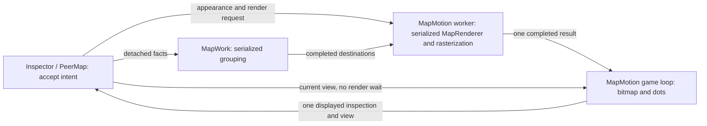

# Rendering and selection

Status: the map handoff is implemented at `e723ae6` and its focused functional
validation passed. The owner reports much better pan/zoom. Preserve this handoff.
The original offscreen reference is frozen at `b20b923`; the corrected-observer
reference is frozen at `ba64259`, with production behavior unchanged. The narrow
peer-snapshot correction is reinstated after correcting its retention reasoning:
it removes unrelated copying; the mixed single-run maxima establish neither a
causal regression nor a marquee fix. Aggregate scope changes now retain shared
Peer identities, demonstrated by the matched focused comparison at `3d2970a`.
Nongeneric native notifications remove repeated sender-ID work at `222e88d`;
sort-key preallocation removes dictionary growth at `78fb43f`. Those results remain
historical evidence; the active correction is now map work on the UI and animation
threads, as specified under [remaining map thread work](#remaining-map-thread-work).
The capture-only observer is corrected and its six-profile reference completed
normally. Do not reopen TableView's publication design; its narrow exception below
permits only work that can and should move off the UI thread.
The map thread-work and displayed-state correction is committed at `fc0916d4`.
Source review, one collected build and one matched city/1,000 docked offscreen run
passed; intended work relocation is demonstrated, but responsiveness remains mixed.
See the [recorded result](../../artifacts/evidence/ui-profile-map-thread-work-20261106-fc0916d4/README.md).
Marker preparation is implemented and measured at `555bd62`; its adverse run is
preserved and is not an accepted performance result. The runtime bookkeeping
correction is implemented at `75af850`; its single matched comparison completed
with mixed results, preserved under [the current review checkpoint](#result-at-75af850-owner-review-required).
The owner requested concrete solutions after that review. The next proposed
implementation is [peer capture and map facts](#next-correction-peer-capture-and-map-facts),
derived from the current source. Review its implementation before another build/run.
Controlled performance acceptance remains unverified. Current behavior is owned
by the contracts linked below.

Purpose: faster input response and smooth animation, supported by comparable
before/after evidence. Active scope: map rendering, interaction and map preparation
on the UI and animation threads. Inspector changes are limited to supplying the
map's detached facts. Earlier table/selection investigations below are retained
for continuity, not instructions to implement them in this round. Owner correction:
TableView work is eligible only if the reviewer or implementer identifies an
operation that **can and should** move off the UI thread: detached inputs, a concrete
blocking cost removed, and simpler or equally clear ownership. Existing native
WinUI updates and UI-affine selectors stay on their owner. This does not authorize
a publication redesign or broad table investigation. Communication remains outside scope.

Owner baseline: the current version is usable and worth preserving. Use this
checkout and its current benchmark work as the starting point; earlier Git
optimization attempts are historical evidence. Retain a correction only when it
delivers its intended result without a confirmed regression in behavior, input
response, navigation/animation or memory on the same workload. This applies to
correctness and bounded-work repairs too; their justification is not permission
to degrade the current app.

Implementation was authorized on 6 November 2026. The implementation lead owns
production changes and comparisons; the existing performance-harness owner owns
fixture setup, recording and measurement endpoints. Use one builder/capture owner
at a time. The [harness guide](../../app/tests/Performance.md) is the measurement
entry point; this plan owns the design and acceptance, and the
[visual review](17-rendering-and-selection-review.html) summarizes it.
Owner direction, 7 November 2026: stop contacting the former reviewing chat.
The implementer presents the review-ready result to the owner and waits for the
owner's review before any further performance change, build or run. Silence is
not approval. The current comparison is complete and ready for that review.

## Execution

Preserve the implemented map handoff throughout: input and presentation use
available compatible content while expensive refinement continues independently.

Owner follow-up, 6 November 2026: while implementing the performance corrections,
investigate the blank space between countries. Adjacent countries should meet at
their shared border rather than look like separated puzzle pieces; the owner
recalls this having been solved earlier. Establish the cause before correcting
it and preserve the map handoff.

Owner follow-up, 6 November 2026: queue white-dot styling after the performance
work and border-gap investigation. Use tiny, softly glowing white location lights
on the dark theme and dark location lights on the light theme, with a subtle soft
halo and no outlined rings. High Contrast uses system colors. Marker-layer caching
remains deferred.

Owner priority, 6 November 2026: make input and rendering fast before broader
memory tuning. Keep memory as a regression guard and flag concrete, blatant
waste. Private commitment, working set and settled retained memory are distinct;
the benchmark peak does not establish a per-peer cost or explain the delta from
an ordinary session. Dedicated memory attribution and tuning remain deferred.

Independent owner follow-up reported by the implementer, 6 November 2026: correct
the moving-files status icon and make its tooltip reachable. Source-complete at
`406fcc8`, independently reviewed against the four-file commit: the existing Move
files glyph is shared by the status and Moving rows; the existing translated
description belongs to the whole icon/rate item, with the label's accessible name
preserved. No new strings, handlers or tests. No build or actual hover check ran;
source review found no remaining question requiring one. This does not change the
frozen `555bd62` performance evidence or close performance acceptance.

Next independent owner follow-up reported by the implementer: in the torrent
column menu, ensure the label is Fit width; give Fit columns, Fit width and Fit
column distinct, appropriate width-only icons; close the menu after precisely
those three sizing commands. The later Fit column request extends the original
two-command request. Preserve other menu behavior and all shipped translations.
The implementer reports that all six catalogues already contain Fit width, from
`d1130dc`; the older screenshot's wording origin remains unverified, so do not
rewrite correct translations. Existing owners/history are being traced; estimate
20–40 minutes. Committed at `67cebc6`. Independent source/contour review of the four-file candidate passed
with no material finding: `Header/Icons.cs` blob `02172dd`, `Header/Menu.cs`
`68d25da`, contract `603bfd5`, existing operation test `5c2a92b`. The reviewer
confirmed that native invocation raises Click before closing, the three wrappers
release the close veto, other actions retain it, and Strip's focus return stays
intact. The generated contour preview shows distinct horizontal icons. Three
closure assertions and reopening steps extend the existing operation test; no
test method was added. No native menu invocation or test-host launch ran. This
source-reviewed correction joins the collected runtime-option build released
below; it does not authorize a separate build or desktop check. This does not
reopen TableView's performance/publication design.

1. **Freeze the baseline.** With the harness owner, record the unchanged code's
   [controlled workload](#controlled-benchmark), source/binary identity, exact
   command, display/DPI, detail/location/arc profile, actual input cadence and raw
   reports. Commit the baseline and preserve its rerunnable binary before
   production edits. **Done:** the workload and procedure repeat, failures and
   missing endpoints are recorded under [measurement handoff](#measurement-handoff).
   A failing product result is a baseline; a changing measurement procedure is not.
2. **Complete the map handoff.** Retain the runtime bookkeeping correction and
   follow [peer capture and map facts](#next-correction-peer-capture-and-map-facts),
   preserving the renderer and presenter. The implementer owns production edits.
   The next diff must demonstrate its publication rules and removed work before
   one collected build/run is released; the earlier mixed result remains evidence.
3. **Correct displayed map state.** Follow [map state](#requested-state-and-displayed-state).
   Adoption, drawing and delayed notification must target the drawn content,
   including frames without dots and subject/detail changes. Keep native table
   gestures and selection behavior unchanged.
4. **Validate the implemented correction.** Use the existing focused workload
   after implementation, distinguishing UI, animation and render-worker time.
   First remove non-GC blocking; consider GC only if it remains a major contributor.
   Do not start another allocation investigation or broad profiling matrix first.
5. **Close acceptance.** Have the harness owner complete the missing endpoints
   needed for each claim; compare the frozen profiles before/after. **Done:**
   every click meets the displayed-frame requirement, navigation, stationary dots
   and marquee meet their independent pacing requirements, first/repeat content
   and Inspector readiness are accounted for, with peak/retained memory checked
   as a regression guard. Broader memory attribution remains deferred.
   Failed or unverified acceptance stays open even when individual corrections
   demonstrate improvement.

No host-sort, binding or TableView redesign project is part of this map round.
Use shared outputs and [testing](../agents/testing.md); compile when source review
cannot answer a remaining question. Current behavior remains owned by
[architecture](../contracts/architecture.md), [peer location](../contracts/peer-location.md),
[torrent Inspector](../contracts/ui/torrents.md) and [TableView](../../lib/TableView/docs/tableview-contract.md).

## Outcome

A torrent or peer selection acknowledges input without awaiting grouping,
projection preparation, geometry, rasterization or a replacement picture.
The map keeps presenting completed content while replacement
content is prepared. New content appears when available. A completed handoff may
contain partial detail: show fewer lines in the next frame rather than wait for
all lines to be ready. Completing visual detail cannot delay input or presentation.
Selection semantics and displayed interaction targets remain correct while
visual refinement is incomplete.

Owner acceptance: a torrent click is visibly reflected in the next displayed
frame. Map navigation, stationary dot animation and marquee movement miss no
presentation deadlines in the controlled benchmark and show no uneven jumps. Measure each
separately; smooth dots cannot compensate for stalled geography. At 60 Hz the
frame period is approximately 16.67 ms; use the actual display refresh rate.

Owner priority: responsive pan/zoom and selection take precedence over dots during
navigation. Keeping dots visible and moving during pan/zoom is desirable if it
preserves responsiveness; pausing or hiding them during the gesture is acceptable
when the alternative is slower navigation. Restoring continuous dots is optional,
not a completion gate. If enabled dots pause or hide, normal animation resumes
when the gesture ends or is cancelled, without another input. Stationary dot
animation retains its separate requirement.

The next-frame requirement applies to the selected torrent row's visual
acknowledgment. Inspector data preparation has a separately measured completion
time and cannot hold that acknowledgment. Trace from native input delivery,
including dispatcher queuing, to the actual displayed selection. A fast handler,
a rendering callback or an unchanged frame is not evidence of visible response.

Native selection, accessibility, drag gestures, unfinished-edit protection and
the retained Inspector remain intact. This does not change when an existing
gesture commits. Native control updates still run on the UI thread; detached
calculation and native map rendering run elsewhere.

## Measurement handoff

The existing harness records each run; the implementer compares reports and
records the correction's result. Its current diagnostic endpoints support useful
before/after evidence while final acceptance may remain unverified. Use the same
recorded fixture, detail/location/arc profile, input schedule and configuration.

Every comparison includes responsiveness and process memory. Add phase timings,
traversal counters, allocation/GC or native-resource probes only when needed to
identify or verify the selected cause; they are not a required set. If diagnostics
change, remeasure the baseline with the same diagnostics. External recording can
use the preserved reference binary directly. New in-process probes require
rebuilding baseline and changed source with identical diagnostic-only changes
and build settings, then comparing those matched builds. Preserve the original
reference binary and record the source revisions and diagnostic changes used.

| Measurement | Existing harness | Remaining work and owner |
| --- | --- | --- |
| Click feedback | Native stimulus timestamps, selection events and XAML render completion, including p95. | Harness owner serializes completed/superseded/unselected/unobserved outcomes per click. Its current one-refresh p95 XAML budget remains diagnostic; it cannot certify every next-frame highlight. |
| Displayed selection | PresentMon surfaces and OS input-to-display observations, without identified highlight pixels. | Harness owner correlates each native click with its row highlight in the first following displayed frame on the correct surface before claiming next-frame acceptance. |
| Inspector readiness | Final selected torrent's row/map settlement. | Harness owner records accepted subject, corresponding published rows/map readiness and supersession for each click, without delaying later input. |
| Motion | Per-surface displayed timing, changed map views, dot draw/progress observations and marquee geometry at XAML completion. | Harness owner correlates the affected visible content with presentation for final geography/dot/marquee pacing claims; moving unrelated content cannot stand in for it. |
| Memory | Externally sampled UI-process private bytes and working set; these include the fixture and exclude GPU VRAM/other processes. | Compare startup, peak and retained use after repeat visits settle; sampled growth alone does not establish a leak. |
| Stall attribution | Overall phase endpoints and native map operation elapsed times. | Architecture lead selects additional probes under the measurement rules above, using the candidate owners below. |
| Workload setup | Static 50-torrent fixture and profiles in the harness guide. | Harness owner records mixed queue participation and adds the focused telemetry variant before comparing update-driven corrections. |

Demonstrated improvement names the measured endpoint and remaining limits.
Reduced XAML completion time is a diagnostic improvement; it becomes evidence of
visible response only when correlated with content. Final next-frame acceptance
is per click, not a p95 threshold. Keep missing acceptance endpoints explicit
while fixing costs the current measurements can already establish.

Judge a correction against its predicted effect at the operation it changes.
Verify the executed source/binary, workload and measurement endpoint before
interpreting a discrepancy. If the predicted reduction is absent, diagnose the
implementation, workload, measurement or assumption. If the local saving is
present but interaction still stalls, locate the remaining bottleneck. Preserve
adverse observations and reject demonstrated regressions; a different single-run
maximum alone establishes no causal regression. Do not repeat a matrix until it
looks favorable. Use existing evidence, then the smallest matched check that can
decide the remaining uncertainty.

Preserve experiments before backing them out. For uncommitted code, stash only
the candidate's owned paths under a descriptive name; retain its evidence and
recovery reference. Keep the stash when applying it, and never apply it over
another experiment or include unrelated shared changes. Committed candidates
remain recoverable by commit even after a revert.

## Findings

Current map review uses `e723ae6`; the TableView findings below remain in the
working tree. The older `707999a` comparison found native rendering ahead of
presentation, split bitmap/scene publication and interaction-dependent grouping.
Those are resolved by the implemented handoff and are not current defects.

| Area | Confirmed behavior | Consequence |
| --- | --- | --- |
| Displayed map state | `OnUpdate` queues an inspection callback; `OnDraw` separately publishes the displayed view. PeerMap also reconciles pointed destinations to newly grouped facts. | Same-subject updates can make pointer/keyboard targets refer to content other than the drawn picture. Subject guards do not exclude this race. |
| Committed selection | Internal `SelectedItems` reads the public getter, which can return a future-view request. | Accessibility, context, drag and invocation can consume pending intent as though it were the current selection. |
| Table selection | Pointer selection commits immediately, but UI Automation uses the public setter, which defers during view preparation. | Accessibility interaction on displayed rows can wait for unrelated preparation. |
| Reentrant selection | A selection callback during projection can queue a correction while `_preparingView` remains true; same-version completion need not drain it. | Requested and committed selection can diverge. |
| Row visuals | Repeated `CanStartDrag` queries enumerate the host's unfiltered numbered order until finding its second participant. | Cost depends on participant positions and query frequency; the alternating fixture needs only three rows per query. Participation can change without a view publication, so caching also needs a narrow refresh. |
| Table projection | Capture and collection-edit publication run synchronously on the UI thread around worker preparation. | Input can queue behind those phases even though sorting is on a worker. Their actual contribution needs attribution. |
| Render relevance and budget | `MapRenderer.Prepare` visits submitted destinations and ranks active routes before the later `Draw` intersection cull. Some first-realization and uncovered-fill paths can exceed the soft rebuild budget. | A background thread and a drawing clip alone do not bound unnecessary preparation or shared-device pressure. Attribute these paths; preserve presentation over available content while detail is deferred. |

The direct pointer-selection call chain contains no drawing-readiness wait.
Synchronous event subscribers still execute inside that call until they yield.
Current host selection handlers already defer Inspector work; keep this path
short rather than introduce asynchronous selection events.

## Map ownership

The implemented map module already separates input, grouping, image production
and presentation. Its interface submits detached facts and current intent, then
consumes completed content. Keep these owners and handoff seams. Their locality
keeps mutable native resources on one worker; their leverage is that every
gesture uses the same presenter. A generic scheduler or adapter adds no depth.
The [peer-location contract](../contracts/peer-location.md) owns the implemented
rendering, cancellation and retirement rules; this plan adds the remaining
thread-work and displayed-state corrections within the same implementation.

### Remaining map thread work

Owner clarification, 6 November 2026: map work comes first; the narrow TableView
exception above applies only to work that can and should move. These are confirmed
source paths, not proof that any one explains the entire stall. GC suspension
overlaps sampled wall time; 500 ms minus 99 ms is not an exclusive CPU attribution.

The following three corrections and the displayed-state correction are implemented
at `fc0916d4`; retain their requirements rather than implementing another version.

1. **Remove the duplicate map capture from the UI.** `InspectorPane.RefreshMap`
   queues a UI callback; `Inspector.UpdateMap` then calls `MapModel.Update`, which
   reads every peer and constructs `Observation[]` before grouping starts. Reuse
   the immutable `(Peer identity, Location, Peer.Record)` facts already captured
   by `Inspector.Filter`. Build observations in that existing worker pass from
   the full subject, not the place-filtered rows. Publish them only with the
   accepted subject/version and notify the map on arrival. `MapModel.Update`
   accepts the completed snapshot reference plus small UI-owned settings; it
   never enumerates peers. Settings-only changes reuse those observations.
   Initial load, telemetry, location resolution and scope clearing use this one
   path; adapt capture fixtures to the same input contract. Keep input immediate
   and compatible old content available. Never label an old snapshot with a new
   subject. This removes the duplicate map scan, not the existing Inspector
   capture. Do not read live Peer getters on workers or add a mutable peer store.
2. **Move native preparation and retirement to the render worker.** `MapMotion`
   creates render targets, brushes and geometry lazily in `Mark`, `Dot` and `Ring`
   during drawing, and disposes these resources in `OnStopped`. Prepare these
   existing small resources on the render worker for its device/DPI and carry
   immutable references with compatible completed content. Retire them through
   the existing worker return path only after every pending/shown user releases
   them, including device replacement and shutdown. The stopped callback releases
   ownership and signals completion; native destruction runs on the worker.
   Move device/DPI native queries outside the handoff lock. The lock protects
   reference exchange only; no UI or animation callback waits for the worker.
   Add no marker-layer cache, resource framework or second rendering path.
3. **Remove repeated preparation from presentation.** `MapMotion.Apply(Traffic)`
   constructs a membership set and LINQ arrays; `MapDots.Update` rebuilds a lane
   dictionary on the animation thread. Prepare immutable route membership and
   rate inputs with `Traffic` on the existing render worker. Adopt those facts
   once per traffic revision, retaining surviving lanes and flight state instead
   of rebuilding their collections. Preserve `Advance(now)` before changing rates,
   so elapsed traffic is counted at its previous rates. Mutable phase and carried bytes remain owned
   solely by the game loop; workers must never mutate its simulation. Per-frame
   work remains advancement and drawing within the existing arc/dot limits.
   `PeerMap.CaptureSelection` must also reuse its captured selection until selection
   or its locations change, instead of copying it again on preparation completion.
   Report `DrawMarks`' remaining destination traversals explicitly: visible marker
   drawing remains presentation work. Preserve marker/ring layer order; do not
   drop markers, claim constant-time drawing or add a cache to hide this work.
   No additional scheduler or generic change framework.

One focused implementation/review/build/profile round completed. Resource lifetime
and stale subject publication received source review; the ordinary replay did not
force every device/DPI or stale-result interleaving. Borders and light styling remain
queued in their recorded order. The unbuilt TableView capacity candidate remains
deferred. The later blocking-GC evidence selects the narrow runtime correction below.

**Review before building:** the implementer reports changed files and, for every
operation above, the calling thread, immutable inputs, publication owner and
retirement owner. Name remaining population-sized loops and waits. The reviewer
traces callers through the first await/dispatch and checks disposal; `Task.Run`
alone does not establish separation. Review the focused diff before the one
collected build. Update the peer-location contract to the implemented ownership.

**Validate after implementation:** reuse focused existing checks for stale subject
publication, selection freshness, device/DPI changes and unload with work pending.
Add only a missing regression tripwire for stale publication or early disposal;
no timing unit tests, allocation microbenchmarks or coverage matrix. Then use one
existing failing map journey to establish whether UI/animation gaps fell and what
still blocks them. Current desktop/capture restrictions remain. Source review
establishes ownership; runtime evidence establishes speed. GC tuning follows only
if GC is a major residual cause. Moving work off-thread does not itself guarantee
presentation deadlines or eliminate shared graphics contention.

### Result at fc0916d4

One matched Replay/InputOnly city/1,000 docked run applied all 1,467 commands and
acknowledged all 21 presses, with no unselected click and three unobserved XAML
completions. Received sampled inclusive UI `MapModel.Update` time changed
1,509.91 → 5.90 ms; game-loop traffic adoption changed 1,029.23 → 127.25 ms.
These journey totals corroborate relocation, not exclusive CPU savings.
Navigation/marquee diagnostic maxima improved, but click completion, delivery
delay, first map observations and worst stationary dot gap worsened. Peak private
commitment fell 1,369.47 → 1,245.14 MiB. Keep all adverse results in the linked
report; one mixed run establishes neither overall success nor causal regression.

The trace lost 248 events. The reported 374.54 ms marquee maximum is the last
geometry-to-phase-end tail; the largest interior geometry gap is 211.54 ms.
Native table publication, layout and marquee `TransformToVisual` remain costly,
but those calls require the UI owner; moving them to a worker is not a valid fix.
No new TableView change is selected. Displayed-frame acceptance and forced
device/DPI/retirement cases remain unverified. The capacity experiment remains
preserved in stash `920418455bfcdd201bc1b6393b1436b13eeebc61`.

### Implemented correction: marker preparation

The focused implementation passed source review with no material finding and was
committed at `555bd62`. Review record: `V:/temp/plan17-marker-preparation-reviewed.md`.
One build and matched permitted run completed; the adverse result is recorded
below. The following requirements describe that implementation, not a new task.

Before this correction, `DrawMarks` received about 31.7 seconds of sampled inclusive
time across each journey. Source tracing identified work that need not run per frame:
destination coordinates relative to the completion's meridian, selection/hover
classification, highlight colors and conversion to sprite tint vectors. Existing
trace stacks also contain sprite-call interop and unmanaged time; this correction
does not claim to remove the whole drawing cost.

Prepare one immutable set of marker draw values on the existing render worker,
carried by `Completed` alongside its inspection. Each location needs its projected
map coordinate and prepared fill/edge colors; retain the marked/pointed subset
in original order for the later ring pass. Use the existing `Highlight` rules
once here. No second classification rule or new module is needed. Refresh these
values when destinations, meridian, palette, High Contrast or highlight changes;
reuse them for view-only movement, fade refinement and unchanged marker facts.
Both fresh drawing and the rate-only `completed with` publication must carry
values matching that completion's input and inspection, independent of bitmap reuse.

The game loop only wraps the prepared coordinate around the current view centre,
applies the current transform, culls and submits the existing native draws. Keep
fixed DIP sizes and the current origin → all markers → rings → arcs → moving dots
order. Never store screen positions that become stale while panning. A completion
with no map input has no markers. Keep prepared data bounded by the existing
completion lifetime; add no marker-layer bitmap/command-list cache, queue, spatial
index or generic caching framework. Native draws and their visible-marker loop
remain presentation work and must stay explicit in the ownership report.

This is one focused implementation/review/build round, estimated 1–2 hours.
Send the diff and ownership report before building. Review wraparound, High
Contrast, selection clearing and rate-only publication from source; no new test
matrix. After implementation, one matched existing workload answers whether this
removed work improves pacing without regression. No new profile before coding.
If native marker submission remains dominant, report that limit rather than
claiming that this preparation change solved it; marker-layer caching still needs
the owner's deferred decision. Broader memory tuning remains deferred; the
specific blocking collection below now meets the owner's major-source condition.

### Result at 555bd62 and current diagnosis

The [preserved comparison](../../artifacts/evidence/ui-profile-marker-preparation-20261106-555bd62/README.md)
contains the one matched city/1,000 docked Replay/InputOnly run. All 1,467 commands
and 21 selection acknowledgments completed; nine XAML completions were unobserved.
Compared with `fc0916d4`, navigation maximum increased 252.84 → 627.54 ms, click
completion 206.80 → 452.81 ms and stationary-dot p95 27.85 → 90.95 ms. Worker
marker preparation received 139.58 ms across the journey, but sampled inclusive
marker drawing increased 31,683.52 → 34,323.32 ms. Relocation is established;
overall improvement is not. Do not claim success, automatically revert or retry
for a favorable result. The trace lost 540 events; attribution is incomplete.

The current worst marquee interval is an interior geometry pair of 610.5884 ms,
not the earlier run's phase-end tail. A received induced generation-2,
nonconcurrent GC-associated Suspend→Restart span overlaps 539.4337 ms of that
gap; its trigger is UI thread 17020. This now satisfies the owner's condition for
investigating GC as a major remaining source. In the same interval, the render
worker waits on its semaphore. The game thread's sampled COM-wrapper monitor wait
and the finalizer's native release overlap the collection: they do not establish
additional independent stalls or a lock owner. Do not add those durations.

Source tracing identifies a plausible framework trigger. Local WinUI
`CCoreServices::TrackMemory` runs during a render walk, periodically checks process
working set through `CWindowsServices::GetMemoryCount`, and requests collection
after growth above its 50 MiB threshold. `JoltHelper_TriggerGCCollect` forwards to
`ReferenceTrackerManager::TriggerCollection`, then the runtime tracker host. The
[.NET 10.0.12 tracker host](https://github.com/dotnet/runtime/blob/v10.0.12/src/libraries/System.Private.CoreLib/src/System/Runtime/InteropServices/ReferenceTrackerHost.cs#L21-L35)
calls `GC.Collect()` for that default request. A subsequent read of the preserved
raw trace resolves the managed caller: `GC/Triggered` at 47,143.9884 ms, UI thread
17020, carries `ReferenceTrackerHost.IReferenceTrackerHost_DisconnectUnusedReferenceSources`
under `Microsoft.UI.Xaml.Application.Start`. This confirms the tracker-host
collection, rather than an explicit app collection. Native frames do not identify
which WinUI caller entered it; the working-set heuristic remains a candidate.
`Runtime/Start` identifies the loaded runtime as .NET 10.0.12. GC 163 reports
200,468 objects promoted for finalization and 1,105,232 handles; those counts do
not identify their individual owners or establish that all are unnecessary.

### Next correction: runtime wrapper bookkeeping

The reviewer found a concrete runtime defect, independently of whether it explains
the whole pause. The installed .NET 10.0.12 `System.Private.CoreLib.dll` was read
with ILSpy: `ComWrappers.RegisterManagedObjectWrapperForDiagnostics` unconditionally
appends the same holder again on every COM-interface lookup, including cache hits.
The list lives as long as its managed key. The preserved `78fb43f` allocation trace
contains this path, with 84.94 MiB of received allocation-tick amounts, including
39.50 MiB of holder arrays. These are sampled churn, not exact retained bytes.
The defect and repair are recorded in [runtime issue 129191](https://github.com/dotnet/runtime/issues/129191)
and [fix 133260](https://github.com/dotnet/runtime/pull/133260). The installed binary,
not the merged upstream fix, decides applicability: its duplicate check is absent.

Implement one Release-only `RuntimeHostConfigurationOption` in
`app/src/TinyTorrent.csproj`: `System.Diagnostics.Debugger.IsSupported=false`.
Use the existing runtime-option pattern, not a startup hook or runtime patch.
The installed `Debugger.InitializeIsSupported` reads this AppContext switch;
the wrapper-registration method then returns before the faulty diagnostic table.
Its normal identity cache, reference-counted handles and WinUI lifetime tracker
remain active. Debug builds retain the default. The tradeoff is reduced COM-wrapper
inspection for debuggers in Release; do not disable EventPipe or use the broader
`DOTNET_EnableDiagnostics` switch, change trimming, or change GC policy.
Add a brief reason and upstream reference at the option; no abstraction or test.

Review gate, 6 November 2026: the actual six-line project diff, blob prefix
`9163ba0`, passed independent source review with no finding. Release and
Release/Capture include the option, Debug excludes it, and the existing replay
option remains unchanged. **One collected `Build.ps1 -App -Capture -Release`
and one matched city/1,000 docked Replay/InputOnly CPU+GC run with a 16 MiB buffer
are released to the implementer.** Inspect and preserve the generated runtimeconfig
before the run: this switch must be false and the existing replay option true.
Include the reviewed UI commits `406fcc8` and `67cebc6`; record them as additional
source differences against frozen `555bd62`. No separate native UI test/window,
capture, favorable-result retry or additional workload is released. Report the
build and comparison results here before another change or run. That source
review alone does not close performance acceptance; the completed result follows.

Build/preflight update: the exact project change is committed at `75af850`.
The [preserved build report](../../artifacts/evidence/ui-build-runtime-bookkeeping-20261106-75af850/README.md)
records a successful collected build with only the existing CapturePerformance.cs
CS8602 warning. The reviewer read the preserved runtimeconfig and verified the
false debugger switch and true replay option. Initial preflight found the installed
TinyTorrent outside this checkout; Capture.ps1 refused that instance because it
owned the same logon pipe. That interruption created no measured trial or retry.
On 7 November the implementer reported the owner's explicit authorization to close
the installed UI and engine, closure of the verified processes, and continuation
with the one released comparison from the preserved `75af850` binary. The original
unused destination was `ui-profile-runtime-bookkeeping-20261106-75af850`.
The comparison has now completed there; its preserved results follow. No rebuild
or extra workload is released. Owner review is required before further work.

This is one small implementation/review/build/comparison round, estimated 30–60
minutes including the existing comparison. The implementer owns the project
option and any necessary contract note; the former reviewer owned this plan and
HTML during that round. The owner now reviews the preserved result. Source review must verify Release/Capture inclusion,
Debug exclusion and unchanged lifetime/diagnostic collection paths. Then collect
the pending approved edits into one build, inspect the generated runtimeconfig,
and run one existing matched offscreen workload against preserved `555bd62`.
Open runtime question: does removing this known growth reduce pauses/memory without
losing behavior or trace evidence? An adverse result keeps performance acceptance
open; no favorable-result retry or automatic revert. Keep all raw results and
record other source differences in the candidate. Do not claim this disables
framework-induced collections or guarantees a shorter pause.

No TableView publication redesign, manual collection, lifetime bypass or new cache
is authorized. Moving allocations to another managed thread does not isolate its
heap from GC. Border gaps and themed location lights retain their queue order.

### Result at 75af850: owner review required

The single released city/1,000 docked Replay/InputOnly CPU+GC comparison completed
on 7 November 2026. The owner explicitly authorized closing the installed UI and
engine; only those verified installed processes were stopped. All five preserved
binary/configuration hashes matched before launch. Replay and tracer exited 0;
no task-owned TinyTorrent or tracer remained. There was no desktop input,
activation, screen capture, UAC, rebuild or retry. The full rerunnable build stays
at its existing checkpoint. The [result and raw evidence index](../../artifacts/evidence/ui-profile-runtime-bookkeeping-20261106-75af850/README.md)
freeze this comparison against `555bd62`, including the two reviewed UI commits
as additional source differences.

The normalized workload matched and all 1,467 commands were delivered. No click
selection was unacknowledged; XAML feedback was unobserved for 6 clicks versus 9
in the reference. Navigation draw worst improved from 627.5408 to 469.2882 ms,
marquee sample worst from 610.5884 to 282.0767 ms, and command-delivery worst from
676.8588 to 408.64 ms. Peak private commitment fell from 1286.14 to 1206.40 MiB.
Other results worsened: click-to-XAML worst 452.8081 to 501.6855 ms, first aggregate
connections 8189.5807 to 9053.9777 ms, first selected connections 462.6479 to
1266.3375 ms, and stationary dot draw worst 310.0855 to 381.2777 ms. Post-click map
settlement improved from 3348.1284 to 1477.8854 ms. These are mixed single-run
measurements, not a causal regression finding or performance acceptance.

The largest interior marquee gap is 282.0767 ms, with 30.36 ms of received
GC-associated suspension overlap, 81.285 ms inclusive sampled layout and an
unresolved 130.442 ms native interval. Do not add overlapping intervals. The
trace lost 1,126 events, so attribution is incomplete. Stationary no-selection
dots were visible in 112/112 sampled draws with 108 advancing same-dot pairs and
zero frozen pairs. Draw timing and XAML completion do not establish displayed
FPS, physical-input latency or next-displayed-frame selection. Final private
memory is not settled retained memory.

**Stop for owner review here.** No next performance correction or additional run
is selected or released. Keep the preserved evidence and runtime correction;
do not retry for favorable maxima or automatically revert a mixed result.
Country borders and themed lights retain their queue order after performance.

Review requested by the owner, 7 November: **retain the runtime correction;
do not accept overall responsiveness yet.** It removes source-confirmed duplicate
bookkeeping with one project option. The lower observed memory and several better
maxima support retaining it, but do not establish a general speedup or causally
attribute the adverse endpoints to this option.

The reviewer checked the preserved raw timing and GC events. The 381.2777 ms
stationary-animation gap overlaps 373.5200 ms of an induced generation-2 suspension
triggered on the UI thread. Its sampled native drawing stack therefore cannot be
read as 381 ms of drawing cost. Six induced nonconcurrent generation-2 starts are
received across the candidate journey versus seven before; their largest paired
suspension is 373.52 ms. GC remains a major animation blocker, even though only
30.36 ms overlaps the worst marquee gap. Across the entire marquee, received
GC-associated overlap is 534.49 ms of 2,003.85 ms. Event loss still limits attribution.

Click maxima also have different observed populations: candidate click 16 supplies
501.69 ms but had no baseline XAML endpoint. Of the 11 click ordinals observed in
both runs, worst completion is still 452.81 → 482.94 ms. Thus differing observations
do not erase the adverse result, and one run does not establish its cause.

That review did not release another run. The owner's subsequent request for
solutions selects the source-backed proposal below. Do not reopen marker
preparation or TableView publication on the strength of inclusive native samples
alone. Review record: `V:/temp/plan17-75af850-checkpoint-review.md`.

Read-only follow-up: [preserved delay attribution](../../artifacts/evidence/ui-profile-runtime-bookkeeping-20261106-75af850/plan17-reviewed-delay-findings.md)
separates delivery, selection and XAML completion. Candidate click 21 totals
482.9419 ms with 13.8477 ms received GC overlap; selection itself is 1.7166 ms.
Its delivery interval includes fixture summary/row-binding notifications, while
post-selection samples include publication, layout and unresolved native time.
These inclusive samples do not select an avoidable operation. Aggregate
first-content timing overlaps 2456.2640 ms of received GC suspension out of
9053.9777 ms. Current allocation ownership remains unproved. No production edit,
build, app launch, new trace or workload accompanied this analysis; the owner's
review gate remains in force.

### Next correction: peer capture and map facts

**Problem and mechanism.** `Inspector.Filter` builds its complete peer tuple array
on the UI thread before `Task.Run`, then the worker builds a second array and one
`MapModel.Observation` object per peer. `ApplyPeers` also filters the complete
current peer list and captures the matching torrent's records before its worker.
These traversals require no WinUI access. At the controlled aggregate size,
each Filter creates 159,810 individual Observation objects in addition to both
full-size arrays. `Observation.Peer` is never read by the map. Remove this work
and allocation directly; no new profiling run is needed to establish that it exists.

**Implementation, one owner for each fact.**

1. In `app/src/Shell/Inspector/Peers.cs`, the UI side of Filter takes only the
   existing peer-list reference, previous/release-list references, place, subject
   and generation. Preserve its immediate unfiltered ShownPeers notification.
   Move the peer traversal and fact capture inside its existing Task.Run.
   Move ApplyPeers' `current.Where(...).Select(...).ToArray()` into that method's
   existing worker as well. Keep parsing/reconciliation there and notifications
   on the UI thread. No extra task, scheduler, timer or delayed batch publication.
2. In `app/src/Torrents/MapModel.cs`, replace the reference-record Observation
   with a readonly record struct containing only Location, Down, Up, Role and
   State. One constructor from the captured immutable Peer.Record and Location
   owns extraction of these values. Remove Peer and Record storage from the
   observation. The worker fills one exact-size Observation array, uses the same
   observations and the corresponding immutable peer-list entries for place
   filtering/counts, and returns that very array in Population. Do not retain a
   temporary tuple array or convert one whole-population array into another.
   Existing map consumers keep their current value properties and grouping rules.
   Update `CapturePeers.cs`'s existing population helper for the constructor;
   no capture-only alternative implementation or new harness.
3. In `app/src/Torrents/Peer.cs`, publish replacement Record and Location
   references with Volatile.Write, and use Volatile.Read in the worker-facing
   capture/location reads. Keep property notifications and other UI getters on
   their present owner. Workers may read immutable facts and stable identity;
   they must not read display formatting, Strings state or WinUI controls.

**Coherence before publication.** Peer membership is already published as lists
that are never modified in place; reconciliation creates a replacement. Retain
that rule. Record updates occur in ApplyPeers' UI continuation; location updates
occur in LocatePeers' UI continuation. Invalidate the existing filter generation
before each nonempty mutation batch, before any PropertyChanged callback can run,
then retain the existing Filter call after the completed batch. A worker can see
old/new immutable references while that batch runs, but its obsolete result must
never be accepted. Keep the generation and subject checks immediately before all
Filter result application, and the existing context/cancellation checks before
ApplyPeers application. Subject or place changes still invalidate old work.
Preserve PeersReady completion for the latest request and peer-release semantics.

Review these orderings explicitly: result accepted before a mutation; mutation
before queued acceptance; mutation during capture; a new place/subject while
capture runs; and clearing/closing the Inspector. In every case, either the
accepted facts belong to the still-current request or the result is discarded.
Do not move a live mutable collection to a worker or read several live Peer
properties as a substitute for capturing its immutable Record once.

**Scope and proof.** This is a single focused implementation/review round,
estimated 1–2 hours before the collected build/comparison. It touches the above
four source files and their existing contract text only. No TableView change,
GC policy, object pool, generic cache, new rendering path or new test suite.
Before building, the diff must show both scans below Task.Run, no per-peer
Observation allocation and no second full-population array. Source review covers
publication races and existing capture consumers. Use an existing stale-subject
tripwire if it needs adjustment; add no timing/allocation coverage matrix.

The theoretical guarantee is removal of these synchronous UI traversals and
per-peer map snapshot objects. It reduces a concrete source of allocation pressure;
it does not guarantee that WinUI stops requesting collections or that all pauses
disappear. After the complete diff passes review, one matched comparison against
preserved `75af850` can assess responsiveness and memory. Do not run another
exploratory profile first. Native UI notifications remain UI work, and their
remaining cost must not be described as removed by this correction.



| Owner | Authority |
| --- | --- |
| Inspector, UI | Accepted peer subject and place filter. Its scope identity changes when the actual subject changes, not on each read or telemetry refresh. |
| TableView, UI | Effective peer row selection. Pending programmatic selection is a distinct documented request. |
| PeerMap, UI | Requested viewport, current chosen destination and hover/keyboard intent; captures UI-affine values. |
| MapWork, serialized worker | Grouping and estimated placement from detached observations. Returns destinations, not interaction state. |
| MapMotion render worker | One mutable MapRenderer, geometry, marks and offscreen rasterization. |
| MapMotion game loop | Adopted completion, per-frame viewport, moving dots and presentation resources; publishes the detached displayed inspection/view together. |

### Independent progress

Input replaces one latest-request slot and signals the dedicated worker. The
below-normal worker completes a useful pass, publishes it and takes the newest
request. It waits when idle or until the next fade step; do not replace it with a Task.Run
pump or polling. Native allocation, disposal and drawing stay outside the short
handoff lock. The UI never joins this worker.

Blocked grouping must leave navigation/rendering over the last completed facts
available. Blocked rendering must leave input and presentation over the last
completed picture available. The presenter does no geography preparation or
offscreen rasterization.

Retain the implemented raster transform, longitude wrapping and one-eighth
viewport margin at every edge. Geography moves immediately while exact content
is prepared. Static strokes/glows and sampling temporarily scale; markers,
rings and dots retain their DIP sizes. Coverage, replacement continuity and
visual quality through the owner's 128x journey remain empirical gates. Add no
mandatory overview, tile cache or alternate representation without a demonstrated
failure of this baseline.

### Present available content; prepare only what can contribute

Owner ruling: a frame never waits for complete visual refinement. `MapMotion`'s
game loop presents the available compatible picture and, when animating, advances
dots without joining grouping or rendering. The render worker publishes useful partial detail
through the existing completion handoff, then refines it on later passes. Existing
cached detail can remain coarse; missing lines can appear later. An empty first
cache is not permission to require a complete scene before first presentation.

Restrict work at its existing owner, before expensive preparation:

- Inspector/PeerMap captures peers for the active subject. A single-torrent view
  does not capture or group the other 49 torrents' peers for rendering. The global
  map legitimately includes all 50; reuse its grouped facts across frames rather
  than re-enumerating all peers during each pan or dot update.
- MapRenderer rejects geometry outside the current view and retained margin
  before tracing, tessellation, brush creation or refinement. Include routes
  crossing the view even when their endpoints are outside it, with longitude
  wrapping and glow bounds. Keep the product's fastest-arc policy; viewport
  rejection does not redefine which routes qualify. Reuse prepared facts and
  cheap bounds; add no spatial index unless measured query cost requires one.
- Use the existing worker's rebuild allowance and pending-work continuation to
  defer unfinished detail. Audit first-realization and coverage-replacement
  exceptions, and the largest native operation, rather than assuming the soft
  allowance bounds every pass. If a native unit demonstrably blocks presentation,
  reduce or split that unit at the renderer; another thread does not solve shared
  graphics contention. Prioritize visible selected content over decorative
  refinement. Do not accumulate requests or finish obsolete offscreen detail
  ahead of the latest relevant view. Finish a bounded useful unit, then take
  work for the latest view; restarting all compatible work on every motion
  would prevent detail from ever arriving.

For a selected relevance or render-budget cost, choose only the capture/grouping,
rejection or geometry counts needed under [measurement handoff](#measurement-handoff).
The focused view must show no render preparation of unrelated torrents' peers;
steady pan/dot frames must not rescan the population. Check overloaded first
appearance as well as cached navigation, and report first useful content
separately from completed detail. Inspection must describe the content actually
presented, including any partial pass, using the displayed-state correction below.
Keep these decisions inside the existing map module, with one renderer and one
completion interface.

### Requested state and displayed state

The worker already publishes one immutable completion with bitmap, source view,
background, scene, inspection/marks and provenance. Keep that metadata separate
from the reusable bitmap. Compatible navigation, appearance, rates and same-subject
membership coalesce while useful work finishes. Existing subject, detail and
surface guards reject incompatible completions without demanding that every
completion match the newest soft request. Origin changes cancel native rendering
when replacement grouped facts reach it; grouping can first finish an older
coherent origin. Do not describe that as immediate cancellation of every stage.

The remaining race is between adoption, drawing and queued UI notification:
completion B can supply inspection while A is still drawn, or B can be drawn
while the UI still holds inspection A. Updating `_pointed` from newer grouped
facts creates the same problem for keyboard actions and descriptions.

Replace the independent inspection, display-mark and displayed-view authorities
with one detached displayed value containing inspection (including marks), view
and existing provenance. Publish it after the matching drawing operations
succeed, including paths with no flying dots. This records submitted drawing;
it does not by itself prove physical scanout.

Each pointer, keyboard, choose, reveal or description operation captures that
value once, checks the existing live subject/detail/lifetime guards and resolves
current chosen/pointed keys within its destinations. Never use a newer grouped
Destination as a displayed target. Retained imagery from an old subject cannot
select its replacement's peers. Current UI intent remains immediate and never
comes back from grouping. `MapModel.Presentation.Marks` remains the one worker
calculation. Notifications may refresh help text from current displayed state;
they cannot install captured target state. No bitmap retention, per-frame UI
event or additional frame protocol is needed.

### Resources and remaining empirical gates

Keep the implemented worker-only bitmap reuse/disposal and reference accounting
for cached, pending and shown completions. There are at most three distinct
full-size targets; recycled metadata cannot become current through bitmap
identity. Native geometry and buffers retire after their users stop. Only the
worker awaits game-loop retirement; the UI does not. No source-proven lifetime
regression was found in the restored cache policy.

The margin makes each target dimension 1.25 times the viewport, or 56.25% more
pixels per target. When changing render targets, report allocated pixel dimensions,
count and DPI; BGRA8 target bytes are width × height × 4, separately from geometry,
effects, device and swap-chain memory. A target-count bound is not a claim of
unchanged RAM.

Use the [measurement handoff](#measurement-handoff) for memory comparisons and
conditional probes. Distinguish fixture storage from extra copies, in-flight work
and render resources when attributing memory cost.
Retain one latest request and bounded completions, release retired subjects and
temporary snapshots, and keep one owner for each cache. Do not buy smoother
frames with unbounded queues, redundant full peer collections or growing caches.
Investigate measured memory increases under the baseline's no-regression rule;
repeat visits must not cause continuing retained growth. Add no memory framework
or cache to satisfy the measurement itself.

Real native graphics calls on the shared device may still serialize. Managed
blocking tests do not answer that question. Measure contention, viewport coverage,
restored visual behavior and presentation pacing before adding another device or
representation. The current design needs no new architecture for those
possibilities until evidence identifies a failure.

## Selection publication

Historical cross-cutting work, outside this map round. Preserve these
requirements for their existing owner; do not change TableView for them here.

These are correctness corrections. Verify their selection semantics separately;
use the benchmark to determine whether they also affect response or frame pacing.

Keep one selection commitment operation and synchronous native notifications.
Public programmatic `Selection` assignment retains its documented ability to
target a replacement view, including rows not displayed yet.

Internal `SelectedItems` must read `_publishedSelection.Items`, not the public
getter's pending request. Accessibility, context, drag and invocation consume
this committed selection. Do not add another selection cache.

Route UI Automation actions on displayed rows through the same immediate
commitment as pointer interaction. Build from effective committed selection,
not a pending programmatic request. Validate the target and operation first;
an accepted current-view action clears older pending intent even when it is a
selection no-op. A rejected action does not consume it. Preserve native current
item, focus and no-op notification behavior and the host's unfinished-edit guard.

Drain corrections queued by synchronous selection callbacks after projection
mechanics, through that same commitment. First recheck the view version: a
callback that replaced the source and requested future rows belongs to the next
projection. Consume same-version corrections through the same commitment until
stable, checking the version after callbacks and before announcing `ViewReady`.
Keep synchronous selection notifications; deferring them would change gestures
and move work rather than remove it.

### Narrow order-capability cache

This change repairs the [TableView performance contract](../../lib/TableView/docs/tableview-contract.md#20-performance-requirements):
scrolling and visibility work must not scale with the source. An uncached query
can traverse the whole order when fewer than two rows participate. Its acceptance
is bounded visual/cursor queries and reliable refresh, even if the alternating
fixture's timing gain is negligible. Keep the implementation to one capability
at the existing owner; measure speed separately from this contract justification.

Capture whether the complete numbered order has at least two participating rows
when source/order facts refresh. Repeated row visuals/cursor queries read this
capability without enumerating the host. The torrent host must refresh queue
participation even when identities and visible order are unchanged.

Use one cached capability in `Order` and a small `Table.RefreshOrder()` operation.
It refreshes that capability with the existing predicate (stopping after two
participating rows), reconciles an active drag and signals existing row visuals.
Regular source/view refresh uses the same operation. It captures no projection,
sorts nothing and emits no native collection edits. Active-drag validation may
still capture the full order deliberately; ordinary capability refresh does not.

Preserve correct sorting behavior, including any measured optimization of
MainWindow's refresh condition. Active sort-key changes must still request the
appropriate projection. Order-capability refresh adds no projection of its own.
Refresh participation whenever it changes, whether or not sorting needs a view
refresh. In each unpublished row-change path that skips `RefreshView`, use
`RefreshOrder()`, including ascending Queue and null/natural sort. Regular view
refresh already uses that same operation; the cache step retains the current
optimized sorting policy rather than restoring the old condition.
Signal visuals even when availability stays true:
participating A/B can become B/C, changing A's cursor. Update existing order-refresh
guidance; add no new event, row subscriptions or membership cache. Keep complete
unfiltered validation at drag start/finish.

The grill rejected refreshing the whole view for every row-change notification:
that notification also includes routine rate/progress telemetry, and rebuilding
the UI capture/projection just to refresh one capability would add work.
Sorting does not disable reordering; correct the contrary stale row comment
alongside this change.

Use the same mixed-participation fixture with reordering enabled for the
[comparison](#measurement-handoff). Source review can establish that queries no
longer enumerate the host; add query/row/time counters only if needed to resolve
its cost. Removing these repeated traversals does not establish that they dominate
the stalls: with the first and third rows participating, each query visits only
three rows. This differs from `GetSelectedRanges`, which scans the whole view.
Queue membership changes also need a focused refresh check; do not
change the timed workload's membership between comparison runs.

## TableView publication

Historical investigation, outside this map round. The phase questions below
are not a new profiling or implementation assignment. No reset, chunking or
publication redesign is authorized by the current execution steps.

Keep source enumeration, keys, mutable selectors and hierarchy capture on their
documented UI owner, then prepare from detached values. Keep the current coherent
one-turn collection publication until phase attribution demonstrates a need to
redesign it. Adding yields to its edit loop would expose inconsistent positions,
held rows, selection and focus to native callbacks.

When investigating publication, distinguish subject replacement from same-subject
refresh; both keep the existing keyed publication implementation and stable Peer
identities. Attribute the selected cost under [measurement handoff](#measurement-handoff),
using the candidate phases below. `FrameCallback` is a deferred UI callback, not
background execution; its work still runs to completion. Row count alone does
not justify a reset, chunked edit loop or
second native-view path. Add a targeted optimization only after its phase is
shown to consume the frame budget.

### First performance work after baseline: attribute the stalls

The current performance harness records map operations and overall selection/
render endpoints. It does not isolate TableView's capture, native edits or
selection-range work, or separate dispatcher delay from graphics contention.
The architecture lead fills only gaps needed for the selected cause under
[measurement handoff](#measurement-handoff). Use the existing capture journey
and timing record; add no permanent profiling framework or second table
implementation.

The owner reports that the current harness exposes frame gaps around 400 ms.
Start with one such gap in the existing input/phase/frame records: identify the
operation and thread occupying or delaying that interval, including whether the
measurement itself contributes. Gap length alone does not establish the cause.
Add only the timestamps and aggregate counts needed to distinguish it.
The following owners are candidate probes, not a prerequisite instrumentation
checklist. Once one expensive operation is attributed, make and compare its
smallest correction before extending the investigation to the next stall.

| Phase | Existing owner | Question answered |
| --- | --- | --- |
| UI source capture | `Body.Source.Capture` | How long does copying the host source hold the UI before preparation can start? |
| UI projection capture | `Table.CaptureProjection` | What do identity, sort and hierarchy capture cost, including repeated captures? |
| Worker preparation and return | `Table.PrepareView` | Is time spent preparing or discarding/retrying a prepared view? |
| Dispatcher delay | existing input and preparation continuations | How long passes between native input delivery or queued UI work and its handler starting? |
| UI publication | `Table.ApplyProjection` / `Body.View.Apply` | What do native removals/insertions, row rebinding, focus and selection reconciliation cost? |
| Native selection queries | `Body.View.GetSelectedRanges` | How often does native code request ranges and how many rows are scanned, including empty selection? |
| Inspector preparation and publication | `Inspector.ApplyPeers` | What UI time and allocation comes from snapshotting the whole global peer list for one torrent's reply? It already retains the combined list when membership/order are unchanged. Would operating on that torrent's records materially reduce the measured stall? |
| Superseded peer filtering | `Inspector.Filter` | How much capture, allocation and worker calculation is spent on results rejected by the version check? Would coalescing before capture remove a measured cost? |
| Sort-triggered work | `InspectorPane.OnRows` / MainWindow's `SnapshotApplied` handler | How often does an update with unchanged active sort keys trigger capture/preparation/publication, and what does it cost? |
| Binding invalidation | `Torrent.Notify` / `Peer.Apply` | Does the torrent's all-properties notification cause material unrelated binding work? Would specific notifications, following the peer pattern, measurably reduce it? |
| Layout and feedback | existing layout, selection and render callbacks | Does layout delay the next visible selection or map update after publication? |
| Graphics and presentation | existing native map work timings and display recorder | Does real native rendering hold up presentation despite the separate worker, or does the stall precede graphics work? |

Correlate selected probes with actual external click timestamps and affected
table/subject. If range-query or other traversal counters are needed under
[measurement handoff](#measurement-handoff), aggregate per publication/frame
instead of emitting an event per row. For a publication cost, separate first/repeat
9,000-peer replacement from same-subject updates.
Keep UI elapsed time distinct from worker elapsed time and queueing; nested
measurements must not be added together as independent costs.
Correlate actual native work and presentation gaps before attributing graphics
contention; a managed blocking hook or overlapping activity alone is insufficient.

These Inspector, sort and binding candidates have the same evidence threshold as
capture, range queries, layout and graphics; they are not four required refactors
or a new priority tier. Per-torrent peer work stays in Inspector and preserves
live Peer identities without another full peer store. If filtering needs
coalescing, use one active calculation and the latest pending request, capturing
only when it can run; preserve subject/place freshness, readiness and useful
progress under continuing updates. Selective sorting must keep cells immediate
and cover every active sort key. Peer changes already identify properties, but
the host refresh events currently carry only a section or `RowsChanged` boolean;
propagate only the additional facts the chosen optimization needs. If specific
torrent notifications earn their cost, include their derived display properties.
Add no generic sort-dependency or notification framework. Retain a performance
change only when the same workload shows useful benefit without loss of
selection, freshness or bounded memory.

Fix the demonstrated causes before treating the remaining correctness/cache
checklist as the performance solution. Make the smallest change supported by
the result. Repeated capture calls
call for eliminating redundant capture within the same valid request; range
scans call for using authoritative selection facts without a second cache;
expensive native publication/layout needs a concrete publication design and
focused review of native indices, gestures, focus and retained rows. If those
phases are small, leave publication intact and follow the input/presentation
delay. Moving selectors to a worker or yielding inside native edits is not a
default fix.

## Controlled benchmark

Use the [existing performance harness](../../app/tests/Performance.md) and its
owner for native-input, presentation and memory evidence. Keep 1920x1080,
synthetic data and fixed locations. Retain
fixed transfer rates for the main comparison; update-driven changes also use the
focused telemetry phase below. Record display refresh, DPI, configuration and
source revision so baseline and changed code are comparable.

Use the frozen 50-torrent fixture with 159,810 peer rows and descending speed
sorting. `Capture.ps1` owns the exact counts in `fixture.json`; use that same
manifest before and after. Match the
harness guide's detail/location/arc profiles between revisions, including actual
retained arcs; country/default-arc results are not comparable to city/high-arc
results. That guide owns the current commands and profile values.

For the separate order-capability comparison, alternate queue participation by
fixture index, starting with a participating row, with 25 in contiguous positions
and 25 outside the queue. Use Name ascending so the seven targets stay visible;
record participation and queue position in its manifest. Run that same focused
variant before and after changing the path; it does not replace or modify the
frozen speed-sorted reference. Hold its population and sort fixed. Check the
cache's membership-change refresh separately under natural sort and ascending
Queue, including changed membership with unchanged visible identities/order.
Use disposable synthetic facts; do not depend on network or engine queue churn.

| Scenario | Gesture and measurement |
| --- | --- |
| First map appearance | Ctrl+Shift+M; measure first visible map and completed drawing separately. |
| World pan | At 1x, drag across the full viewport left to right in one second, then back in one second. |
| Europe zoom | Zoom from 1x to 128x in two seconds, then back in two seconds. |
| Europe pan | At approximately 16x, pan across the viewport left in two seconds, then right in two seconds. |
| Rapid torrent selection | Keep all 50 torrents loaded, list above a half-height Peers Inspector, map left, peer table right; click the seven visible targets sequentially 150 ms apart for three visits. Measure next-frame row acknowledgment and corresponding Inspector data completion separately. |
| Marquee | Retain that layout; drag at constant speed and measure displayed movement for uneven steps. |
| Dots | Stationary map at 1x; measure moving-dot presentation independently of geography updates. |

### Focused check while telemetry changes

When changing peer refresh, filtering, sort triggers or binding notifications,
reuse the selection/marquee journey with one deterministic rate/progress update
sequence running throughout it. Keep the same 50-torrent manifest, layout and
gestures; retain Name ascending for torrents and an unchanged address sort for
peers. Hold identities, locations and queue participation fixed so value-only
updates exercise the suspect paths without adding membership churn.

Replay torrent summaries and peer replies through their normal application paths,
including change notifications and host refresh decisions; directly setting cells
or map inputs would bypass the work being investigated. Use the normal telemetry
cadence and preserve the exact schedule and changed values with the report. Record
scheduled versus applied updates and any coalescing, so UI delay cannot silently
reduce the load. Do not wait for Inspector settlement between clicks or pause
updates during the marquee. Respect the normal requested peer scope.

Measure click response, Inspector freshness, independent map/marquee pacing and
process memory under [measurement handoff](#measurement-handoff). Verify that
visible values still update while unchanged sort keys avoid unnecessary projection.
Compare unchanged and changed code with the same telemetry sequence before
crediting an optimization. This is one focused variant in the existing harness,
not a new framework or a reason to replay every map journey. The harness owner
adds it before comparing changes to these update-driven paths; retain the fixed-rate
baseline and report this additional phase separately.

### Functional sort check

For a change to sort-refresh decisions, add one separate short functional check
in the affected table: sort by a changing rate, update two rows so their rates
cross, and verify immediate cell values plus the expected order after its normal
`SortInterval`. Respect held rows: the pointed/context/gesture row keeps its
position, then reaches its sorted place when released under the existing settle
rules. Keep selection and identity intact. This uses the same fixture and normal
update paths; it is separate from the unchanged-key timed workload and does not
replay the full benchmark. [TableView sorting](../../lib/TableView/docs/tableview-contract.md#9-sorting)
owns those semantics.

### Comparison and acceptance

Compare first and repeat openings/selections. Report displayed FPS, p95 and
worst frame intervals, stalls, missed presentation deadlines and selection
latency. Average FPS alone cannot establish a pass. Attribute the selected delay
to its source operation using correlated timestamps. Do not move the start of a
latency measurement past a queued or expensive phase.

Apply the per-click outcomes, displayed-content correlation and Inspector
readiness requirements in [measurement handoff](#measurement-handoff); report
missing acceptance evidence as unverified. Retain the independent 150 ms input
sender and report actual cadence without waiting for Inspector completion.

Publish a before/after table with these metrics per scenario and separate geography,
dots and marquee results. Include Inspector readiness, first/repeat behavior and
the attributed source paths, first useful versus complete detail, peak memory
and settled retained memory across repeat visits. Confirm that irrelevant peers
do not enter focused render preparation and stable frames do not rescan them.
Do not substitute reduced method time for visible improvement. Preserve the raw
reports and failed or unobserved outcomes.

The benchmark is the acceptance evidence for the proposed architecture. The
plan does not establish a pass before implementation and measurement. First
appearance, completed drawing and Inspector preparation remain separately
reported timings; their numerical limits have not been set by the owner.

## Investigation record

### Baseline and coordination, 6 November 2026

**Frozen replay baseline:** six offscreen profiles completed normally at
`b20b923`, with production behavior unchanged from `1b26388`. The
[baseline report](../../artifacts/evidence/ui-benchmark-replay-baseline-20261106-b20b923/README.md)
preserves the exact binary, identity, workload, commands, raw evidence and limits.
Worst navigation draw gaps span 199.5-360.8 ms. Docked marquee worst gaps are
256.4, 246.8 and 818.5 ms; observed selection XAML feedback reaches 301.5 ms.
All 21 commands per docked run are selected with exact matches and valid sender
cadence; 2/3/3 XAML endpoints are unobserved after supersession. Peak private
memory is 964-1,436 MiB. Country/200 and city/200 selected-map baselines have no
draw samples for a second; later visible-dot gaps reach 4.1/4.8/2.8 seconds.
Their cause stays open, and absent samples establish no smoothness claim.

The replay harness passed independent source review, recorded in
`V:/temp/plan17-replay-review.md`, and the owner's overseeing review in
`V:/temp/plan17-overseeing-review.md`, with no material findings. Its single
Release build passed, reporting one nullable warning on an unchanged harness
line. The country/200 docked trial passed the runtime gate and was reused as its
baseline profile. The remaining five profiles each ran once. All runners,
windows, fixture engines and external senders/sources exited normally.

The owner prohibits desktop input, activation/focus stealing, screenshots/video,
automatic capture retries, UAC, Windows elevation and permission changes. Use
`-Replay -InputOnly` under the [harness guide](../../app/tests/Performance.md).
PresentMon 2.3.1 is a passive ETW recorder, not a gesture generator; `-InputOnly`
alone still runs the prohibited foreground SendInput journey. Keep its safety
guard intact and do not rerun it or repeatedly restore focus. The interrupted
post-reboot foreground attempts remain in
`artifacts/evidence/ui-benchmark-post-reboot-20261106-1b26388-baseline/matrix.json`;
focus interruptions are not product performance failures.

**First attribution:** two separate EventPipe probes used the preserved binary:
thread-time/GC and allocation sampling. Both completed normally. The
[profile report](../../artifacts/evidence/ui-profile-city1000-docked-20261106-b20b923/README.md)
records a reproduced 603.6 ms marquee gap with table publication and blocking
collections, and at least 62.8 MiB of unrelated peer-record snapshot copying in
`Inspector.ApplyPeers` during aggregate readiness. Its narrow per-torrent
snapshot correction passed focused independent source review at
`V:/temp/plan17-peer-snapshot-review.md`. The
[comparison record](../../artifacts/evidence/ui-benchmark-peer-snapshot-20261106-2beb6e7/README.md)
preserves four completed profiles, the city/200 docked readiness failure and the
unrun final profile. Some peaks and marquee gaps improved, while docked click
and navigation observations worsened. Rejection based on these mixed single-run
maxima was too strong: the unchanged-product reference below also varies widely,
and the failed readiness observation was a capture defect. The correction is
reinstated with its reviewed semantics intact. It still scans the combined list
once, but captures records and copies tuples only for the replying torrent;
both worker-side whole-list filters disappear. With the complete 159,810-row
fixture, a reply for at most 9,000 peers therefore excludes at least 150,810
unrelated record references from its snapshot. This is a local work/allocation
reduction, not a measured next-frame or marquee improvement. The original
prediction wrongly treated unrelated setup allocation as an explanation of the
marquee stall: only about 0.14 MiB of this snapshot allocation was observed during
that phase. Native table publication and blocking collections remain separate
measured costs. Trace event loss and sampled wall-time limits are preserved in
the report. No new full-matrix run is required to reverse the causal claim.
The reinstated `Peers.cs` is byte-for-byte the reviewed Git blob
`bfcf3babdf615cdbc2f575e5ed2933399be72640` from `2beb6e7`; the candidate binary's
identity records that source commit. Recovery is also preserved in named stash
`8f6436caa4c64b6c0055f6974b1f9d47effe15aa` (`plan17: reviewed per-torrent peer
snapshot candidate (2beb6e7)`). Its code can be read with
`git show 2beb6e7:app/src/Shell/Inspector/Peers.cs`; apply the named stash only
after checking that its owned file has no other edits. The stash was applied
without dropping it. No broader source was stashed.

**Interop investigation:** the measured vector callback asks
`IObservableVectorMethods<object>.IID` for each event, which recomputes the
generic signature and hash. The stable SDK projection `10.0.26100.87` still
does this, although its CsWinRT 2.3.1 hash routine allocates less. A no-window
isolated check of this exact getter made 100,000 calls: the preserved runtime
took 155.6 ms / 84.0 MB allocated; the newer runtime took 157.1 ms / 40.0 MB.
Both returned the same IID. This establishes no speed benefit, so no dependency
changed. Scratch procedure: `V:/temp/plan17-iid-cost.ps1`. Continue into the local
WinUI notification consumer before choosing a publication correction; neither
the managed wrapper's sampled wall time nor this isolated allocation result
establishes the native cause of the stall.

**Native source checkpoint:** the
[source-backed record](../../artifacts/evidence/ui-native-publication-20261106/README.md)
follows the synchronous vector notification through `ItemCollection`, native
selection and the modern panel, including the composed override round trip.
It records per-item count/cache/transition bookkeeping, positive interop
allocation samples and native reentrancy guards. It establishes no full-source
scan or graphics wait. The local WinUI revision differs from the preserved
projection's version identity; exact native binary/source correspondence is
unverified. Read-only independent review is at
`V:/temp/plan17-native-publication-review.md`.
The next bounded check enables capture-only aggregate notification counting for
one city/1,000 docked replay. Correlate its completed-notification intervals,
counts and requested subject with existing input/marquee QPC. Large repeated
bursts lead to their source/view triggers; small or brief batches leave the
unobserved publication/GC/queue interval unresolved. This observer adds no per-row log records
or production table hooks, does not time quiet replacements or all of
`ApplyProjection`, and supplies no new uninstrumented reference.
Observer source review passed at `V:/temp/plan17-change-observer-review.md`.

The [one instrumented standard-profile run](../../artifacts/evidence/ui-notification-attribution-20261106-deb3e1e/README.md)
at `deb3e1e` completed normally: all 1,467 commands applied, with only 22
peer-table notifications in the timed marquee (9,000 → 9,000 rows, about
3.92 ms first-to-last completed-notification span). The worst sampled geometry
gap is still 266.69 ms. Large 157,236-insertion and 150,810-removal setup bursts
remain. The raw samples do not establish that intermediate aggregate scopes
settled during this gesture. This different execution does not invalidate the
original gap: independently recomputing that exact 603.6 ms interval gives
228.7 ms inclusive sampled elapsed under `View.Apply`, alongside later binding
and layout. The 766.7 ms figure covers the whole original marquee phase.
Neither value is exclusive CPU, and the counter's omitted work remains open.

One source-confirmed reconstruction is under investigation: aggregate selection
changes call `RefreshScope`, whose `Clear` drops `Peers`. `ReadPeers` then seeds
from the eight-torrent cache before sequential replies reconstruct the scope.
Scopes larger than that cache therefore reconstruct Peer objects shared by
successive scopes. TableView can coalesce intermediate changes, so this does not
by itself establish additional native notifications or explain the observed gap.
Retain overlapping peers at the existing Inspector owner while preserving scope
filtering, explicit release, readiness, cancellation and session invalidation;
add no second cache or yielding native edit path.
The smallest correction identified by source review replaces aggregate
`RefreshScope.Clear` with `History = null`, and seeds `_releaseBaseline` at
ReadPeers' existing scoped-list publication before assigning `Peers`. Retarget,
session and stale-read invalidation stay at their current owners. Design review:
`V:/temp/plan17-scope-retention-review.md`. Before this production change, use the
focused `peer-scope` variant (14 → 15 → 14 torrents) to establish common Peer
identity loss and notification churn, then compare the same variant. It retains
the frozen inventory/map profile but deliberately has no live churn or timed
click/motion schedule, so it cannot stand in for standard-profile acceptance.

The [focused reference](../../artifacts/evidence/ui-peer-scope-reference-20261106-7025057/README.md)
at `7025057` completed normally with correct membership. Growing 14 → 15 torrents
retained 51,000 of 73,950 shared Peer objects; shrinking back retained 42,000.
Thus 22,950 and 31,950 shared objects were reconstructed respectively. Native
notifications stayed near the required net size changes: grow inserted 1,789 and
removed 4; shrink removed 1,785. Scope readiness was 3,203.91 and 2,205.81 ms;
these elapsed endpoints include reads, map and table work, not exclusive CPU.
Peak/final private commitment was 1,434.24/1,328.83 MiB. The reference binary,
identities, raw data and counting script are preserved before production changes.
The three-line correction has passed independent focused source review at
`V:/temp/plan17-scope-retention-implementation-review.md`. Its remaining question
is whether the same focused workload retains every shared identity with correct
membership and normal completion; speed and memory observations remain separate.

The [candidate comparison](../../artifacts/evidence/ui-peer-scope-candidate-20261106-3d2970a/README.md)
at `3d2970a` retained all 73,950 shared identities at every step, with no missing
or outside rows and normal exit. Native changes match the required size deltas.
Grow/shrink readiness changed to 1,966.44/1,888.40 ms, while initial large-scope
shrink worsened to 11,400.07 ms; preserve that adverse observation. Peak/final
private commitment changed to 1,354.68/1,159.37 MiB. The identity correction is
demonstrated; the whole-phase timing changes do not isolate its CPU benefit.

One [standard city/1,000 docked comparison](../../artifacts/evidence/ui-benchmark-scope-retention-20261106-3d2970a/README.md)
also completed normally: 1,467/1,467 commands applied, no unselected clicks, two
unobserved XAML click completions. Against corrected-observer `ba64259`, worst
navigation/observed click completion changed 464.24/495.04 → 363.71/365.06 ms;
marquee worsened 269.40 → 355.59 ms. Peak/final private commitment changed
1,340.47/1,145.14 → 1,425.98/1,069.81 MiB. These mixed single-run maxima do not
establish a causal speed regression or improvement. No retry ran. Keep the narrow
identity correction and continue attribution of the still-failing frame budgets.

Next measured cause: the managed generic vector callback generates its sender's
interface ID repeatedly. The original exact gap has 89.15 ms inclusive sampled
elapsed in that getter under native publication; the separate allocation trace
receives 3.353 MiB byte arrays and 3.862 MiB signature strings/type arrays through
that path during the marquee. Those samples overlap other work and GC and are
not exclusive CPU. Offline reinspection finds only 1.89 ms under native selected
range queries over that marquee, which does not justify a range rewrite.
The installed WinUI projection exposes public `IBindableObservableVector` over
`IList` with a fixed interface ID. Replacing only the sender interface/delegate
keeps the existing per-row args, native action/index sequence, quiet replacements,
selection ownership and reconciliation. It avoids restoring the historically
slower .NET collection-event/item-list path. Independent design review:
`V:/temp/plan17-bindable-design-review.md`. Compare the candidate against preserved
`3d2970a` on the same standard city/1,000 docked workload; the predicted local
result is removal of generic sender-ID work, with native work and overall input
stalls measured separately. No speed claim precedes that comparison.

The fixed-ID candidate at `222e88d` has passed its source review and one Release
capture build. Its [completed attribution](../../artifacts/evidence/ui-profile-bindable-20261106-222e88d/README.md)
observes the nongeneric bindable callback and no generic sender-ID/signature
generation beneath publication. The intended local cost is removed. Remaining
native callbacks, composed notifications, projection capture and layout are
distinct costs. The [unprofiled matched run](../../artifacts/evidence/ui-benchmark-bindable-20261106-222e88d/README.md)
against `3d2970a` completed normally, 1,467/1,467 commands applied and no unselected
clicks. Worst navigation/marquee gaps changed 363.71/355.59 → 230.66/274.26 ms;
worst observed click completion changed 365.06 → 485.12 ms, with four unobserved
XAML completions. Peak/final private commitment changed 1,425.98/1,069.81 →
1,402.68/1,110.56 MiB. Retain the demonstrated local correction without claiming
an end-to-end speed result from these mixed single-run maxima.

The new trace's exact worst marquee gap is 253.1878 ms. Projection capture
accounts for 173.66 ms inclusive sampled elapsed, including 106.54 ms in native
realized-child iterator creation and 58.10 ms in sort-key capture. A 54.04 ms
UI-triggered large-allocation GC suspension overlaps dictionary resize; a second
40.50 ms suspension is worker-triggered. The full trace has zero lost events.
These are nested sampled/wait intervals, not exclusive dictionary or iterator CPU.
The next narrow correction gives the existing sort-key dictionary its known
`items.Count` capacity, removing repeated backing-array growth without adding
state or changing key selection/comparison. Compare it against the preserved
`222e88d` profiled workload. Leave the native iterator interval unresolved rather
than assuming its method consumed that entire elapsed time.

The [matched capacity trace](../../artifacts/evidence/ui-profile-sort-capacity-20261106-78fb43f/README.md)
at `78fb43f` completed normally with all 1,467 commands applied and no unselected
clicks. The exact UI sort-capture lambda changes 411.35 → 144.24 ms sampled
inclusive elapsed; its old 136.95 ms resize stack is absent. Initial allocation
and GC remain possible. Source review and actual stacks support the local growth
correction, not an exclusive-CPU or overall speed claim.
Profiled worst navigation/click completion changed 617.26/397.96 →
284.32/185.62 ms, while marquee worsened 253.19 → 531.66 ms; peak/final private
commitment changed 1,304.21/1,068.64 → 1,369.47/1,183.20 MiB. Preserve these
mixed observations. Its worst gap includes native publication/layout and
98.84 ms of GCStart-associated suspension. Whole-marquee GCStart-associated
suspension totals 682.56 ms across 13 intervals, versus 413.36 ms/nine before;
short sampling-profiler suspensions are excluded. Both traces report zero lost
events. The next selected question is the current allocation owner feeding those
collections, using one allocation trace after the retained local corrections.
This targets measured GC stalls; broader memory tuning remains deferred.

The [current allocation trace](../../artifacts/evidence/ui-profile-alloc-current-20261106-78fb43f/README.md)
uses the preserved `78fb43f` production binary with `gc-verbose` and a 64 MiB
buffer. It completed normally with zero lost events, receiving 112.61 MiB of
allocation-tick amounts during its marquee (17.18 MiB on UI thread 3284).
These are sampled cumulative amounts, not retained bytes or exact per-owner
allocation censuses. Fixture reads and peer reconciliation/parsing are major
contributors. Filter capture/worker amounts are only 1.25/1.40 MiB; this does not
support choosing superseded filtering as the next cause.
Worker projection receives 15.85 MiB and UI projection capture 6.54 MiB in that
interval. Their entry arrays identify more repeated growth at existing owners:
the UI identity map, worker uniqueness set and worker position map start at zero
despite available counts. The deferred three-line candidate supplies `rows.Count`,
the validated source/node count and `order.Count` respectively, preserving all
collection contents, comparers, validation and reconciliation. The identity
map can still grow for extra displayed/released rows; no count is guessed by
an extra traversal. Compare against this frozen allocation trace with the same
diagnostics. Native iteration, wire reads and other map/peer costs remain separate.

The failed readiness run has all peers parsed and observes arcs, locations and
moving dots. Its XAML callback stops while the independent map continues drawing,
so it cannot establish a blank map: the ready timestamp previously depended on
that callback. The capture-only correction moves the same subject/count/map
checks into the existing UI polling wait, removes callback-owned readiness state,
and labels its endpoint `map-draw-ui-poll` in raw outcomes and reports. Focused
independent source review passed at `V:/temp/plan17-readiness-review.md` and
`V:/temp/plan17-readiness-overseeing-review.md`.

**Corrected-observer reference:** all six unchanged-production profiles at
`ba64259` completed normally and are frozen with their exact binary in the
[new reference](../../artifacts/evidence/ui-benchmark-draw-observer-baseline-20261106-ba64259/README.md).
Every scheduled replay command was applied, cadence passed and all presses were
acknowledged. Docked country/200, city/200 and city/1,000 have 8, 2 and 6 unobserved
XAML completions respectively; physical display feedback remains unverified.
Worst navigation draw gaps span 253.0–464.2 ms, docked click completion reaches
1,108.4 ms and marquee gaps span 212.1–271.8 ms. Peak private commitment spans
928–1,341 MiB; final samples are not settled retained memory. Missing selected-map
draw/dot intervals remain. These unchanged-product worst-value differences do not
prove that the filter caused the earlier adverse observations.
The original reference and failed run remain intact. No retry of that failed
run or timeout extension ran. Next attribute the measured UI publication costs
and compare the next correction against this matched observer, retaining the
snapshot correction's distinct local claim.

The new procedure measures command-to-render behavior and is not comparable to
the old SendInput runs. Displayed/native-input acceptance, exact map-command
correlation, per-click Inspector readiness, earlier transition findings and the
separate queue-participation variant remain open. No production edits preceded
the freeze.

**Pre-reboot handoff:** the owner requested saving the current measurements and
repeating them after reboot before accepting a baseline. The
[provisional report](../../artifacts/evidence/ui-benchmark-pre-reboot-20261106-2c398e6f/README.md)
preserves the exact binary, source identity, commands and raw evidence. The live
fixture now has 50 torrents, 159,810 known peers and 5,000 connection slots, with
seeded speed sorting and 250 connection swaps per second. The
[harness guide](../../app/tests/Performance.md) owns this newer workload; the
fixed-sort and older row counts below describe earlier proposals or recordings.
Five focused runs completed; the country docked run completed clicks, marquee
and navigation before external focus interrupted its final churn interval.
Displayed FPS, the separate queue-membership variant and post-reboot acceptance
remain unverified. No performance improvement or regression is claimed.

At this review, a complete accepted baseline had not been handed off. The harness
had moved to the heavier 50-torrent/130,650-row manifest and independent timed
input, with mixed queue participation still to be set and recorded. The earlier
seven-torrent and 44,400-row workloads are historical, not that baseline.

An earlier seven-torrent preflight reached navigation, selection and marquee,
then timed out reopening the map. Its partial [timing report](../../artifacts/evidence/Capture-performance-236af6f7-4d95-49e9-94b7-735ebd24ff9d/captures/timing.json)
contains 21 clicks: selection-event median 26.7296 ms, p95 79.4499 ms, worst
83.5063 ms; XAML completion median 49.2017 ms, p95 86.4198 ms, worst 87.9012 ms.
The failed no-recorder run's in-process sender delivered nominal 150 ms clicks
129–171 ms apart and could pause with the app. These are diagnostic endpoints,
not displayed latency or a frozen baseline. Preserve the repeat-opening failure;
a successful fresh docked-map run cannot clear a failed return to it.

Coordination attempts with the Add map performance tests chat and desktop fallback
failed with `Transport closed`; messages were not delivered. Saved public status
and artifacts could be read, but the freeze could not be confirmed with that
owner. That chat retained harness/build/capture ownership and the owner's remaining
UAC confirmation; this investigation started no competing capture.

### Implemented map handoff

The [focused report](../../artifacts/evidence/Capture-map-handoff-d220f8ff-add3-44be-adfb-cc33004a45fd/captures/review.json)
passed eight functional journeys at `e723ae6`: picture reuse without retained
pixels, inspection, invisible-rate bitmap reuse, navigation/packets during blocked
rendering, native route cancellation, compatible telemetry during replacement
grouping, selection during blocked grouping and navigation during blocked grouping.
Both fixture layers awaited native worker retirement; the run ended normally
with no TinyTorrent UI or engine left running.

The [saved frame](../../artifacts/evidence/Capture-map-handoff-d220f8ff-add3-44be-adfb-cc33004a45fd/captures/map-handoff.png)
showed fitted geography, arcs and markers aligned, selected location colour and
other routes dimmed. Capture setup created its output directory and waited for
the fitted raster's Draw followed by Update before export. The restored three-view
fill cache and half-view recrop preserve policy, not a measured speedup. The owner
named 0.9.1.2 as the visible pan/zoom reference, not proof of its entire behavior.
The owner also reports that earlier revisions animated dots during pan/zoom, but
the larger change set was reverted because the app became slow. The cause was
not isolated; that revert does not establish that the dots caused the slowdown.
Managed blocking hooks and a still image do not establish real device contention
or displayed frame pacing.

### Source and review history

The review traced these paths; it did not implement their corrections:

| Path | Source |
| --- | --- |
| Pointer selection, commitment and preparation | [Input](../../lib/TableView/src/Table/Input.cs), [Selection](../../lib/TableView/src/Table/Selection.cs) |
| Accessibility and native selection ranges | [Surface](../../lib/TableView/src/Body/Surface.cs), [View](../../lib/TableView/src/Body/View.cs) |
| Row visuals and complete-order capability | [Row](../../lib/TableView/src/Body/Row.cs), [Reordering](../../lib/TableView/src/Table/Reordering.cs), [Order](../../lib/TableView/src/Order.cs) |
| Host selection and Inspector scheduling | [MainWindow](../../app/src/Shell/MainWindow.cs), [workspace](../../app/src/Shell/MainWindow/Workspace.cs), [Inspector selection](../../app/src/Shell/Inspector/Selection.cs) |
| Projection capture and publication | [Table view](../../lib/TableView/src/Table/View.cs), [source capture](../../lib/TableView/src/Body/Source.cs), [Schema](../../lib/TableView/src/Schema.cs) |
| Map input, preparation and interaction | [PeerMap](../../app/src/Torrents/PeerMap.xaml.cs), [MapWork](../../app/src/Torrents/MapWork.cs), [MapModel](../../app/src/Torrents/MapModel.cs), [navigation](../../app/src/Torrents/PeerMap/Navigation.cs) |
| Map rendering, completion and retirement | [MapMotion](../../app/src/Torrents/MapMotion.cs), [MapRenderer](../../app/src/Torrents/MapRenderer.cs), [MapViewport](../../app/src/Torrents/MapViewport.cs) |

Three initial design rounds covered map lifetimes, selection and TableView
publication. A fourth map round replaced the heavy-rendering-on-the-game-loop
recommendation with the independent presenter, since implemented at `e723ae6`.
After the owner's improved-pan/zoom report, a fresh expert completed three further
rounds: current baseline and decisions; reachable state/lifetime/interaction
cases; final challenge and pruning. The lead rejected whole-view refresh for
telemetry and the expert revised it to narrow order refresh. These were design
rounds with checked source claims, not independent runtime performance reviews.
The additional cold review found one medium plan defect: a cached order capability
would not refresh under natural sort when membership changed without a reordered
source. The correction covers every unpublished row-change branch that skips
view refresh. Its record is `V:/temp/render-selection-cold-20261106-natural-order-review.md`.
The full review in `V:/temp/plan17-full-review-20261106/review.md` identified the
measurement handoff, sorting-policy/cache wording and telemetry-check ambiguities
resolved above. Plan 16 was completed and deleted in `cab7769`; numbering follows
Git history, including completed plans.

### Measurements and limits

These historical measurements predate the implemented `e723ae6` handoff.
The shared Release capture output matched the compared `707999a` snapshot;
`Build.ps1 -App -Capture -Release` reported it up to date without compilation.
Later concurrent renderer-budget edits were not measured. These numbers record
the fixture run, not a product guarantee or proof that the regression is fixed.

The focused selection check used a disposable store and ended normally, leaving
no TinyTorrent process running:

```powershell
pwsh -NoProfile -File .\app\tests\Capture.ps1 -Review selection-frame -Configuration Release -ArtifactsPath 'C:\SynoSoftware\TinyTorrent2\artifacts'
```

Its [raw report](../../artifacts/evidence/Capture-selection-frame-74a5707c-a069-482f-aaea-432a15975d34/captures/review.json)
contains 20 measured calls for each Inspector state:

| Inspector | Handler median / maximum | First rendered frame median / maximum |
| --- | --- | --- |
| Closed | 0.9229 / 3.1783 ms | 16.6378 / 21.3389 ms |
| Open | 0.7165 / 1.5842 ms | 13.1681 / 19.0269 ms |

The fixture invokes `SelectItem` directly; it does not deliver native pointer
messages. Later reported frame gaps reached 414.2001 ms closed and 85.0182 ms open.
A gap does not identify blocked input or its cause. Native pointer-to-selection
latency remains unverified.

An existing [map-composition report](../../artifacts/evidence/Capture-map-composition-6eb2311d-0d21-4700-9ecc-23c7ae2774ed/captures/review.json)
from the same compared source recorded picture replacement, inspection,
cancellation, selection/navigation during blocked preparation and live navigation
without a reported failure. Its live-navigation journey issued 96 requests and
observed 71 requested views: median 31.4463 ms, p95 32.1632 ms, maximum 33.417 ms.
These timings exclude requests whose views were not observed; they do not
establish every input's latency. An inspected screenshot showed no obvious static
corruption but cannot establish animation quality or responsiveness.

Its 98 native render samples had median 9.66 ms, p95 15.1713 ms and maximum
23.5841 ms; three exceeded 16.6667 ms. The slowest fill took 19.8303 ms, including
7.831 ms tracing and 11.6798 ms fill realization. That work then preceded
presentation on the game loop. The dependency is now removed; these are neither
current render costs nor displayed frame intervals.

Raw capture artifacts are local, disposable evidence; the summaries above retain
the useful results if those artifacts are removed. The outstanding native-input,
graphics-contention and lifecycle questions remain listed in the implementation
sequence. No build, capture or benchmark ran for this documentation revision.
