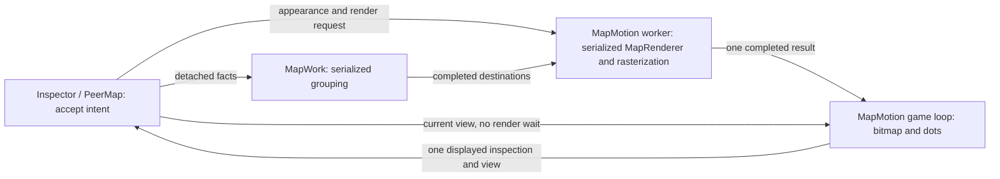

# Rendering and selection

Status: the map handoff is implemented at `e723ae6` and its focused functional
validation passed. The owner reports much better pan/zoom. Preserve this handoff.
The matched offscreen replay baseline is frozen at `b20b923`; no production
optimization has been applied. See the current investigation record below.
The displayed-state and selection corrections below remain to be implemented;
controlled performance acceptance remains unverified. Current behavior is owned
by the contracts linked below.

Purpose: faster input response and smooth animation, supported by comparable
before/after evidence. Scope: map rendering and interaction, selection and
TableView publication, Inspector peer refresh/filtering, host sort triggers and
torrent binding notifications. Communication's paused subscription redesign
remains outside this work.

Owner baseline: the current version is usable and worth preserving. Use this
checkout and its current benchmark work as the starting point; earlier Git
optimization attempts are historical evidence. Retain a correction only when it
delivers its intended result without a confirmed regression in behavior, input
response, navigation/animation or memory on the same workload. This applies to
correctness and bounded-work repairs too; their justification is not permission
to degrade the current app.

Implementation was authorized on 6 November 2026. The implementation lead owns
production changes and comparisons; the existing performance-harness owner owns
fixture setup, recording and measurement endpoints. Use one builder/capture owner
at a time. The [harness guide](../../app/tests/Performance.md) is the measurement
entry point; this plan owns the design and acceptance, and the
[visual review](17-rendering-and-selection-review.html) summarizes it.

## Execution

Preserve the implemented map handoff throughout: input and presentation use
available compatible content while expensive refinement continues independently.

Owner follow-up, 6 November 2026: while implementing the performance corrections,
investigate the blank space between countries. Adjacent countries should meet at
their shared border rather than look like separated puzzle pieces; the owner
recalls this having been solved earlier. Establish the cause before correcting
it and preserve the map handoff.

Owner follow-up, 6 November 2026: queue white-dot styling after the performance
work and border-gap investigation. Use tiny, softly glowing white location lights
on the dark theme and dark location lights on the light theme, with a subtle soft
halo and no outlined rings. High Contrast uses system colors. Marker-layer caching
remains deferred.

1. **Freeze the baseline.** With the harness owner, record the unchanged code's
   [controlled workload](#controlled-benchmark), source/binary identity, exact
   command, display/DPI, detail/location/arc profile, actual input cadence and raw
   reports. Commit the baseline and preserve its rerunnable binary before
   production edits. **Done:** the workload and procedure repeat, failures and
   missing endpoints are recorded under [measurement handoff](#measurement-handoff).
   A failing product result is a baseline; a changing measurement procedure is not.
2. **Remove one demonstrated stall.** Use existing records from one failing
   journey, then only the [phase probes](#first-performance-work-after-baseline-attribute-the-stalls)
   needed to locate its longest stall. Make the smallest correction at its owner
   in a focused, independently removable commit. Compare under the
   [measurement rules](#measurement-handoff), including memory.
   **Done per correction:** record the source operation, measured blocking/delay,
   correction and comparable result, with diagnostic and visible endpoints
   distinguished. Drop performance-only changes with negligible benefit that add
   state or complexity. Once the cause is measurable, correct it before adding
   probes; missing final display correlation belongs to step 5 and does not block
   that correction. Use the smallest existing check for the changed path under
   the testing policy. Repeat for measured stalls that remain.
3. **Correct displayed state and selection.** Follow [map state](#requested-state-and-displayed-state)
   and [selection publication](#selection-publication) at their existing owners.
   **Done:** same-subject adoption/draw/notification interleavings target drawn
   content; subject/detail invalidation and draws without dots remain safe;
   accepted current-view actions supersede pending intent, same-version callback
   corrections commit before readiness, and source-changing callbacks retain
   future requests. Preserve native gestures, focus, identity and draft protection.
   These are correctness results, independent of speed claims.
4. **Bound order-capability queries.** Implement the [single cached capability](#narrow-order-capability-cache)
   required by TableView's existing scrolling/visibility work bound. This is a
   contract repair, not an optional performance-only optimization. **Done:** row
   visual/cursor queries enumerate no host collection, participation refresh is
   reliable, active/completed drag validation remains complete, and capability
   refresh adds no projection of its own. Measure its speed benefit separately.
5. **Close acceptance.** Have the harness owner complete the missing endpoints
   needed for each claim; compare the frozen profiles before/after. **Done:**
   every click meets the displayed-frame requirement, navigation, stationary dots
   and marquee meet their independent pacing requirements, first/repeat content
   and Inspector readiness are accounted for, and peak/retained memory is explained
   and bounded.
   Failed or unverified acceptance stays open even when individual corrections
   demonstrate improvement.

The candidate list is closed. Further work follows remaining measured stalls.
Use shared outputs and [testing](../agents/testing.md); compile when source review
cannot answer a remaining question. Current behavior remains owned by
[architecture](../contracts/architecture.md), [peer location](../contracts/peer-location.md),
[torrent Inspector](../contracts/ui/torrents.md) and [TableView](../../lib/TableView/docs/tableview-contract.md).

## Outcome

A torrent or peer selection acknowledges input without awaiting grouping,
projection preparation, geometry, rasterization or a replacement picture.
The map keeps presenting completed content while replacement
content is prepared. New content appears when available. A completed handoff may
contain partial detail: show fewer lines in the next frame rather than wait for
all lines to be ready. Completing visual detail cannot delay input or presentation.
Selection semantics and displayed interaction targets remain correct while
visual refinement is incomplete.

Owner acceptance: a torrent click is visibly reflected in the next displayed
frame. Map navigation, stationary dot animation and marquee movement miss no
presentation deadlines in the controlled benchmark and show no uneven jumps. Measure each
separately; smooth dots cannot compensate for stalled geography. At 60 Hz the
frame period is approximately 16.67 ms; use the actual display refresh rate.

Owner priority: responsive pan/zoom and selection take precedence over dots during
navigation. Keeping dots visible and moving during pan/zoom is desirable if it
preserves responsiveness; pausing or hiding them during the gesture is acceptable
when the alternative is slower navigation. Restoring continuous dots is optional,
not a completion gate. If enabled dots pause or hide, normal animation resumes
when the gesture ends or is cancelled, without another input. Stationary dot
animation retains its separate requirement.

The next-frame requirement applies to the selected torrent row's visual
acknowledgment. Inspector data preparation has a separately measured completion
time and cannot hold that acknowledgment. Trace from native input delivery,
including dispatcher queuing, to the actual displayed selection. A fast handler,
a rendering callback or an unchanged frame is not evidence of visible response.

Native selection, accessibility, drag gestures, unfinished-edit protection and
the retained Inspector remain intact. This does not change when an existing
gesture commits. Native control updates still run on the UI thread; detached
calculation and native map rendering run elsewhere.

## Measurement handoff

The existing harness records each run; the implementer compares reports and
records the correction's result. Its current diagnostic endpoints support useful
before/after evidence while final acceptance may remain unverified. Use the same
recorded fixture, detail/location/arc profile, input schedule and configuration.

Every comparison includes responsiveness and process memory. Add phase timings,
traversal counters, allocation/GC or native-resource probes only when needed to
identify or verify the selected cause; they are not a required set. If diagnostics
change, remeasure the baseline with the same diagnostics. External recording can
use the preserved reference binary directly. New in-process probes require
rebuilding baseline and changed source with identical diagnostic-only changes
and build settings, then comparing those matched builds. Preserve the original
reference binary and record the source revisions and diagnostic changes used.

| Measurement | Existing harness | Remaining work and owner |
| --- | --- | --- |
| Click feedback | Native stimulus timestamps, selection events and XAML render completion, including p95. | Harness owner serializes completed/superseded/unselected/unobserved outcomes per click. Its current one-refresh p95 XAML budget remains diagnostic; it cannot certify every next-frame highlight. |
| Displayed selection | PresentMon surfaces and OS input-to-display observations, without identified highlight pixels. | Harness owner correlates each native click with its row highlight in the first following displayed frame on the correct surface before claiming next-frame acceptance. |
| Inspector readiness | Final selected torrent's row/map settlement. | Harness owner records accepted subject, corresponding published rows/map readiness and supersession for each click, without delaying later input. |
| Motion | Per-surface displayed timing, changed map views, dot draw/progress observations and marquee geometry at XAML completion. | Harness owner correlates the affected visible content with presentation for final geography/dot/marquee pacing claims; moving unrelated content cannot stand in for it. |
| Memory | Externally sampled UI-process private bytes and working set; these include the fixture and exclude GPU VRAM/other processes. | Compare startup, peak and retained use after repeat visits settle; sampled growth alone does not establish a leak. |
| Stall attribution | Overall phase endpoints and native map operation elapsed times. | Architecture lead selects additional probes under the measurement rules above, using the candidate owners below. |
| Workload setup | Static 50-torrent fixture and profiles in the harness guide. | Harness owner records mixed queue participation and adds the focused telemetry variant before comparing update-driven corrections. |

Demonstrated improvement names the measured endpoint and remaining limits.
Reduced XAML completion time is a diagnostic improvement; it becomes evidence of
visible response only when correlated with content. Final next-frame acceptance
is per click, not a p95 threshold. Keep missing acceptance endpoints explicit
while fixing costs the current measurements can already establish.

## Findings

Current map review uses `e723ae6`; the TableView findings below remain in the
working tree. The older `707999a` comparison found native rendering ahead of
presentation, split bitmap/scene publication and interaction-dependent grouping.
Those are resolved by the implemented handoff and are not current defects.

| Area | Confirmed behavior | Consequence |
| --- | --- | --- |
| Displayed map state | `OnUpdate` queues an inspection callback; `OnDraw` separately publishes the displayed view. PeerMap also reconciles pointed destinations to newly grouped facts. | Same-subject updates can make pointer/keyboard targets refer to content other than the drawn picture. Subject guards do not exclude this race. |
| Committed selection | Internal `SelectedItems` reads the public getter, which can return a future-view request. | Accessibility, context, drag and invocation can consume pending intent as though it were the current selection. |
| Table selection | Pointer selection commits immediately, but UI Automation uses the public setter, which defers during view preparation. | Accessibility interaction on displayed rows can wait for unrelated preparation. |
| Reentrant selection | A selection callback during projection can queue a correction while `_preparingView` remains true; same-version completion need not drain it. | Requested and committed selection can diverge. |
| Row visuals | Repeated `CanStartDrag` queries enumerate the host's unfiltered numbered order until finding its second participant. | Cost depends on participant positions and query frequency; the alternating fixture needs only three rows per query. Participation can change without a view publication, so caching also needs a narrow refresh. |
| Table projection | Capture and collection-edit publication run synchronously on the UI thread around worker preparation. | Input can queue behind those phases even though sorting is on a worker. Their actual contribution needs attribution. |
| Render relevance and budget | `MapRenderer.Prepare` visits submitted destinations and ranks active routes before the later `Draw` intersection cull. Some first-realization and uncovered-fill paths can exceed the soft rebuild budget. | A background thread and a drawing clip alone do not bound unnecessary preparation or shared-device pressure. Attribute these paths; preserve presentation over available content while detail is deferred. |

The direct pointer-selection call chain contains no drawing-readiness wait.
Synchronous event subscribers still execute inside that call until they yield.
Current host selection handlers already defer Inspector work; keep this path
short rather than introduce asynchronous selection events.

## Map ownership

The implemented map module already separates input, grouping, image production
and presentation. Its interface submits detached facts and current intent, then
consumes completed content. Keep these owners and handoff seams. Their locality
keeps mutable native resources on one worker; their leverage is that every
gesture uses the same presenter. A generic scheduler or adapter adds no depth.
The [peer-location contract](../contracts/peer-location.md) owns the implemented
rendering, cancellation and retirement rules; this plan adds the remaining
displayed-state correction rather than prescribing a second implementation.



| Owner | Authority |
| --- | --- |
| Inspector, UI | Accepted peer subject and place filter. Its scope identity changes when the actual subject changes, not on each read or telemetry refresh. |
| TableView, UI | Effective peer row selection. Pending programmatic selection is a distinct documented request. |
| PeerMap, UI | Requested viewport, current chosen destination and hover/keyboard intent; captures UI-affine values. |
| MapWork, serialized worker | Grouping and estimated placement from detached observations. Returns destinations, not interaction state. |
| MapMotion render worker | One mutable MapRenderer, geometry, marks and offscreen rasterization. |
| MapMotion game loop | Adopted completion, per-frame viewport, moving dots and presentation resources; publishes the detached displayed inspection/view together. |

### Independent progress

Input replaces one latest-request slot and signals the dedicated worker. The
below-normal worker completes a useful pass, publishes it and takes the newest
request. It waits when idle or until the next fade step; do not replace it with a Task.Run
pump or polling. Native allocation, disposal and drawing stay outside the short
handoff lock. The UI never joins this worker.

Blocked grouping must leave navigation/rendering over the last completed facts
available. Blocked rendering must leave input and presentation over the last
completed picture available. The presenter does no geography preparation or
offscreen rasterization.

Retain the implemented raster transform, longitude wrapping and one-eighth
viewport margin at every edge. Geography moves immediately while exact content
is prepared. Static strokes/glows and sampling temporarily scale; markers,
rings and dots retain their DIP sizes. Coverage, replacement continuity and
visual quality through the owner's 128x journey remain empirical gates. Add no
mandatory overview, tile cache or alternate representation without a demonstrated
failure of this baseline.

### Present available content; prepare only what can contribute

Owner ruling: a frame never waits for complete visual refinement. `MapMotion`'s
game loop presents the available compatible picture and, when animating, advances
dots without joining grouping or rendering. The render worker publishes useful partial detail
through the existing completion handoff, then refines it on later passes. Existing
cached detail can remain coarse; missing lines can appear later. An empty first
cache is not permission to require a complete scene before first presentation.

Restrict work at its existing owner, before expensive preparation:

- Inspector/PeerMap captures peers for the active subject. A single-torrent view
  does not capture or group the other 49 torrents' peers for rendering. The global
  map legitimately includes all 50; reuse its grouped facts across frames rather
  than re-enumerating all peers during each pan or dot update.
- MapRenderer rejects geometry outside the current view and retained margin
  before tracing, tessellation, brush creation or refinement. Include routes
  crossing the view even when their endpoints are outside it, with longitude
  wrapping and glow bounds. Keep the product's fastest-arc policy; viewport
  rejection does not redefine which routes qualify. Reuse prepared facts and
  cheap bounds; add no spatial index unless measured query cost requires one.
- Use the existing worker's rebuild allowance and pending-work continuation to
  defer unfinished detail. Audit first-realization and coverage-replacement
  exceptions, and the largest native operation, rather than assuming the soft
  allowance bounds every pass. If a native unit demonstrably blocks presentation,
  reduce or split that unit at the renderer; another thread does not solve shared
  graphics contention. Prioritize visible selected content over decorative
  refinement. Do not accumulate requests or finish obsolete offscreen detail
  ahead of the latest relevant view. Finish a bounded useful unit, then take
  work for the latest view; restarting all compatible work on every motion
  would prevent detail from ever arriving.

For a selected relevance or render-budget cost, choose only the capture/grouping,
rejection or geometry counts needed under [measurement handoff](#measurement-handoff).
The focused view must show no render preparation of unrelated torrents' peers;
steady pan/dot frames must not rescan the population. Check overloaded first
appearance as well as cached navigation, and report first useful content
separately from completed detail. Inspection must describe the content actually
presented, including any partial pass, using the displayed-state correction below.
Keep these decisions inside the existing map module, with one renderer and one
completion interface.

### Requested state and displayed state

The worker already publishes one immutable completion with bitmap, source view,
background, scene, inspection/marks and provenance. Keep that metadata separate
from the reusable bitmap. Compatible navigation, appearance, rates and same-subject
membership coalesce while useful work finishes. Existing subject, detail and
surface guards reject incompatible completions without demanding that every
completion match the newest soft request. Origin changes cancel native rendering
when replacement grouped facts reach it; grouping can first finish an older
coherent origin. Do not describe that as immediate cancellation of every stage.

The remaining race is between adoption, drawing and queued UI notification:
completion B can supply inspection while A is still drawn, or B can be drawn
while the UI still holds inspection A. Updating `_pointed` from newer grouped
facts creates the same problem for keyboard actions and descriptions.

Replace the independent inspection, display-mark and displayed-view authorities
with one detached displayed value containing inspection (including marks), view
and existing provenance. Publish it after the matching drawing operations
succeed, including paths with no flying dots. This records submitted drawing;
it does not by itself prove physical scanout.

Each pointer, keyboard, choose, reveal or description operation captures that
value once, checks the existing live subject/detail/lifetime guards and resolves
current chosen/pointed keys within its destinations. Never use a newer grouped
Destination as a displayed target. Retained imagery from an old subject cannot
select its replacement's peers. Current UI intent remains immediate and never
comes back from grouping. `MapModel.Presentation.Marks` remains the one worker
calculation. Notifications may refresh help text from current displayed state;
they cannot install captured target state. No bitmap retention, per-frame UI
event or additional frame protocol is needed.

### Resources and remaining empirical gates

Keep the implemented worker-only bitmap reuse/disposal and reference accounting
for cached, pending and shown completions. There are at most three distinct
full-size targets; recycled metadata cannot become current through bitmap
identity. Native geometry and buffers retire after their users stop. Only the
worker awaits game-loop retirement; the UI does not. No source-proven lifetime
regression was found in the restored cache policy.

The margin makes each target dimension 1.25 times the viewport, or 56.25% more
pixels per target. When changing render targets, report allocated pixel dimensions,
count and DPI; BGRA8 target bytes are width × height × 4, separately from geometry,
effects, device and swap-chain memory. A target-count bound is not a claim of
unchanged RAM.

Use the [measurement handoff](#measurement-handoff) for memory comparisons and
conditional probes. Distinguish fixture storage from extra copies, in-flight work
and render resources when attributing memory cost.
Retain one latest request and bounded completions, release retired subjects and
temporary snapshots, and keep one owner for each cache. Do not buy smoother
frames with unbounded queues, redundant full peer collections or growing caches.
Investigate measured memory increases under the baseline's no-regression rule;
repeat visits must not cause continuing retained growth. Add no memory framework
or cache to satisfy the measurement itself.

Real native graphics calls on the shared device may still serialize. Managed
blocking tests do not answer that question. Measure contention, viewport coverage,
restored visual behavior and presentation pacing before adding another device or
representation. The current design needs no new architecture for those
possibilities until evidence identifies a failure.

## Selection publication

These are correctness corrections. Verify their selection semantics separately;
use the benchmark to determine whether they also affect response or frame pacing.

Keep one selection commitment operation and synchronous native notifications.
Public programmatic `Selection` assignment retains its documented ability to
target a replacement view, including rows not displayed yet.

Internal `SelectedItems` must read `_publishedSelection.Items`, not the public
getter's pending request. Accessibility, context, drag and invocation consume
this committed selection. Do not add another selection cache.

Route UI Automation actions on displayed rows through the same immediate
commitment as pointer interaction. Build from effective committed selection,
not a pending programmatic request. Validate the target and operation first;
an accepted current-view action clears older pending intent even when it is a
selection no-op. A rejected action does not consume it. Preserve native current
item, focus and no-op notification behavior and the host's unfinished-edit guard.

Drain corrections queued by synchronous selection callbacks after projection
mechanics, through that same commitment. First recheck the view version: a
callback that replaced the source and requested future rows belongs to the next
projection. Consume same-version corrections through the same commitment until
stable, checking the version after callbacks and before announcing `ViewReady`.
Keep synchronous selection notifications; deferring them would change gestures
and move work rather than remove it.

### Narrow order-capability cache

This change repairs the [TableView performance contract](../../lib/TableView/docs/tableview-contract.md#20-performance-requirements):
scrolling and visibility work must not scale with the source. An uncached query
can traverse the whole order when fewer than two rows participate. Its acceptance
is bounded visual/cursor queries and reliable refresh, even if the alternating
fixture's timing gain is negligible. Keep the implementation to one capability
at the existing owner; measure speed separately from this contract justification.

Capture whether the complete numbered order has at least two participating rows
when source/order facts refresh. Repeated row visuals/cursor queries read this
capability without enumerating the host. The torrent host must refresh queue
participation even when identities and visible order are unchanged.

Use one cached capability in `Order` and a small `Table.RefreshOrder()` operation.
It refreshes that capability with the existing predicate (stopping after two
participating rows), reconciles an active drag and signals existing row visuals.
Regular source/view refresh uses the same operation. It captures no projection,
sorts nothing and emits no native collection edits. Active-drag validation may
still capture the full order deliberately; ordinary capability refresh does not.

Preserve correct sorting behavior, including any measured optimization of
MainWindow's refresh condition. Active sort-key changes must still request the
appropriate projection. Order-capability refresh adds no projection of its own.
Refresh participation whenever it changes, whether or not sorting needs a view
refresh. In each unpublished row-change path that skips `RefreshView`, use
`RefreshOrder()`, including ascending Queue and null/natural sort. Regular view
refresh already uses that same operation; the cache step retains the current
optimized sorting policy rather than restoring the old condition.
Signal visuals even when availability stays true:
participating A/B can become B/C, changing A's cursor. Update existing order-refresh
guidance; add no new event, row subscriptions or membership cache. Keep complete
unfiltered validation at drag start/finish.

The grill rejected refreshing the whole view for every row-change notification:
that notification also includes routine rate/progress telemetry, and rebuilding
the UI capture/projection just to refresh one capability would add work.
Sorting does not disable reordering; correct the contrary stale row comment
alongside this change.

Use the same mixed-participation fixture with reordering enabled for the
[comparison](#measurement-handoff). Source review can establish that queries no
longer enumerate the host; add query/row/time counters only if needed to resolve
its cost. Removing these repeated traversals does not establish that they dominate
the stalls: with the first and third rows participating, each query visits only
three rows. This differs from `GetSelectedRanges`, which scans the whole view.
Queue membership changes also need a focused refresh check; do not
change the timed workload's membership between comparison runs.

## TableView publication

Keep source enumeration, keys, mutable selectors and hierarchy capture on their
documented UI owner, then prepare from detached values. Keep the current coherent
one-turn collection publication until phase attribution demonstrates a need to
redesign it. Adding yields to its edit loop would expose inconsistent positions,
held rows, selection and focus to native callbacks.

When investigating publication, distinguish subject replacement from same-subject
refresh; both keep the existing keyed publication implementation and stable Peer
identities. Attribute the selected cost under [measurement handoff](#measurement-handoff),
using the candidate phases below. `FrameCallback` is a deferred UI callback, not
background execution; its work still runs to completion. Row count alone does
not justify a reset, chunked edit loop or
second native-view path. Add a targeted optimization only after its phase is
shown to consume the frame budget.

### First performance work after baseline: attribute the stalls

The current performance harness records map operations and overall selection/
render endpoints. It does not isolate TableView's capture, native edits or
selection-range work, or separate dispatcher delay from graphics contention.
The architecture lead fills only gaps needed for the selected cause under
[measurement handoff](#measurement-handoff). Use the existing capture journey
and timing record; add no permanent profiling framework or second table
implementation.

The owner reports that the current harness exposes frame gaps around 400 ms.
Start with one such gap in the existing input/phase/frame records: identify the
operation and thread occupying or delaying that interval, including whether the
measurement itself contributes. Gap length alone does not establish the cause.
Add only the timestamps and aggregate counts needed to distinguish it.
The following owners are candidate probes, not a prerequisite instrumentation
checklist. Once one expensive operation is attributed, make and compare its
smallest correction before extending the investigation to the next stall.

| Phase | Existing owner | Question answered |
| --- | --- | --- |
| UI source capture | `Body.Source.Capture` | How long does copying the host source hold the UI before preparation can start? |
| UI projection capture | `Table.CaptureProjection` | What do identity, sort and hierarchy capture cost, including repeated captures? |
| Worker preparation and return | `Table.PrepareView` | Is time spent preparing or discarding/retrying a prepared view? |
| Dispatcher delay | existing input and preparation continuations | How long passes between native input delivery or queued UI work and its handler starting? |
| UI publication | `Table.ApplyProjection` / `Body.View.Apply` | What do native removals/insertions, row rebinding, focus and selection reconciliation cost? |
| Native selection queries | `Body.View.GetSelectedRanges` | How often does native code request ranges and how many rows are scanned, including empty selection? |
| Inspector preparation and publication | `Inspector.ApplyPeers` | What UI time and allocation comes from snapshotting the whole global peer list for one torrent's reply? It already retains the combined list when membership/order are unchanged. Would operating on that torrent's records materially reduce the measured stall? |
| Superseded peer filtering | `Inspector.Filter` | How much capture, allocation and worker calculation is spent on results rejected by the version check? Would coalescing before capture remove a measured cost? |
| Sort-triggered work | `InspectorPane.OnRows` / MainWindow's `SnapshotApplied` handler | How often does an update with unchanged active sort keys trigger capture/preparation/publication, and what does it cost? |
| Binding invalidation | `Torrent.Notify` / `Peer.Apply` | Does the torrent's all-properties notification cause material unrelated binding work? Would specific notifications, following the peer pattern, measurably reduce it? |
| Layout and feedback | existing layout, selection and render callbacks | Does layout delay the next visible selection or map update after publication? |
| Graphics and presentation | existing native map work timings and display recorder | Does real native rendering hold up presentation despite the separate worker, or does the stall precede graphics work? |

Correlate selected probes with actual external click timestamps and affected
table/subject. If range-query or other traversal counters are needed under
[measurement handoff](#measurement-handoff), aggregate per publication/frame
instead of emitting an event per row. For a publication cost, separate first/repeat
9,000-peer replacement from same-subject updates.
Keep UI elapsed time distinct from worker elapsed time and queueing; nested
measurements must not be added together as independent costs.
Correlate actual native work and presentation gaps before attributing graphics
contention; a managed blocking hook or overlapping activity alone is insufficient.

These Inspector, sort and binding candidates have the same evidence threshold as
capture, range queries, layout and graphics; they are not four required refactors
or a new priority tier. Per-torrent peer work stays in Inspector and preserves
live Peer identities without another full peer store. If filtering needs
coalescing, use one active calculation and the latest pending request, capturing
only when it can run; preserve subject/place freshness, readiness and useful
progress under continuing updates. Selective sorting must keep cells immediate
and cover every active sort key. Peer changes already identify properties, but
the host refresh events currently carry only a section or `RowsChanged` boolean;
propagate only the additional facts the chosen optimization needs. If specific
torrent notifications earn their cost, include their derived display properties.
Add no generic sort-dependency or notification framework. Retain a performance
change only when the same workload shows useful benefit without loss of
selection, freshness or bounded memory.

Fix the demonstrated causes before treating the remaining correctness/cache
checklist as the performance solution. Make the smallest change supported by
the result. Repeated capture calls
call for eliminating redundant capture within the same valid request; range
scans call for using authoritative selection facts without a second cache;
expensive native publication/layout needs a concrete publication design and
focused review of native indices, gestures, focus and retained rows. If those
phases are small, leave publication intact and follow the input/presentation
delay. Moving selectors to a worker or yielding inside native edits is not a
default fix.

## Controlled benchmark

Use the [existing performance harness](../../app/tests/Performance.md) and its
owner for native-input, presentation and memory evidence. Keep 1920x1080,
synthetic data and fixed locations. Retain
fixed transfer rates for the main comparison; update-driven changes also use the
focused telemetry phase below. Record display refresh, DPI, configuration and
source revision so baseline and changed code are comparable.

Use the simulator's updated 50-torrent fixture: three with 3,000 leechers and
6,000 seeds each, 40 spanning 50–1,000 leechers, and seven spanning 1,000–3,000.
The current launcher gives every torrent twice as many seeds, totaling 130,650
actual peer rows across the tables and map. Its first seven click targets have
50, 100, 500, 1,000, 3,000, 3,000 and 3,000 leechers. `Capture.ps1` owns the exact
counts in `fixture.json`; use that same manifest before and after. Match the
harness guide's detail/location/arc profiles between revisions, including actual
retained arcs; country/default-arc results are not comparable to city/high-arc
results. That guide owns the current commands and profile values.

Required fixture refinement before freezing: alternate queue participation by
fixture index, starting with a participating row, with 25 in contiguous positions and
25 outside the queue. Use Name ascending so the seven targets stay
visible; record each torrent's participation and queue position with the fixture
manifest. Hold this population and sort fixed for timed comparisons. Check the
cache's membership-change refresh separately under natural sort and ascending
Queue, including changed membership with unchanged visible identities/order.
Use disposable synthetic facts; do not depend on network or engine queue churn.

| Scenario | Gesture and measurement |
| --- | --- |
| First map appearance | Ctrl+Shift+M; measure first visible map and completed drawing separately. |
| World pan | At 1x, drag across the full viewport left to right in one second, then back in one second. |
| Europe zoom | Zoom from 1x to 128x in two seconds, then back in two seconds. |
| Europe pan | At approximately 16x, pan across the viewport left in two seconds, then right in two seconds. |
| Rapid torrent selection | Keep all 50 torrents loaded, list above a half-height Peers Inspector, map left, peer table right; click the seven visible targets sequentially 150 ms apart for three visits. Measure next-frame row acknowledgment and corresponding Inspector data completion separately. |
| Marquee | Retain that layout; drag at constant speed and measure displayed movement for uneven steps. |
| Dots | Stationary map at 1x; measure moving-dot presentation independently of geography updates. |

### Focused check while telemetry changes

When changing peer refresh, filtering, sort triggers or binding notifications,
reuse the selection/marquee journey with one deterministic rate/progress update
sequence running throughout it. Keep the same 50-torrent manifest, layout and
gestures; retain Name ascending for torrents and an unchanged address sort for
peers. Hold identities, locations and queue participation fixed so value-only
updates exercise the suspect paths without adding membership churn.

Replay torrent summaries and peer replies through their normal application paths,
including change notifications and host refresh decisions; directly setting cells
or map inputs would bypass the work being investigated. Use the normal telemetry
cadence and preserve the exact schedule and changed values with the report. Record
scheduled versus applied updates and any coalescing, so UI delay cannot silently
reduce the load. Do not wait for Inspector settlement between clicks or pause
updates during the marquee. Respect the normal requested peer scope.

Measure click response, Inspector freshness, independent map/marquee pacing and
process memory under [measurement handoff](#measurement-handoff). Verify that
visible values still update while unchanged sort keys avoid unnecessary projection.
Compare unchanged and changed code with the same telemetry sequence before
crediting an optimization. This is one focused variant in the existing harness,
not a new framework or a reason to replay every map journey. The harness owner
adds it before comparing changes to these update-driven paths; retain the fixed-rate
baseline and report this additional phase separately.

### Functional sort check

For a change to sort-refresh decisions, add one separate short functional check
in the affected table: sort by a changing rate, update two rows so their rates
cross, and verify immediate cell values plus the expected order after its normal
`SortInterval`. Respect held rows: the pointed/context/gesture row keeps its
position, then reaches its sorted place when released under the existing settle
rules. Keep selection and identity intact. This uses the same fixture and normal
update paths; it is separate from the unchanged-key timed workload and does not
replay the full benchmark. [TableView sorting](../../lib/TableView/docs/tableview-contract.md#9-sorting)
owns those semantics.

### Comparison and acceptance

Compare first and repeat openings/selections. Report displayed FPS, p95 and
worst frame intervals, stalls, missed presentation deadlines and selection
latency. Average FPS alone cannot establish a pass. Attribute the selected delay
to its source operation using correlated timestamps. Do not move the start of a
latency measurement past a queued or expensive phase.

Apply the per-click outcomes, displayed-content correlation and Inspector
readiness requirements in [measurement handoff](#measurement-handoff); report
missing acceptance evidence as unverified. Retain the independent 150 ms input
sender and report actual cadence without waiting for Inspector completion.

Publish a before/after table with these metrics per scenario and separate geography,
dots and marquee results. Include Inspector readiness, first/repeat behavior and
the attributed source paths, first useful versus complete detail, peak memory
and settled retained memory across repeat visits. Confirm that irrelevant peers
do not enter focused render preparation and stable frames do not rescan them.
Do not substitute reduced method time for visible improvement. Preserve the raw
reports and failed or unobserved outcomes.

The benchmark is the acceptance evidence for the proposed architecture. The
plan does not establish a pass before implementation and measurement. First
appearance, completed drawing and Inspector preparation remain separately
reported timings; their numerical limits have not been set by the owner.

## Investigation record

### Baseline and coordination, 6 November 2026

**Frozen replay baseline:** six offscreen profiles completed normally at
`b20b923`, with production behavior unchanged from `1b26388`. The
[baseline report](../../artifacts/evidence/ui-benchmark-replay-baseline-20261106-b20b923/README.md)
preserves the exact binary, identity, workload, commands, raw evidence and limits.
Worst navigation draw gaps span 199.5-360.8 ms. Docked marquee worst gaps are
256.4, 246.8 and 818.5 ms; observed selection XAML feedback reaches 301.5 ms.
All 21 commands per docked run are selected with exact matches and valid sender
cadence; 2/3/3 XAML endpoints are unobserved after supersession. Peak private
memory is 964-1,436 MiB. Country/200 and city/200 selected-map baselines have no
draw samples for a second; later visible-dot gaps reach 4.1/4.8/2.8 seconds.
Their cause stays open, and absent samples establish no smoothness claim.

The replay harness passed independent source review, recorded in
`V:/temp/plan17-replay-review.md`, and the owner's overseeing review in
`V:/temp/plan17-overseeing-review.md`, with no material findings. Its single
Release build passed, reporting one nullable warning on an unchanged harness
line. The country/200 docked trial passed the runtime gate and was reused as its
baseline profile. The remaining five profiles each ran once. All runners,
windows, fixture engines and external senders/sources exited normally.

The owner prohibits desktop input, activation/focus stealing, screenshots/video,
automatic capture retries, UAC, Windows elevation and permission changes. Use
`-Replay -InputOnly` under the [harness guide](../../app/tests/Performance.md).
PresentMon 2.3.1 is a passive ETW recorder, not a gesture generator; `-InputOnly`
alone still runs the prohibited foreground SendInput journey. Keep its safety
guard intact and do not rerun it or repeatedly restore focus. The interrupted
post-reboot foreground attempts remain in
`artifacts/evidence/ui-benchmark-post-reboot-20261106-1b26388-baseline/matrix.json`;
focus interruptions are not product performance failures.

The new procedure measures command-to-render behavior and is not comparable to
the old SendInput runs. Displayed/native-input acceptance, exact map-command
correlation, per-click Inspector readiness, earlier transition findings and the
separate queue-participation variant remain open. Next: profile the city/1,000
docked marquee gap, attribute one source operation/thread, then make and compare
its smallest correction. No production edits precede this freeze.

**Pre-reboot handoff:** the owner requested saving the current measurements and
repeating them after reboot before accepting a baseline. The
[provisional report](../../artifacts/evidence/ui-benchmark-pre-reboot-20261106-2c398e6f/README.md)
preserves the exact binary, source identity, commands and raw evidence. The live
fixture now has 50 torrents, 159,810 known peers and 5,000 connection slots, with
seeded speed sorting and 250 connection swaps per second. The
[harness guide](../../app/tests/Performance.md) owns this newer workload; the
fixed-sort and older row counts below describe earlier proposals or recordings.
Five focused runs completed; the country docked run completed clicks, marquee
and navigation before external focus interrupted its final churn interval.
Displayed FPS, the separate queue-membership variant and post-reboot acceptance
remain unverified. No performance improvement or regression is claimed.

At this review, a complete accepted baseline had not been handed off. The harness
had moved to the heavier 50-torrent/130,650-row manifest and independent timed
input, with mixed queue participation still to be set and recorded. The earlier
seven-torrent and 44,400-row workloads are historical, not that baseline.

An earlier seven-torrent preflight reached navigation, selection and marquee,
then timed out reopening the map. Its partial [timing report](../../artifacts/evidence/Capture-performance-236af6f7-4d95-49e9-94b7-735ebd24ff9d/captures/timing.json)
contains 21 clicks: selection-event median 26.7296 ms, p95 79.4499 ms, worst
83.5063 ms; XAML completion median 49.2017 ms, p95 86.4198 ms, worst 87.9012 ms.
The failed no-recorder run's in-process sender delivered nominal 150 ms clicks
129–171 ms apart and could pause with the app. These are diagnostic endpoints,
not displayed latency or a frozen baseline. Preserve the repeat-opening failure;
a successful fresh docked-map run cannot clear a failed return to it.

Coordination attempts with the Add map performance tests chat and desktop fallback
failed with `Transport closed`; messages were not delivered. Saved public status
and artifacts could be read, but the freeze could not be confirmed with that
owner. That chat retained harness/build/capture ownership and the owner's remaining
UAC confirmation; this investigation started no competing capture.

### Implemented map handoff

The [focused report](../../artifacts/evidence/Capture-map-handoff-d220f8ff-add3-44be-adfb-cc33004a45fd/captures/review.json)
passed eight functional journeys at `e723ae6`: picture reuse without retained
pixels, inspection, invisible-rate bitmap reuse, navigation/packets during blocked
rendering, native route cancellation, compatible telemetry during replacement
grouping, selection during blocked grouping and navigation during blocked grouping.
Both fixture layers awaited native worker retirement; the run ended normally
with no TinyTorrent UI or engine left running.

The [saved frame](../../artifacts/evidence/Capture-map-handoff-d220f8ff-add3-44be-adfb-cc33004a45fd/captures/map-handoff.png)
showed fitted geography, arcs and markers aligned, selected location colour and
other routes dimmed. Capture setup created its output directory and waited for
the fitted raster's Draw followed by Update before export. The restored three-view
fill cache and half-view recrop preserve policy, not a measured speedup. The owner
named 0.9.1.2 as the visible pan/zoom reference, not proof of its entire behavior.
The owner also reports that earlier revisions animated dots during pan/zoom, but
the larger change set was reverted because the app became slow. The cause was
not isolated; that revert does not establish that the dots caused the slowdown.
Managed blocking hooks and a still image do not establish real device contention
or displayed frame pacing.

### Source and review history

The review traced these paths; it did not implement their corrections:

| Path | Source |
| --- | --- |
| Pointer selection, commitment and preparation | [Input](../../lib/TableView/src/Table/Input.cs), [Selection](../../lib/TableView/src/Table/Selection.cs) |
| Accessibility and native selection ranges | [Surface](../../lib/TableView/src/Body/Surface.cs), [View](../../lib/TableView/src/Body/View.cs) |
| Row visuals and complete-order capability | [Row](../../lib/TableView/src/Body/Row.cs), [Reordering](../../lib/TableView/src/Table/Reordering.cs), [Order](../../lib/TableView/src/Order.cs) |
| Host selection and Inspector scheduling | [MainWindow](../../app/src/Shell/MainWindow.cs), [workspace](../../app/src/Shell/MainWindow/Workspace.cs), [Inspector selection](../../app/src/Shell/Inspector/Selection.cs) |
| Projection capture and publication | [Table view](../../lib/TableView/src/Table/View.cs), [source capture](../../lib/TableView/src/Body/Source.cs), [Schema](../../lib/TableView/src/Schema.cs) |
| Map input, preparation and interaction | [PeerMap](../../app/src/Torrents/PeerMap.xaml.cs), [MapWork](../../app/src/Torrents/MapWork.cs), [MapModel](../../app/src/Torrents/MapModel.cs), [navigation](../../app/src/Torrents/PeerMap/Navigation.cs) |
| Map rendering, completion and retirement | [MapMotion](../../app/src/Torrents/MapMotion.cs), [MapRenderer](../../app/src/Torrents/MapRenderer.cs), [MapViewport](../../app/src/Torrents/MapViewport.cs) |

Three initial design rounds covered map lifetimes, selection and TableView
publication. A fourth map round replaced the heavy-rendering-on-the-game-loop
recommendation with the independent presenter, since implemented at `e723ae6`.
After the owner's improved-pan/zoom report, a fresh expert completed three further
rounds: current baseline and decisions; reachable state/lifetime/interaction
cases; final challenge and pruning. The lead rejected whole-view refresh for
telemetry and the expert revised it to narrow order refresh. These were design
rounds with checked source claims, not independent runtime performance reviews.
The additional cold review found one medium plan defect: a cached order capability
would not refresh under natural sort when membership changed without a reordered
source. The correction covers every unpublished row-change branch that skips
view refresh. Its record is `V:/temp/render-selection-cold-20261106-natural-order-review.md`.
The full review in `V:/temp/plan17-full-review-20261106/review.md` identified the
measurement handoff, sorting-policy/cache wording and telemetry-check ambiguities
resolved above. Plan 16 was completed and deleted in `cab7769`; numbering follows
Git history, including completed plans.

### Measurements and limits

These historical measurements predate the implemented `e723ae6` handoff.
The shared Release capture output matched the compared `707999a` snapshot;
`Build.ps1 -App -Capture -Release` reported it up to date without compilation.
Later concurrent renderer-budget edits were not measured. These numbers record
the fixture run, not a product guarantee or proof that the regression is fixed.

The focused selection check used a disposable store and ended normally, leaving
no TinyTorrent process running:

```powershell
pwsh -NoProfile -File .\app\tests\Capture.ps1 -Review selection-frame -Configuration Release -ArtifactsPath 'C:\SynoSoftware\TinyTorrent2\artifacts'
```

Its [raw report](../../artifacts/evidence/Capture-selection-frame-74a5707c-a069-482f-aaea-432a15975d34/captures/review.json)
contains 20 measured calls for each Inspector state:

| Inspector | Handler median / maximum | First rendered frame median / maximum |
| --- | --- | --- |
| Closed | 0.9229 / 3.1783 ms | 16.6378 / 21.3389 ms |
| Open | 0.7165 / 1.5842 ms | 13.1681 / 19.0269 ms |

The fixture invokes `SelectItem` directly; it does not deliver native pointer
messages. Later reported frame gaps reached 414.2001 ms closed and 85.0182 ms open.
A gap does not identify blocked input or its cause. Native pointer-to-selection
latency remains unverified.

An existing [map-composition report](../../artifacts/evidence/Capture-map-composition-6eb2311d-0d21-4700-9ecc-23c7ae2774ed/captures/review.json)
from the same compared source recorded picture replacement, inspection,
cancellation, selection/navigation during blocked preparation and live navigation
without a reported failure. Its live-navigation journey issued 96 requests and
observed 71 requested views: median 31.4463 ms, p95 32.1632 ms, maximum 33.417 ms.
These timings exclude requests whose views were not observed; they do not
establish every input's latency. An inspected screenshot showed no obvious static
corruption but cannot establish animation quality or responsiveness.

Its 98 native render samples had median 9.66 ms, p95 15.1713 ms and maximum
23.5841 ms; three exceeded 16.6667 ms. The slowest fill took 19.8303 ms, including
7.831 ms tracing and 11.6798 ms fill realization. That work then preceded
presentation on the game loop. The dependency is now removed; these are neither
current render costs nor displayed frame intervals.

Raw capture artifacts are local, disposable evidence; the summaries above retain
the useful results if those artifacts are removed. The outstanding native-input,
graphics-contention and lifecycle questions remain listed in the implementation
sequence. No build, capture or benchmark ran for this documentation revision.
