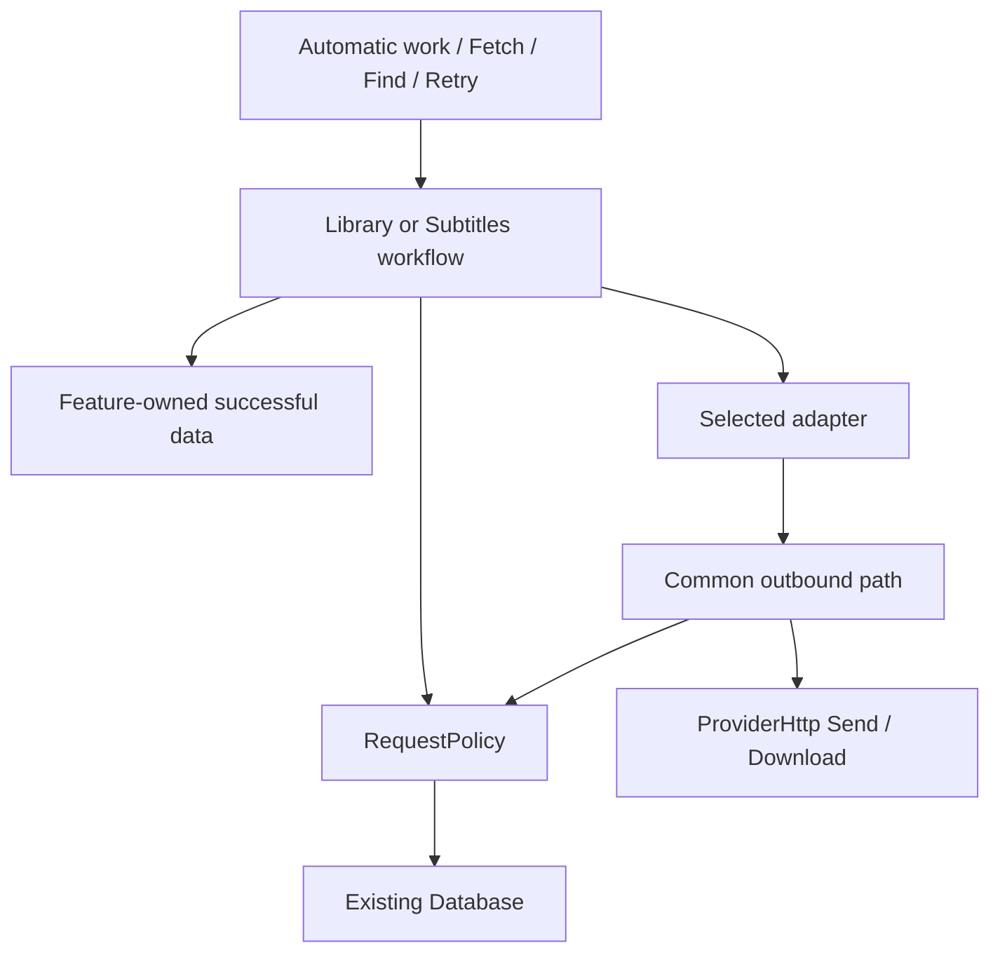

# Library and subtitle request protection

Implemented and verified on 2026-10-13, reconciled with IMDb datasets phase 1.
Active app contracts remain authoritative. This covers remote calls from TMDB,
Wikidata, OMDb, MDBList, OpenSubtitles, SubDL, SubSource and IMDb dataset
downloads. IMDb movie searches read local data under the rules below. The
removed IMDb and Rotten Tomatoes website readers are outside this change.

## Decision and scope

Use one concrete, window-lifetime `Services.RequestPolicy` to own durable
request suppression, access waits, pacing and their reset semantics. Library
owns identification and metadata reuse. Subtitles owns matching, acquisition
and file publication. Adapters own endpoint parameters and response decoding.
Refactor within those responsibilities and delete replaced implementations.

Remember a valid missing answer by the question asked, across files and
restarts. Temporary failures have shared backoff; they are never missing-data
answers. **Force fetch** requests a fresh answer despite local suppression.
**Reset search protection** clears the selected history without deleting useful
data or user decisions. Reset and requesting data are separate actions; reset
does not enqueue a search. Remote quotas remain separate.

Success has four observable conditions:

- Equivalent files reuse an answer, including an empty one, without another
  remote request.
- An outage causes one recovery attempt per applicable backoff, not one per
  movie. Unaffected access paths remain usable.
- Every local hold has a visible retry/reset path, and every timed wait can end.
- Reset cannot lose unrelated accepted work, erase successful data, or let an
  old completion restore cleared protection.

Known misses do not poll. Keep the app's automatic-work eligibility, startup
delay, subtitle completion stages, network route and file-publication rules.
Keep the current five-search cap for remote searches and shared setting. Reaching it creates a
local block; the agreed Force/Missing/All actions provide explicit recovery.

## Source findings

| Implementation baseline | Problem the replacement solves |
| --- | --- |
| [VideoLookup](../app/src/Library/VideoLookup.cs) keeps search answers in `_searches`; [Store](../app/src/Library/Store/Identification.cs) persists counts and per-file `video_misses`. | Empty answers are not reusable across a restart and another file. Per-file misses also omit language. |
| Library's capped search returns an empty list plus `Limited`/`Answered` flags. | Refusal to search can be confused with an actual missing answer. |
| [ProviderJson](../app/src/Library/ProviderJson.cs) treats any 404 as an unusable video. | Resource absence needs endpoint knowledge; a broken search endpoint must not become a movie miss. |
| [IMDb](../app/src/Library/Imdb/Provider.cs) searches a replaceable local dataset through the same Library workflow. | Remote suppression, search charges and durable query reuse would needlessly stop or stale local answers. |
| [Supplier](../app/src/Subtitles/Supplier.cs) returns filtered matches; [Acquisition](../app/src/Subtitles/Acquisition/Acquire.cs) counts the completed workflow. | No acceptable match can look like remote absence. A workflow count cannot pace its pages, login or fallback calls. |
| Library failures, supplier waits and per-job subtitle network backoff have separate owners. | Recovery and reset have inconsistent scope; many jobs can each make a first failing request. |
| [Account checks](../app/src/Subtitles/Acquisition.cs) serialize with acquisition, but persist allowance only for the saved account in `subtitle_settings`. | A different draft account's remote wait is only session state; cancelling the draft or reopening must not discard the protection it incurred. |
| [Library cancellation](../app/src/Library/VideoLookup.cs) calls `EndBatch`, clearing queued work. | Reset cannot reuse that method unchanged without discarding accepted work. |

Existing code already supplies useful seams: `Supplier.Operation` carries the
account and validity check through `Supplier.Send`; Library's `SaveSearch` and
`SaveResponse` commit related data together and finish after caller cancellation.
Extend those paths instead of adding parallel operation or persistence layers.
These are source findings, not executed runtime evidence.

## Ownership and interface

| Responsibility | Owner | Reason |
| --- | --- | --- |
| Metadata workflow, matching and successful caches | Library | Remote facts still need identification and user-decision rules. |
| Subtitle workflow, matching, successful candidates and files | Subtitles | Candidates still need language, release and destination rules. |
| Suppression, access recovery, pacing and reset semantics | RequestPolicy | Every adapter needs the same protection decisions. |
| Request parameters, parsing and provider-specific quota facts | Adapter | Remote contracts differ; common policy does not. |
| HTTP connections, confirmed route and transport cancellation | ProviderHttp, including its streaming Download path | Protection must not create a second transport or route authority. |
| IMDb download/import and replaceable data | Imdb.Dataset; Library coordinates lookup drain | A dataset update must preserve the installed file until a complete replacement is ready. |
| Schema initialization and transaction execution | Database | Feature data and protection need one commit authority. |
| Construction, lifetime and cross-feature reset coordination | MainViewModel | Neither feature owns the other's lifetime. |

The policy reads eligibility, records classified outcomes, reserves outbound
allowance and resets local history. Use named requests, intents and outcomes;
never an empty list or a combination of `force`, `limited` and `answered`
flags to communicate refusal.

Integrate it at the common Library lookup/resource-read path and common
subtitle search/download path. Endpoint adapters report facts and cannot invent
their own admission checks, retry delays or resets. The outbound path applies
the policy before every call, including calls inside one adapter operation.
Replace the allowance checks inside `Supplier.Send`; retain its validity check
before each send, including redirects and login. Authentication controls which
credentials are sent, not whether pacing applies to an unauthenticated download.

Library currently serializes execution through `VideoLookup._access`;
Subtitles uses `Acquisition._operation`, including account checks. Keep
serialization with each workflow because it also protects decisions and
publication. IMDb reads use Library's execution owner too, but no network policy.
Refactor those methods as needed; their present shape is not a constraint.
A shared executor, second scheduler, generic cache callbacks and shared-task
cancellation machinery would duplicate that responsibility and are unnecessary.

Feature stores record reusable answers and request outcomes in one
`Database.Run` transaction. RequestPolicy owns its SQL; its internal recording
operation participates through the current connection. There is no nested
`Database.Run`, network I/O in a transaction, or database access in adapters.
The policy provides eligibility and due times; feature workers own queue order
and wakeups. Presentation reads the same policy as execution.

Keep the shared [AccountDialog](../app/src/Views/AccountDialog.cs), plugin access
declarations and `Services.Credentials` as their existing owners. The dialog
edits; Library or Subtitles saves/checks; RequestPolicy owns protection. Do not
add provider-specific editors or a new credential store. Library currently has
no account-check operation; this feature does not require inventing one.

## Request identity and access scope

Request identity answers: **have we obtained this answer for this evidence?**
It contains the catalogue/supplier, operation, effective parameters, relevant
language and any established subtitle evidence stage that permits another try.
Use one bounded, canonical representation built from the same prepared input
as the outbound request. Do not parse or normalize independently in two places.

- Library search includes effective query and language for localized providers.
  Description identity names the movie, series or individual episode resource.
- Subtitle hash search includes hash, size and language. Filename/title search
  includes the parameters that supplier actually receives, retaining release
  distinctions it uses.
- For suppliers without hashes, early and completed subtitle evidence have
  distinct suppression identities: the existing completion rule permits one
  later title search even with unchanged remote parameters. Equivalent copies
  share the completed-evidence answer. Earlier successful candidates remain
  reusable where they satisfy the matching rules.
- Catalogue identity distinguishes providers. OMDb and MDBList do not share
  answers merely because they describe the same IMDb movie; local IMDb data
  cannot satisfy a remote provider's missing search or resource.
- Local paths and torrent identities do not distinguish otherwise equivalent
  questions. An adapter that sends a filename includes that effective filename,
  not its directory. Account-dependent content includes its account scope.

Access scope answers: **which calls does this failure or allowance affect?**
Adapters identify the applicable service, key, account or endpoint scope and
request/download allowance. Apply every relevant hold. IMDb dataset downloads
have their own access scope, independent of local movie reads.
A search-format failure cannot be cleared by successful login.

Use the effective built-in or personal key for key-scoped allowances, and a
stable remote account identity for account-scoped allowances where available.
Changing a password must not silently refill a known account quota. Credential
changes invalidate authentication failure for the replaced credentials, not an
unrelated quota. Persist only opaque credential identities, never secrets in
history or logs. Switching back to a previously used identity restores its
unexpired holds. Other installations' consumption of a shared key is unknowable
locally; remote replies remain authoritative.

Saved-account and draft-account Check use the same admission and accounting as
other calls, with the captured effective credentials. Check is an explicit access
recheck, not a movie search: it neither consumes the per-movie cap nor creates
content-negative history, even when a supplier verifies access with a fixed title.
Persist its usage and remote holds independently of saving the draft. Cancelling
the editor discards credentials and presentation results, not observed remote
limits. A successful check clears only the access failure it actually disproves.

A displayed item maps to its current structured request identities at the feature
owner. Scoped retry uses those identities; Settings reset uses their catalogue or
supplier. Never select history by substring matching opaque keys. Library's
provider chooser stays: each actionable provider choice uses its own protection
state, never another provider's block or an aggregate force state on the parent.

## Answers, holds and recovery

These are different facts, not one catch-all status enum. A feature may have
good saved information while a fresh request is waiting or has failed.

| Fact | Ordinary behavior | What ends it |
| --- | --- | --- |
| Valid answer | Reuse feature-owned data, including absent optional fields. | Explicit refresh or the adapter's applicable freshness rule. |
| Valid empty answer / missing resource | Remember the exact request in RequestPolicy; no polling. | A fresh user request, reset or newly eligible evidence. |
| No acceptable match | Keep candidates and the feature's matching decision; do not label the remote data absent. | Changed evidence/options or user selection/fresh search. |
| Temporary transport/server failure | Shared access backoff; pending work waits. | A relevant due attempt succeeds, or the user requests an early local probe. |
| Remote quota/rate wait | Hold only the affected calls until their deadline. | Deadline and subsequent remote response. Local reset cannot replenish it. |
| Access needs attention | Stop the affected path without polling. | Correct setup, supported verification, or an explicit recheck. |
| Unusable individual record | Hold that request, preserving good data. | Retry/reset or a targeted correction when its adapter is fixed. |
| Malformed protocol/page format | Back off the affected operation, preventing every movie from failing separately. | A relevant successful retry or adapter correction. |
| Cancellation/local ineligibility | No missing answer. | Later work becomes eligible. |

Only a validated remote response establishes missing data. HTTP 200 is
insufficient; errors/challenges inside its body must be classified. A 404/410
is a missing item only when the adapter knows it identifies the requested
resource rather than a broken endpoint. Unsupported input and local filtering
never create a remote miss.

Store the last valid answer separately from later failed attempts. A timeout
during Force fetch must neither replace good metadata nor erase a remembered miss
and reopen automatic searching. An explicit refresh reports its failure even
when older information is displayed. A cache hit cannot clear an access failure,
and success on one operation cannot clear an unrelated hold.

Only RequestPolicy owns remote-negative history. Feature caches must not keep
a second independent missing flag. Matching decisions and local file failures
remain feature facts. A missing subtitle download reference affects that
reference, not the movie's entire subtitle search.

## Execution and request pacing

Within its serialized workflow, the feature:

1. Revalidates current membership/settings, then rereads cache and protection.
2. Reuses an answer or reports the hold. Fresh intent applies to the requested
   search/resource; unchanged successful dependencies remain reusable.
3. Invokes the adapter. Before every outbound call, the common send path checks
   operation validity and atomically reserves applicable pacing allowance.
4. Records any remote wait/failure before another call can start, including the
   next page. Known remote holds are retained for the captured access identity
   even if the requesting file/context has since been cancelled.
5. Commits reusable data and its classified request outcome. It applies a match
   or publishes a file only after the existing current-target check.
6. Releases execution so later duplicates read the committed answer or hold.

No second request runs concurrently through the same feature owner. Do not
queue repeated submissions of an already-pending user command. A cancelled
operation releases execution; a later caller can retry if no answer was
received. There is no shared result task whose cancellation another caller owns.

A long wait returns a reason and due time to the worker; it does not retain an
execution gate while idle. Queues skip held work when another eligible access
path can run. Explicit work gets priority between operations through feature
scheduling. On wake, recheck the policy: a remembered due time is not permission.

Pace every outbound call: search pages, detail reads, login, allowed redirects,
download-link requests and file downloads. Apply quota charges only to endpoints
covered by that supplier's allowance; a CDN read is not automatically another
API charge. Keep a reservation once a send may have begun, including cancellation
or timeout. Do not replay an uncertain allowance-spending operation blindly;
reuse its acquired reference or follow the supplier's supported recovery.

Start with the existing serialized execution, adapter-declared rate windows,
and a fixed local minimum of one second between starts per access scope. This
is a conservative initial policy, not a measured optimum or a supplier rate
claim. Persist the bounded usage needed by long quota windows, including
SubSource's declared windows; remove its separate enforcement. Use monotonic
elapsed time for in-session pacing and UTC for saved deadlines.

For temporary failures, use the existing 30-second exponential backoff, with
small jitter and a maximum of one hour including jitter. Persist its streak
and due time at access scope. The next eligible real request is the probe;
there is no extra health-check call. Record its outcome before admitting another
job. Pending work can recover automatically; known misses create no timer.

A relevant remote deadline takes precedence over an earlier local retry.
Parse both Retry-After forms and provider-specific quota facts. HTTP 429 does
not prescribe the service's quota scope; see [HTTP 429](https://www.rfc-editor.org/rfc/rfc6585.html#section-4)
and [Retry-After](https://www.rfc-editor.org/rfc/rfc9110.html#name-retry-after).
The shared policy caps a newly received deadline at 24 hours from receipt,
so an excessive remote value cannot prevent requests indefinitely. This caps
newly recorded deadlines; it does not rewrite existing stored holds.
Without a usable deadline, use the supplier's documented reset rule or a
one-hour fallback followed by one probe. Missing headers must not create
permanent waits. These policy constants are not new user settings.

The streaming dataset download path uses the same outbound admission and
records status and Retry-After facts before reading the body or starting the
next transfer. Classify remote transfer failures there; local file writes,
import failures and dataset SQLite errors remain Dataset recovery and do not
create remote service backoff. Preserve its
idle timeout and streaming writes; do not buffer a large dataset or impose
the JSON path's whole-request timeout. A dataset 404 is a download failure,
never evidence that a particular movie is absent.

## IMDb datasets and local answers

[IMDb datasets phase 1](imdb-datasets.md#phase-1-the-imdb-provider) is already
implemented. Keep its separate replaceable file, read-only lookup connections,
temporary import, explicit Download/Update/Delete actions and Settings feedback.
This feature protects its remote downloads; it does not repeat that implementation.

**Owner ruling: IMDb offline is managed only in Settings.** It is not an entry
in Library context menus, the individual Fetch/Force fetch provider chooser,
or batch fetch actions. Local movie reads never start a download. Settings
Download/Update requests the complete dataset as one operation; there is no
per-movie IMDb download endpoint. Phase 1 currently transfers the basics and
ratings source archives to build one installed SQLite dataset; this feature
does not change that import format or split it into movie downloads.

RequestPolicy protects remote requests, so it needs no IMDb bypass or special
exemption. **The plugin contract declares whether a provider supports
downloading information for an individual movie: `ProviderOption.IsOnline`,
true for every provider that declares no `Dataset`.** API providers are
online; IMDb offline declares its dataset. Settings still lists both. The
provider chooser, context menus, batch actions and execution admission consume
this same capability; never infer it from the provider's name or from whether
its data is installed. Library
continues to read the installed dataset locally under its ordinary matching owner.

- Reading local movie data is not a protected remote request: it creates no
  remote search count, negative history or access wait. Missing or damaged
  data directs the person to Settings. Reset cannot install or repair it.
- Remote completed-query caching must not absorb local dataset reads. Local
  answers use the installed dataset's freshness: after replacement, neither
  learned candidates nor saved title/year matching shortcuts may settle an
  unresolved movie using stale dataset facts. Keep accepted identifications
  and useful saved metadata. This is local data invalidation at Library's
  existing owner, not permission to bypass any protection or contact IMDb.
- Keep the existing per-session attempt markers to bound an automatic sweep.
  An empty local answer does not cause a busy loop; a later session may read it
  again. Installing a dataset clears only that catalogue's unresolved attempt
  markers and any session query reuse, so eligible unfinished work can see new
  titles during the same session. Failed or cancelled installation leaves the
  old dataset and its eligibility state intact.
- Dataset installation and deletion use Library's pause/drain operation instead
  of ending its batch. Keep queued entries and explicit decisions. Installation
  resumes eligible accepted work; deletion leaves work waiting for available
  data or an explicit Stop, without starting a download. Preserve the existing
  setting that deletion turns off IMDb automatic lookups.
- Download and Update are explicit Settings commands for the entire dataset.
  Each transfer follows the same request protection, pacing and remote waits
  as other outbound calls. Each explicit Download or Update uses the shared
  recheck command: it may try once past an earlier attention or local backoff
  hold. It still respects remote waits, allowance and pacing. Reset uses the
  standard rules; no separate IMDb override is needed. Do not charge the
  movie cap, create per-movie misses, automatically redownload a dataset, or
  let a remote download hold stop reads of the installed file.
- Reset for IMDb or all providers first prevents another dataset command from
  starting, then cancels and drains the whole Download/Build/Install command
  and its policy writes **before taking Library's change/execution gates**.
  Otherwise completion can wait for `Reload` while reset waits for completion.
  Use the existing download owner and check cancellation before installation;
  preserve installed data and report interruption in its existing UI. Reset
  never restarts the large download. File replacement
  remains serialized with Library reads; no database lock is held while
  draining the transfer or importing the data.

The later cross-provider IMDb rating join belongs to phase 2, after this feature.
Do not implement ATTACH, rating fallback, IMDb-ID backfill, a dataset migration,
or phase 3 imports here. Keep protection transactions in `library.db` and
dataset failures out of that file's incompatible-storage recovery. When phase 2
adds the attachment, its Database owner will coordinate detach/replacement
outside transactions within the existing Library drain; it must retain these
protection and file-preservation rules. A changed local rating never clears an
OMDb/TMDB search hold or grants permission to contact those providers.

## Retry and reset

**Owner ruling: an individual item has one Fetch entry, labelled Force fetch
when locally blocked. Reset all belongs only in Settings, never a context menu.**
The label exposes the override before the click; do not show two competing
commands or require a failed Fetch followed by another confirmation. The command
captures the item, provider and query. Changed input uses ordinary admission,
and a newly discovered block is explained rather than silently overridden.

The subtitle choice dialog labels its retry **Search again**, so the action
describes the person's task. It retains the same scoped override of local
protection and explains the current block; supplier waits are never overridden.

Search feedback covers that captured query. Selecting a candidate identifies
its detail or subtitle-download resource; a hold on that resource is shown at
the selection action, which offers its own scoped Force fetch. A different
candidate never inherits permission to override the previous candidate's hold.

Use the existing [feedback placement](interface.md#feedback-placement) owner
to show why an item is blocked. A remembered miss is informational, not an error;
a temporary failure names the cause and retry time. Keep the same short reason
available with the command through its description and accessibility text.
Force fetch permits one fresh attempt for that item, not a provider-wide reset.
A provider-imposed wait shows its deadline and has no force override; credentials
that need correction offer Settings. Disable repeated submission while pending.

For a subtitle batch, use a scope selector and one Find button. Library's
batch instead groups videos by the provider's last answer, as described below.
Reuse the native interaction pattern, not a new generic batch framework. The
three subtitle scopes
have nested counts, for example a selection with one request per item and 10
eligible, 5 locally blocked and 10 already satisfied items:

| Scope | Example count | Requested work |
| --- | --- | --- |
| New | 10 | Missing work without local suppression; remote waits still apply. |
| Missing data | 15 | New plus locally blocked missing work; explicitly retry the blocked requests once. |
| All selected | 25 | Missing work plus a fresh lookup for already satisfied items. |

New describes missing work without a local block, not newly added torrents.
Missing data explicitly includes blocked items. All selected includes refresh
of successful data. Explain that behavior beside the selector; do not add a reset
step or confirmation. Feature owners first classify requests, then count each
selected movie with at least one request in that scope. The counts are nested,
but differences are not always counts of blocked movies: a movie can have both
an eligible language and a blocked language. New executes only eligible languages;
Missing also executes its blocked unresolved languages; All includes satisfied
languages. For EN exact plus ES blocked, Missing counts one movie and requests
only ES. Pending duplicate work is not accepted again.

Remote waits and setup failures do not change those scope memberships; show why
included work cannot run yet, rather than silently dropping it from the count.
Exclude unsupported inputs and explicitly cleared Library entries under their
existing rules. Derive counts and execution from this one feature classification,
recheck at execution, and report changed eligibility or waits. Group equivalent
requests so each is refreshed once per batch. Saved data stays if refresh fails.

Library also projects resource holds discovered for the current file evidence
in this session. The attempt records the required question and joins its live
RequestPolicy hold, so another successful request releases it immediately.
After reopening, dependencies such as episode resources are discovered again
during resolution; initial counts cannot include an undiscovered dependency,
but persisted protection still refuses its HTTP request at execution.

Library defines missing through its existing identification/data rules, not
whether every optional field has a value. Subtitles defines the corresponding
unresolved work through its existing language and match rules. Its current
**No exact match** includes likely subtitles already downloaded; preserve that
distinction rather than equating missing with no `.srt` file. Adapt the middle
subtitle scope to include new and blocked unresolved searches while keeping its
feature-specific wording. Count a movie once even when several wanted languages
need work. Keep the separate Exact match only / Best match / alternatives choice.
All repeats supplier searches; it does not authorize overwriting subtitle files,
re-downloading the same reference or replacing user choices. The existing
publication and ownership rules still decide what can be saved.

For Library All, refresh the already accepted identification through its
provider; do not rematch it or replace an explicit choice. Never apply a
different match silently. Library's batch groups videos by the chosen provider's last answer: Not checked
yet uses New's protection, Not found last time uses Missing's, and Already
checked uses All's. For a video another provider identified, the answer adds
to the same IMDb title and never replaces the identification.

The current subtitle `Searchable` excludes capped requests from every scope.
Replace that check with scope-aware policy admission: New respects it; Missing
and All explicitly include and retry locally blocked work. This is an intentional
change to the batch rule in the subtitle contract, not a rename of its scopes.

Settings > Plugins owns **Reset search protection**. Reset all clears all local
blocks and the associated cap/backoff history across Library and Subtitles; a
provider-specific reset applies the same operation to that provider. Reset starts
no search and deletes no movie information, subtitles or user decisions.

| Action | Changes | Preserves |
| --- | --- | --- |
| Force fetch; blocked work included by Missing or All | One fresh invocation bypasses the relevant local request hold and existing cap; it may make one early probe through a pre-existing local access backoff. The shared hold stays recorded until the probe's result updates it. | Good data, last valid answer if retry fails, unrelated history, remote holds and pacing. |
| Reset search protection (provider/supplier or all, in Settings) | Transactionally clear the scope's local request suppression, transient backoff and retained cap counts; invalidate dependent attempts and completed-search reuse for blocked unresolved requests. Do not enqueue a search or grant fresh intent to later work. | Saved candidates and metadata, user decisions, files, credentials, unrelated history, access-needs-attention state, remote holds and pacing usage. |

Fresh intent belongs to the captured request, never a global or permanent force
mode. Persist it with already-durable accepted subtitle jobs, so reopening before
execution does not lose the person's Missing/All request. Library keeps its
existing session-only batch lifetime. The intent ends when that requested lookup
answers, fails or is stopped; waiting for admission does not spend it. Keep this
within existing accepted-work storage, not another queue.

An early probe admits only the authorized logical lookup while the shared
backoff stays recorded, including the pages and authentication calls needed to
complete that lookup. The old hold cannot block its own continuation. Allow at
most one such probe per access scope for a command, not once per movie. Later
failures/waits apply immediately, including between pages or login and search,
and supersede any older queued override. A stopped or failed
fresh attempt cannot pass its override to ordinary retries. Actual success or
failure updates the shared hold; force preserves its failure streak so another
failure does not restart at the shortest delay.

Equivalent files share protection, so resetting one request can make others
eligible. Reset does not invoke Fetch/Find or start a new batch. Existing automatic
settings and already accepted jobs retain their normal scheduling, so accepted
work can resume after its local hold is cleared. It never enables a disabled feature,
creates subtitle jobs for old torrents or searches every installed provider.
Explicit clears and satisfied jobs remain intact; only suppressed unfinished
work becomes eligible.

Suggested settings text: “Allow previously skipped searches again. Keeps movie
information and subtitles. Does not add searches. Previously queued work may
resume.” Enabled automatic work still follows its normal scheduling. Show remote waits
with their retry time; a force request during one reports that wait without sending.
Setup failures offer settings or a supported recheck. Disable repeat reset
submission while pending, report failures, and refresh eligibility after commit.
Use the existing English/Spanish text and keyboard paths; no per-file flood of
toasts or new diagnostics page.

Reset's coordination is part of the feature change:

1. MainViewModel serializes resets with feature lifetime changes and pauses
   admission at the affected feature owners.
2. Cancel and drain active operations, including their outcome/cache writes.
   Obtain execution gates in fixed order: Library, then Subtitles if both apply.
   Features never acquire each other's gate, and policy recording never calls
   back into them.
3. In one Database transaction, clear the selected policy facts and dependent
   feature attempts. Each feature invalidates completed-search reuse for the
   affected blocked unresolved requests, preserving candidate records and
   successful metadata. Otherwise the next Fetch could reuse the same rejected
   candidate set and stop again without asking the provider. Do not invalidate
   every successful query in the reset scope. Remove Library suppression attempts.
   For subtitle jobs,
   clear suppression-derived NoMatch/capped-complete state and reopen only work
   still authorized by existing manual or automatic eligibility. Preserve stage
   evidence, Exact/Likely match facts, output references, choices and unrelated
   jobs. A finished historical search is not renewed manual authorization.
4. Release gates, refresh state and resume previously accepted work. Do not turn
   the cleared scope into a search queue. If drain or commit fails,
   retain committed history, resume from it and report reset failure.

Refactor Library's current batch-ending cancellation into explicit Stop versus
temporary pause/drain behavior. Preserve interrupted-but-still-valid queued
intent. Subtitle reset preserves membership and file ownership; it only reopens
the necessary search stage. Never hold a UI/database lock while draining the
network. Existing operation timeouts bound the drain. This avoids both lost work
and stale completions without another generation/version protocol.

## Persistence and failure boundaries

Use the existing Database, schema authority and transaction path. Keep only:

- Current request suppression and its checked time; no append-only attempt log.
- Access holds, failure streaks and deadlines with their actual scopes.
- Bounded pacing usage required by declared windows.
- Existing cap counts while the owner ruling remains.
- Completion times on reusable answers, so one accepted refresh is shared by
  equivalent batch items and survives a queued subtitle job reopening.

The SQLite consolidation implemented in commit `77a3317` is the starting point,
as recorded in [the database contract](database.md). Preserve its ownership:
`Database/Schema.cs` defines storage, `Database.Run` executes transactions, and
`Database/Files.cs` owns shared membership reconciliation, cleanup and snapshot
invalidation. Current source membership remains temporary engine-derived facts;
protection history never creates membership or accepted work. Keep protection
independent of torrent withdrawal, so removing and re-adding a movie does not
refill its remote allowance. Save reusable replies after cancellation but apply
them to files only through the existing current-membership/decision check.
Reset must invalidate affected presentation snapshots in its commit and retain
the established rollback/reopen and fail-closed recovery paths. Add no second
connection, schema initializer, in-memory membership catalogue or reset store
for protection. IMDb's separately owned replaceable file remains the documented
exception, not another owner of `library.db`.

Successful remote-answer caches stay with their feature. Record complete search identity
alongside candidates: Library's learned choices alone cannot prove that a
specific query was answered. Subtitle caches retain stable references and
matching facts, not expired download URLs or subtitle payloads. Respect provider
freshness/retention rules; history cleanup must not silently renew traffic.

Save completed intermediate resource reads, so a missing episode does not
discard an already-read series description. A partially completed search is
never an authoritative empty answer or complete candidate set. Keep partial
pages only where the existing adapter/cache representation supports them;
do not add a generic pagination-resume framework for this change.

Actual remote replies can outlive the requesting context: persist their
reusable answer and access facts for the captured identity, but never apply an
obsolete file decision. Reset drains those writes before its clearing transaction.
Cancellation before a valid answer creates no miss. A crash after a remote reply
but before local commit can cause a repeat; HTTP and SQLite cannot commit
atomically, and uncertain requests must not become permanent negative answers.

If protection cannot be read or saved, pause new remote work and use existing
storage recovery. Do not silently run unprotected. Local features remain usable
where their data is readable. A confirmed route change cancels obsolete traffic
and releases local transient backoff, preserving content history and
remote account holds. Shutdown, database recovery and reset use the app's
existing lifetime authority.

## The existing search cap

Retain the [shared search limit](architecture.md#third-party-provider-access),
its default of five, and its current scope and counting semantics:
Library catalogue/text; subtitle supplier/title/year/season/episodes/language;
completed workflows count, including misses. Reaching the cap marks the request
locally blocked, so the individual command becomes Force fetch. That command
and the batch Missing and All scopes authorize one fresh attempt despite the
cap; New and automatic work respect it.
Do not change subtitle counting to charge each hash/title sub-search as part of
this refactor.

RequestPolicy owns the cap and features consult it after cache
reuse. Record charges with completed remote lookup outcomes; cache hits,
rejected admission and failed network attempts do not count. Remove the
Library-to-Subtitles setting callback. The cap supplements request reuse and
access recovery; it is not a second implementation of either.

## Implementation plan and completion criteria

Implement as one coherent feature change after approval. Each step moves direct
callers and removes their old implementation; the final result has one protection
authority. Schema changes follow the [database contract](database.md).

Use these skills during implementation and review:

- [sqlite-expert](C:/Users/user/.agents/skills/sqlite-expert/SKILL.md): review
  durable request keys, constraints, indexes, transaction boundaries and atomic
  reset, including preservation of successful data and accepted retry intent.
- [domain-modeling](C:/Users/user/.agents/skills/domain-modeling/SKILL.md): keep
  New, Blocked, Missing, Force fetch, reset and provider waits precise and
  consistent with the product vocabulary; record settled terms in `CONTEXT.md`.
- [codebase-design](C:/Users/user/.agents/skills/codebase-design/SKILL.md): review
  ownership, interfaces and seams, keeping one policy implementation and removing
  replaced paths without adding unnecessary layers.

Apply their guidance within the app's authoritative contracts and this feature's
scope. Preserve the single SQLite owner, schema versioning and the owner's
build/test authorization rules; generic skill defaults do not override them.

| Step | Change and deletions | Complete when |
| --- | --- | --- |
| 1. Define shared outcomes and history | Add concrete RequestPolicy and durable request/access state. Place enums according to app naming rules. Move the existing cap and its setting to this owner. | Every hold has an owner, scope and release condition; admission never masquerades as an empty answer. |
| 2. Move Library lookup and resource reuse | Integrate API paths and Settings' streaming IMDb dataset download. Keep local dataset reads outside the remote-request workflow; no IMDb protection exception. Remove IMDb from per-item and batch Fetch actions. Replace session-only remote search reuse, per-file `video_misses` admission, `_failures` and `Limited`/`Answered` inference. Centralize the shared resource-read sequence at Library's owner. | Equivalent remote requests reuse durable answers; local reads see the installed dataset. IMDb downloads start only through Settings. Language/resources remain distinct, and failed refresh preserves good data. No adapter implements independent protection. |
| 3. Move subtitle protection | Separate remote candidates from host matching. Integrate through the existing operation/send path. Replace supplier wait dictionaries, saved-account-only deadlines, private rate enforcement and per-job network backoff; retain evidence stages and local file recovery. | Hash/title/completion behavior is correct; checks and every outbound call are paced; draft checks retain their own holds; an outage does not retry once per movie. |
| 4. Implement recovery and reset | Refactor pause/drain without losing accepted work. Use one Fetch/Force fetch entry for an individual item, three batch scopes with shared counting/admission, and reset only in Plugins settings. Retain subtitle match/download choices. Reuse the shared account editor and remove the cross-feature limit callback. | The label exposes local override before the click; batch counts match the chosen scope, reset commits without starting a search, late writes cannot undo it, and remote waits survive. |
| 5. Consolidate contracts and verify | Update architecture, Library, Subtitles, Database and affected interface/text contracts together. Replace duplicated protection descriptions with the approved authority. | No old protection path or obsolete schema/state remains; focused evidence below is recorded when authorized. |

Common send/admission integration is part of steps 2 and 3, including auth,
pagination, redirects, detail reads and downloads. Resolve the identified
ownership and cancellation problems in these steps rather than deferring them
behind a wrapper. No new project, interface-per-class, generic repository,
event bus or central executor is needed.

Keep unrelated navigation, engine behavior, general storage cleanup and
transport redesign outside this work. Existing structure earns its place only
when it keeps the feature simpler and its authority obvious.

## Verification

The completed implementation passed an independent adversarial source review,
including focused rechecks of its findings. Debug x64 compilation completed with
zero warnings and zero errors. Referenced projects were up to date; the app's
C# and XAML compilation covered the changed feature. No engine or third-party
dependency build was required.

`app/tests/SourceChecks.ps1` passed against the built app with real isolated
SQLite files and controlled HTTP replies. Its existing workflow coverage includes
stale-result rejection, source membership, subtitle publication and ownership,
reopen, lookup counts and failed-request exclusion. Added regression scenarios
protect against these observed defects, which the previous coverage did not test:

- Empty Library answers remain distinguishable from absent answers, obey the
  captured refresh time, and cease to be reusable after reset.
- Equivalent fresh subtitle work sends and charges one search; completed evidence
  can retry an early miss even when the supplier has no hash search.
- Remote wait headers survive an unreadable response body; OpenSubtitles' body
  deadlines retain their download-only scope for both successful and 402 replies.
- A malformed detail endpoint receives one failed request during shared backoff,
  rather than another request for each movie.
- A force command cannot bypass a new failure it just caused; reset retains
  remote holds, pacing reservations and existing subtitle output ownership.
- Cached candidates are matched against the current year/release, while the
  chooser retains both candidate selection and explicit fresh retry. Chooser-only
  no-match decisions participate in reset without deleting candidate facts.
- Batch scope membership remains stable under remote holds, excludes unsupported
  inputs, and projects known resource holds from RequestPolicy rather than a
  second saved block. Resolving that resource releases the projected hold.
- Prepared query text identifies the same search counter in preflight and
  execution. Route recovery clears local backoff while retaining content history
  and remote waits.
- A new Force command supersedes an older failed access recheck. Accepted
  subtitle retries survive local file waits and resume with their original
  authorization; choosing a subtitle does not renew that authorization.
- Contradictory later subtitle pages cannot replace a complete cached answer.
  OMDb errors inside successful HTTP responses hold the provider instead of
  creating a separate failed movie record for every request.
- Dataset installation and its automatic provider switch preserve accepted API
  batches; an explicit provider change retains its normal cancellation behavior.

`app/tests/ProviderChecks.ps1` passed HTTP CONNECT, SOCKS4a, SOCKS5 and unavailable
adapter refusal checks. The required generated-output check found no recursive
output outside `artifacts/`. No live provider account, large IMDb download or
interactive desktop journey was exercised; visual layout and live service
behavior remain outside this validation evidence.

The following scenarios remain the review criteria for later changes; they are
not a claim that each was separately exercised by the checks above:

- Duplicate files and reopen repeat an empty lookup; changed language/resource
  or completed subtitle evidence is wrongly suppressed.
- Filtered candidates, malformed/partial responses or cancellation become a
  false miss; failed retry erases good data or the previous valid miss.
- An outage retries once per queued movie; successful login clears an unrelated
  search/download hold; quota switching/reopen or discarding a checked draft
  loses a known deadline or changes the saved account.
- Reset during a delayed reply restores old suppression, drops unrelated queued
  work or publishes to a removed file; resetting history starts a new search.
- Force fetch bypasses a newly reported failure, or internal pagination/login/
  download calls bypass pacing; ordinary Fetch silently overrides a hold or a
  retry applies to a different item/query than its feedback named.
- Batch counts exclude blocked items from Missing/All, count languages as movies,
  or force the same shared request repeatedly; subtitle refresh overwrites a file
  or loses the existing distinction between a likely and an exact match.
- A queued subtitle refresh loses its authorization on reopen, an early probe
  admits unrelated work, or Library All still skips already identified entries.
- Nonempty candidates yield no acceptable match, then reset and ordinary Fetch
  reuse that same completed search instead of sending one fresh query; retained
  candidate facts and subtitle files must survive this reset.
- Local IMDb empty/ambiguous answers or cap history stop a new dataset from
  resolving an unfinished movie; installation loses queued Library work.
  Local reads must not send HTTP or incur remote-policy charges. Dataset
  download waits must leave installed-data reads usable, and reset/cancellation
  must preserve the installed file without restarting a download.
- IMDb damage reaches Library's incompatible-storage recovery and offers to
  delete user decisions; keep that failure classified at its dataset owner.

Verify these through feature execution as well as policy decisions: policy
tests alone cannot prove serialization or publication. Review the smallest
affected WinUI journey for reset discovery, pending/failure feedback, keyboard
access and English/Spanish text. Report remaining evidence gaps.
